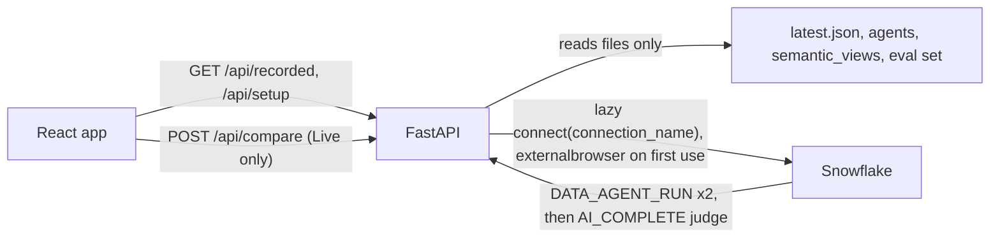

# Plan: Three-tab compare UI (Setup / Compare / Analysis), no login

## Context

- **Reference (`~/Projects/cortex-sense/game_analytics_demo/app/web`):**
  - It is a Next.js and Flask app with three tabs: Setup, Comparison and Analysis.
  - It has no login UI. The backend calls `snowflake.connector.connect(connection_name=...)` lazily, and the auth method (externalbrowser) comes from `~/.snowflake/connections.toml`.
  - Live mode runs `SELECT SNOWFLAKE.CORTEX.DATA_AGENT_RUN('<fqn>', %s)`.
  - Recorded data is static JSON, so Recorded mode and Analysis need no backend call.
  - Styling uses CSS variables (`--sense:#29b5e8`, `--baseline:#64748b`, `--bg-card:#f8fafc`, `--border:#e2e8f0`), rounded cards, uppercase muted labels, pills, and `react-markdown` with `remark-gfm` for answers.
- **This app (`app/`), Vite + React + FastAPI:**
  - Login is OAuth: `oauth.py`, the `ONTOLOGY_COMPARE_LOCAL_OAUTH` integration, a sign-in page and a cookie session.
  - Agents run through `agents.stream_agent` (DATA_AGENT_RUN via `execute_async` and polling). The judge is `judge.py` (boolean verdict).
  - Recorded mode and the per-answer reasons were just added. `evaluations/results/latest.json` comes from `scripts/batch_eval.py`.
- **Requirements from the request:**
  - No login at start.
  - Recorded is the default mode.
  - An external browser login happens only when you run a Live compare, through DATA_AGENT_RUN on a named connection.
  - Three tabs, modelled on the reference.

## Design

- **Connection** (`app/backend/sf.py`):
  - One cached connection, created on the first Live call. It uses `connection_name = SNOWFLAKE_CONNECTION_NAME` (default `ONTOLOGY_DEMO_CONN`), `role = APP_ROLE` (default `ONTOLOGY_APP_ROLE`) and `warehouse = COMPUTE_WH`, then runs `USE SECONDARY ROLES NONE`. The default role means Live runs with the same privileges as the batch eval.
  - A lock guards creation. If the connection is closed or its token has expired, it reconnects once.
  - Both agents run concurrently on it with `execute_async` and polling (the existing pattern), so there is a single browser login per backend process.
- **Judge:** one shared graded judge, 0 / 0.33 / 0.67 / 1 with the 1% and 3% rules.
  - Move the prompt, schema and parsing out of `scripts/batch_eval.py` into `app/backend/judge.py`.
  - `batch_eval.py` imports them, the way it already imports `questions.py`.
  - Live verdicts and recorded verdicts then mean the same thing.
- **Setup data needs no Snowflake.** A new `GET /api/setup` reads the repo:
  - the agent specs (`agents/*.yaml`, `agents/router/*.yaml`);
  - the semantic views (`semantic_views/*.yaml`: name, schema, logical tables, imports);
  - eval set questions grouped by challenge;
  - the challenge headings from `documentation/README_ontology_games_challenges.md`;
  - ontology domains and term counts from `scripts/build_ontology.py`.
- **Remove OAuth entirely:**
  - Delete `oauth.py` and the sign-in page.
  - Remove `/api/me`, `/api/roles` and the `/oauth/*` routes.
  - Remove the OAuth settings from `.env.example` (`OAUTH_*` and the client-secret lookup).
  - Replace `app/sql/01_local_oauth.sql` with `app/sql/01_app_role.sql`, which keeps only the `ONTOLOGY_APP_ROLE` grants.
  - Drop the `ONTOLOGY_COMPARE_LOCAL_OAUTH` security integration (asks for confirmation first, since it is an account-level object).

## Implementation steps

1. **Backend connection and agents**
   - `sf.py`: add a lazily cached `get_connection()` for the named connection, with role, warehouse and secondary roles none.
   - `agents.py`: `stream_agent(side, question)` uses that connection and no longer takes a credential. Keep `parse`/`summarize_final` and extend it to return `steps` (tool, type, sql, status, rows), `tool_counts`, `tokens` and `elapsed`, the same shape as `batch_eval.parse_response`. Ideally the two share one function.
   - `main.py`:
     - Drop OAuth.
     - `POST /api/compare` streams as today; its final events carry the richer shape, and its verdict uses the graded judge.
     - Add `GET /api/setup`.
     - Keep `GET /api/recorded`, `/api/questions` and cancel.
     - Add `GET /api/live-status`, which reports whether a connection is open, so the UI can warn that the first Live run opens a browser login.
2. **Shared graded judge:** move the judge into `app/backend/judge.py` and have `scripts/batch_eval.py` import it. Re-run `--summarize` to confirm the Markdown output is unchanged.
3. **Frontend shell** (`App.tsx`, `styles.css`):
   - A header with title and subtitle, like the reference.
   - Tabs: Setup, Compare and Analysis. Compare opens by default (see Assumptions), and only the active tab is rendered.
   - Reference CSS variables and card, pill and label styles in plain CSS, with dark mode via `prefers-color-scheme`.
   - Add `react-markdown` and `remark-gfm` (npm install) to render answers.
4. **Setup tab:**
   - An architecture card: baseline vs BON agent, `SV_GAMING_CROSS_DOMAIN` and the views it imports with table counts, the ontology domains with term counts, and a mermaid-free static diagram as boxes.
   - A "What each agent can reach" grid with two cards.
   - Agent definitions as `
` with YAML.
   - The seven challenges with their eval questions.
   - The router demo, noted as optional.
5. **Compare tab:**
   - **Picker card:** a select grouped by challenge C1-C7 and a Recorded/Live segmented toggle (Recorded default). The button reads "Show" or "Compare live". A custom-question input runs live only.
   - **Live warning:** when no connection is open yet, a muted note says "First live run opens a Snowflake browser login."
   - **Question header:** challenge pill, id and question.
   - **Two agent panels** (baseline is grey, ontology `--sense`). Each has:
     - a header with the label and sublabel (agent FQN), a score badge (CORRECT, PARTIAL or WRONG plus the score) and an elapsed pill;
     - the answer rendered as markdown;
     - a trace block: "How it answered: N tool calls (Generating SQL, Searching ontology, Running SQL)", expandable steps with SQL and row counts, tokens, and "Why this score (judge)".
   - **Below the panels:** an "Expected answer" box with the naive trap, and a judge verdict card with the headline and both reasons.
   - **Scorecard:** passes per challenge per agent from the recorded run.
6. **Analysis tab:**
   - **Intro:** the run id, judge model and pass threshold.
   - **Summary cards:** baseline correct/13, ontology correct/13, mean scores, and challenges where only the ontology agent passed.
   - **One section per challenge (C1-C7).** For each question:
     - a card with a header (challenge pill and question);
     - a behaviour table with columns Agent, Score, Tool calls, Tools used, Tables touched (logical `__table` names and `ONTOLOGY_DEMO.*` names pulled from the SQL), Tokens, Time;
     - two answer blocks (markdown answer plus trace and judge reason);
     - a footer with the expected answer and the naive trap.
7. **Dev and install:**
   - `app/dev.sh`: no `.env` requirement. Pass `SNOWFLAKE_CONNECTION_NAME` through. Remove `--mock` OAuth bits, but keep mock agents for offline UI work.
   - `install.sh` step 05 becomes "App role grants" (`app/sql/01_app_role.sql`).
   - Update `app/README.md` and `README.md`.
8. **Tests:** update `test_compare.py` for the credential-free `stream_agent` and the graded verdict, and keep `test_questions.py`.

## Verification

- `npx tsc --noEmit` (frontend), `python3 app/backend/test_compare.py`, `python3 app/backend/test_questions.py`.
- `python3 scripts/batch_eval.py --summarize evaluations/results/latest.json`: the summary rebuilds the same as now.
- Start `bash app/dev.sh` with no `.env`.
  - The app opens straight to Compare in Recorded mode, with no login.
  - Setup and Analysis render from files only. No Snowflake connection is opened; check `/api/live-status`.
- Run one question live (Q13): the browser login opens once, both agents stream, and the graded verdict appears. A second live run opens no new login.
- Browser check of all three tabs, including dark mode.

## Assumptions (tell me to change)

- The default tab is **Compare** (in Recorded mode), so you land on results. The reference defaults to Setup.
- Live mode runs as `ONTOLOGY_APP_ROLE` through your named connection (default `ONTOLOGY_DEMO_CONN`, or `SNOWFLAKE_CONNECTION_NAME`).
- The OAuth security integration `ONTOLOGY_COMPARE_LOCAL_OAUTH` is dropped (with a confirmation prompt at that step).

## Critical files

- [app/frontend/src/App.tsx](app/frontend/src/App.tsx): tabs, Compare/Analysis/Setup views (likely split into components/)
- [app/backend/main.py](app/backend/main.py): remove OAuth; /api/setup, /api/live-status, graded live verdict
- [app/backend/sf.py](app/backend/sf.py): lazy named-connection (externalbrowser) for Live only
- [app/backend/agents.py](app/backend/agents.py): credential-free DATA_AGENT_RUN and the richer final shape
- [app/backend/judge.py](app/backend/judge.py) and [scripts/batch_eval.py](scripts/batch_eval.py): one shared graded judge
