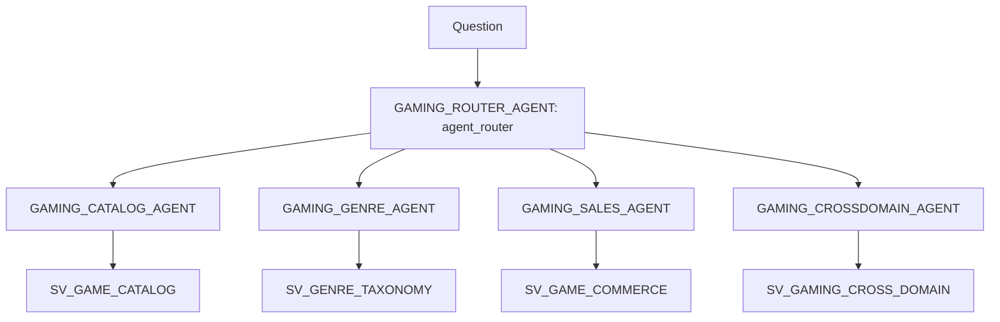

# Plan: Domain agents + router agent

## Context

- **Semantic views already deployed** in `ONTOLOGY_DEMO.CROSS_DOMAIN` (see cross-domain/README.md): `SV_GAME_CATALOG`, `SV_GENRE_TAXONOMY` (imports catalog), `SV_GAME_COMMERCE`, `SV_GAMING_CROSS_DOMAIN` (strict, the same joins as the baseline), and `SV_GAMING_CROSS_DOMAIN_RESOLVED`.

- **Your choices:** the crossdomain agent uses **`SV_GAMING_CROSS_DOMAIN`**. **No Business Ontology search**: each agent has exactly one `cortex_analyst_text_to_sql` tool over one semantic view.

- **Existing pattern to copy:** yamls/gaming\_baseline\_agent.yaml (YAML spec, `query_data` tool, `COMPUTE_WH`), deployed by yamls/deploy\_yamls.py with `CREATE OR REPLACE AGENT ... FROM SPECIFICATION $$...$$`. You prefer YAML for agents.

- **Router format,** from resources/cortex\_agent\_router\_capability\_summary.md and the add-subagents skill. This is a preview feature, not officially supported.

  - Declare `tools: [{tool_spec: {type: agent_router, name: agent_router}}]`.
  - Add `tool_resources.agent_router.subagents[]`. Each entry needs `name`, `display_name`, `description` (the routing hint), and `source: {type: DATA_AGENT, fqn, sample_questions}`.
  - Known issue: Snowsight doesn't list the subagents as tools.

- **Two cautions:**

  - The `SV_GENRE_TAXONOMY` and crossdomain semantic views use `IMPORTS`, which Snowsight can't open. The agents still work through SQL and REST.
  - This chat's Snowflake session may still be read-only, so deploy through the `snow` CLI with `JWESTRA_AWS1`, as before.

### Agents and routing boundaries

| Agent                      | Semantic view              | Owns                                                                                                                        | Hands back / routes elsewhere                                     |
| -------------------------- | -------------------------- | --------------------------------------------------------------------------------------------------------------------------- | ----------------------------------------------------------------- |
| `GAMING_CATALOG_AGENT`     | `SV_GAME_CATALOG`          | Catalog games, developers, publishers, franchises, release dates, lifecycle status, POV                                     | anything about revenue, customers or genres                       |
| `GAMING_GENRE_AGENT`       | `SV_GENRE_TAXONOMY`        | Genre membership, roll-up, game counts by genre (catalog games come via import)                                             | revenue by genre, which goes to crossdomain                       |
| `GAMING_SALES_AGENT`       | `SV_GAME_COMMERCE`         | Digital, hardware and subscription revenue, customers, regions, products and SKUs, revenue types, exclusivity, Sales titles | anything needing catalog attributes (developer, franchise, genre) |
| `GAMING_CROSSDOMAIN_AGENT` | `SV_GAMING_CROSS_DOMAIN`   | Questions combining Sales with Catalog or Genre: revenue by developer, franchise, genre or catalog game                     | none                                                              |
| `GAMING_ROUTER_AGENT`      | none (`agent_router` only) | Picks one subagent, or several in parallel for compound questions, then synthesizes                                         | must not answer data questions itself                             |

## Implementation steps

1. **Write four agent YAMLs** in `cross-domain/agents/`, modeled on `gaming_baseline_agent.yaml`:

   - The files are `catalog_agent.yaml`, `genre_agent.yaml`, `sales_agent.yaml` and `crossdomain_agent.yaml`.
   - Each has one `query_data` tool with a domain-specific description. `tool_resources.query_data.semantic_view` points at its own semantic view only, with warehouse `COMPUTE_WH`.
   - **Orchestration instructions** state the domain boundary and say to reply "outside my domain" for questions outside it, rather than guessing.
   - **Response instructions** match the baseline: number first, then a short explanation.

2. **Write `cross-domain/agents/router_agent.yaml`:**

   - `agent_router` tool plus `tool_resources.agent_router.subagents` for the four FQNs.
   - Each subagent gets a specific routing `description` taken from the table above and 2-3 `sample_questions`.
   - Instructions say to always route, never answer data questions directly. Use crossdomain when a question mixes revenue or customers with developer, franchise, genre or catalog game. For compound questions, call several subagents in parallel and synthesize the result.

3. **Add `cross-domain/deploy_agents.py`,** modeled on `yamls/deploy_yamls.py`:

   - It creates the four domain agents first, then the router, with `CREATE OR REPLACE AGENT ... COMMENT ... PROFILE ... FROM SPECIFICATION $$..$$`.
   - Then it grants `USAGE` on all five agents to `ONTOLOGY_APP_ROLE`. The semantic view grants already exist from `sql/grants.sql`.
   - It supports `--dry-run`, and asserts that no spec contains `$$`.

4. **Add `cross-domain/agent_routing_check.sql`.** It runs `SNOWFLAKE.CORTEX.DATA_AGENT_RUN` on the router for 5 representative questions and extracts which subagent(s) were invoked plus the answer text:

   - "How many games has Santa Monica Studio developed?" goes to catalog.
   - "How many RPG games are there?" goes to genre.
   - "What was hardware revenue in North America?" goes to sales.
   - "Which developer earned the most revenue?" goes to crossdomain.
   - "How many Horror games are there, and what was total subscription revenue?" goes to genre and sales in parallel.

5. **Update cross-domain/README.md:** add an Agents section with the diagram, the boundary table, how to deploy and run the check, the routing results, and the preview caveats (`agent_router` is undocumented; Snowsight hides the subagents and can't open views that use `IMPORTS`).

6. **Deploy** with the `snow` CLI. Run the routing check, and also run it once as `ONTOLOGY_APP_ROLE` with no secondary roles to confirm the app role can use the router. Record the results.

## Verification

- `DESCRIBE AGENT` on each domain agent shows exactly one tool and the intended semantic view.
- On the router, the subagent query from the skill lists the four FQNs.
- The routing check reaches the expected subagent for questions 1-4, and both genre and sales for question 5.
- Domain isolation: asking the catalog agent "What was hardware revenue?" returns an "outside my domain" style answer and runs no SQL.
- `ONTOLOGY_APP_ROLE` can run the router end to end.

## Critical Files

- cross-domain/agents/router\_agent.yaml (new) - agent\_router spec + routing descriptions
- cross-domain/agents/crossdomain\_agent.yaml (new) - the only agent over the composed SV
- cross-domain/deploy\_agents.py (new) - ordered deploy + grants
- cross-domain/agent\_routing\_check.sql (new) - routing verification
- yamls/gaming\_baseline\_agent.yaml - spec pattern to follow
