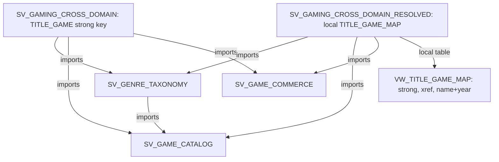

# Plan: Cross-domain composable semantic views (two composed variants)

## Context

- **Source:** yamls/gaming\_baseline\_sv.yaml is a single semantic view with 16 logical tables and 18 relationships, spanning `GAME_CATALOG` and `GAME_SALES`. It is deployed by yamls/deploy\_yamls.py via `SYSTEM$CREATE_SEMANTIC_VIEW_FROM_YAML`.

- **Business Ontology domains:** `Game Catalog`, `Genre Taxonomy`, `Game Commerce`. The split follows them: GAME\_CATALOG is divided into catalog and genre views, and GAME\_SALES becomes commerce.

- **Composable semantic views** ([docs](<> "https://docs.snowflake.com/en/LIMITEDACCESS/composable-semantic-views"), private preview):

  - **IMPORTS:** a top-level YAML `imports:` block.
  - **Imported objects are fixed.** Relationships to imported entities use logical dimension names.
  - **Composed views can define local tables,** which is how the resolved variant adds its mapping.
  - **Diamond imports** are allowed.
  - **Unique names:** identifiers must be unique across the import graph.
  - **Limits:** no Snowsight support and no replication.

- **Probe:** a compile-only `CREATE SEMANTIC VIEW ... IMPORTS` passed the parser and stopped only at the privilege check, because plan mode is read-only.

- **Identity facts,** checked read-only. Sales `TITLES.TITLE_ID` (5001-5090) is a different key from Catalog `GAMES.GAME_ID` (21-679). Of the 90 titles:

  - 75 carry `CATALOG_GAME_ID` (strong).
  - 13 resolve only through `TITLE_CODE_XREF` (medium).
  - 2 resolve only by name and release year (weak).
  - Strong and crosswalk never conflict.

- **Why the mapping is a SQL view:** semantic view relationships are column equi-joins, so they can't express the three-route rule. The resolved pairs must exist as rows. The view lives in `CROSS_DOMAIN`, owned by the cross-domain layer rather than Commerce or Catalog.

- **Out of scope:** no new agent and no ontology representations. Existing `ONTOLOGY_AGENTS` objects are untouched.

### Split (definitions copied verbatim from the baseline YAML)

| View                                              | Logical tables                                                                                                                                                                                                            | Relationships                                                                                                                                                                     |
| ------------------------------------------------- | ------------------------------------------------------------------------------------------------------------------------------------------------------------------------------------------------------------------------- | --------------------------------------------------------------------------------------------------------------------------------------------------------------------------------- |
| `SV_GAME_CATALOG`                                 | GAMES, GAME\_FRANCHISES                                                                                                                                                                                                   | FRANCHISE\_GAME                                                                                                                                                                   |
| `SV_GENRE_TAXONOMY` (imports catalog)             | GENRE\_CLASSIFICATION, GENRE\_ROLLUP                                                                                                                                                                                      | GENRE\_GAME, GENRE\_ROLLUP\_GAME                                                                                                                                                  |
| `SV_GAME_COMMERCE`                                | CUSTOMERS, DIGITAL\_PRODUCTS, DIGITAL\_TRANSACTIONS, HARDWARE\_PRODUCTS, HARDWARE\_SALES, REVENUE\_TYPES, SALES\_GAME\_PLATFORMS, SALES\_PLATFORMS, SUBSCRIPTION\_CHARGES, SUBSCRIPTION\_PLANS, TITLES, TITLE\_CODE\_XREF | the 12 Sales-internal relationships                                                                                                                                               |
| `SV_GAMING_CROSS_DOMAIN` (imports all 3)          | none                                                                                                                                                                                                                      | **TITLE\_GAME**: TITLES(CATALOG\_GAME\_ID) to GAMES(GAME\_ID). Same as the baseline.                                                                                              |
| `SV_GAMING_CROSS_DOMAIN_RESOLVED` (imports all 3) | **TITLE\_GAME\_MAP** on `CROSS_DOMAIN.VW_TITLE_GAME_MAP` (TITLE\_ID PK, GAME\_ID, MATCH\_ROUTE)                                                                                                                           | **TITLE\_TO\_MAP**: TITLES(TITLE\_ID) to TITLE\_GAME\_MAP. **MAP\_TO\_GAME**: TITLE\_GAME\_MAP(GAME\_ID) to GAMES. No TITLE\_GAME, so there's only one path from titles to games. |

- **Coverage:** the two direct-join variants together cover all 16 baseline tables and 18 relationships.
- **Unchanged domains:** both composed views import the same three domain views, untouched. Only the cross-domain join differs.
- **Unmatched transactions:** digital transactions with a NULL `TITLE_ID` still reach the game through `TXN_PRODUCT` and then `PRODUCT_TITLE`, which Commerce already defines.

## Implementation steps

1. **Set up and smoke-test.** Run `CREATE SCHEMA IF NOT EXISTS ONTOLOGY_DEMO.CROSS_DOMAIN`. Create a tiny view, then a view that imports it, and query both. Check name collisions (`STATUS` on GAMES, CUSTOMERS and DIGITAL\_PRODUCTS; `RELEASE_DATE` on GAMES and TITLES). If they collide, prefix those dimensions with the domain name and note it in the README.

2. **Create `cross-domain/sql/vw_title_game_map.sql`.** It defines `ONTOLOGY_DEMO.CROSS_DOMAIN.VW_TITLE_GAME_MAP` with the Game Identity Match Rule: `COALESCE(strong, xref, name+year)` with the name match using `COLLATE(...,'en-ci-ai')`, plus `MATCH_ROUTE`.

   - Grant `SELECT` to `ONTOLOGY_APP_ROLE`, plus `REFERENCES`/`SELECT` on the new semantic views. That's an ordinary grant, needed so the app role can query them.

3. **Write the YAMLs** in `cross-domain/yamls/`:

   - `sv_game_catalog.yaml`, `sv_genre_taxonomy.yaml`, `sv_game_commerce.yaml`
   - `sv_gaming_cross_domain.yaml` (imports plus TITLE\_GAME)
   - `sv_gaming_cross_domain_resolved.yaml` (imports plus the local TITLE\_GAME\_MAP table and its two relationships)

   Each view's description names its ontology domain. The resolved view's description says it applies the governed identity rule.

4. **Add `cross-domain/deploy.py`,** modeled on `yamls/deploy_yamls.py` (`snow sql -f`, `--connection`, `--dry-run`).

   - Create order: map view, catalog, genre, commerce, strict, resolved.
   - Drop the semantic views in reverse order first.

5. **Add `cross-domain/parity_check.sql`,** with two sections:

   - **Strict vs baseline. Expect 0 differing rows:**

     - total digital gross
     - game count by `rollup_genre`
     - gross by `games.developer_name`
     - hardware revenue by region
     - active customers by region

   - **Resolved vs expected governed answers.** It shows the resolved view next to the strict one, so the gain is visible:

     - map coverage: 90 titles, routes 75/13/2
     - revenue across catalog games: $19,231,852.01 (strict $15,861,443.42)
     - top developer: Santa\_Monica\_Studio $3,419,553.73 (strict $2,919,819.89)
     - games with digital sales: 87
     - Ghost of Yōtei revenue: $198,000.00
     - RPG revenue, using ROLLUP\_GENRE IN ('RPG','Roguelike','ActionRPG','Soulslike'): $13,436,693.28

6. **Write `cross-domain/README.md`:**

   - what composability shows, with the split table and diagram
   - why the mapping is a cross-domain SQL view and not a relationship
   - how strict and resolved differ, and how that relates to the with-vs-without-ontology demo
   - how to deploy and check, and the preview limitations

7. **Deploy, run both parity sections,** and record the results in the README.

## Verification

- `SHOW SEMANTIC VIEWS IN SCHEMA ONTOLOGY_DEMO.CROSS_DOMAIN`: 5 views, with the expected `imports` arrays.
- `DESC ... MODE = COMPACT` on each composed view shows only its imports plus its local join or table. `MODE = EXPANDED` shows all 16 imported tables, plus `TITLE_GAME_MAP` for the resolved view.
- Strict parity: every check returns 0 differences against `GAMING_BASELINE_SV`.
- Resolved: every check equals the expected answer in ontology\_setup/ontology\_eval\_set.md (currency within $0.01).
- `python3 cross-domain/deploy.py --dry-run` prints the SQL without connecting.

## Critical Files

- yamls/gaming\_baseline\_sv.yaml - source being split
- cross-domain/sql/vw\_title\_game\_map.sql (new) - governed identity rule as rows
- cross-domain/yamls/sv\_gaming\_cross\_domain\_resolved.yaml (new) - imports + local map table
- cross-domain/deploy.py (new) - ordered deploy
- cross-domain/parity\_check.sql (new) - strict parity + resolved expected answers
