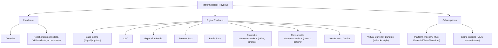
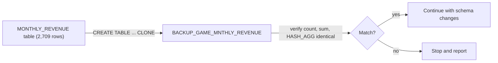
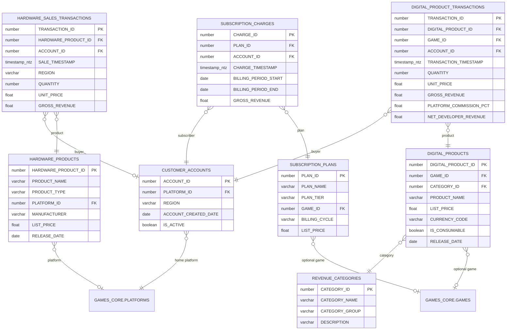
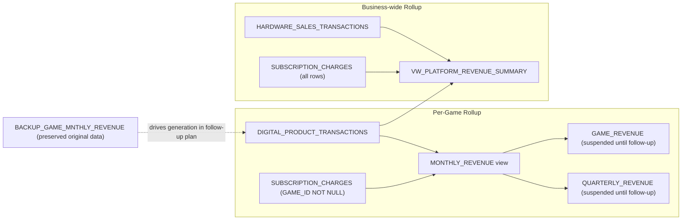

# Plan: Expand GAME_SALES into a Full Commerce Domain (schema only)

## Context

Researched how platform holders (Sony/PlayStation and the wider industry) make money. Advertising is out of scope. Three groups remain:



Platform commission (Sony's ~30% cut of digital sales) is derived from the gross vs. developer-net split on each digital transaction, so it has no table of its own.

**Scope change:** synthetic data generation has moved to a separate follow-up plan, `game-sales-synthetic-data-generation.plan.md`, which keeps all the generation ideas (lifecycle-weighted category splits, volume options, exact-match verification against the backup). This plan only builds the schema and protects the existing revenue data.

Existing objects affected:
- [sql/game_sales/tables/MONTHLY_REVENUE.sql](sql/game_sales/tables/MONTHLY_REVENUE.sql): base table, 2,709 rows, $27,424,645,524 total. Becomes a view.
- [sql/game_sales/dynamic_tables/GAME_REVENUE.sql](sql/game_sales/dynamic_tables/GAME_REVENUE.sql) and [sql/game_sales/dynamic_tables/QUARTERLY_REVENUE.sql](sql/game_sales/dynamic_tables/QUARTERLY_REVENUE.sql): read MONTHLY_REVENUE. Their column contract is preserved so their SQL never changes.
- `VW_PLATFORM_EXCLUSIVITY`: reads `GAME_REVENUE.INCOME`.
- [sql/game_sales/stored_procedures/SP_GENERATE_MONTHLY_REVENUE.sql](sql/game_sales/stored_procedures/SP_GENERATE_MONTHLY_REVENUE.sql): truncates and inserts into MONTHLY_REVENUE. Left untouched here; reworked in the follow-up plan.
- `GAMES_CORE.MONETIZATION_TYPES` / `GAME_MONETIZATION`: game design labels with no prices, dates, or amounts. Unchanged.

## Step 0 (first, before anything else): protect the revenue data



1. Copy, don't just rename: `CREATE TABLE ONTOLOGY_DEMO.GAME_SALES.BACKUP_GAME_MNTHLY_REVENUE CLONE ONTOLOGY_DEMO.GAME_SALES.MONTHLY_REVENUE;` A clone gives an independent copy with the same columns, primary key, and data, while the original stays in place until the copy is verified.
2. Verify the copy is identical before going further:
   ```sql
   SELECT 'orig' src, COUNT(*), SUM(MONTHLY_INCOME), HASH_AGG(*) FROM ONTOLOGY_DEMO.GAME_SALES.MONTHLY_REVENUE
   UNION ALL
   SELECT 'backup', COUNT(*), SUM(MONTHLY_INCOME), HASH_AGG(*) FROM ONTOLOGY_DEMO.GAME_SALES.BACKUP_GAME_MNTHLY_REVENUE;
   ```
   Expected for both: 2,709 rows, $27,424,645,524 (rounded), same hash. If anything differs, stop.
3. Save the backup DDL to `sql/game_sales/tables/BACKUP_GAME_MNTHLY_REVENUE.sql`.
4. Safety net: the dropped MONTHLY_REVENUE table also remains recoverable through Time Travel (`UNDROP`) for the retention period, but the clone is the primary copy.

## Step 1: freeze downstream revenue numbers

The new fact tables start empty, so a live MONTHLY_REVENUE view would return no rows until the follow-up plan generates data. To keep revenue numbers visible in the meantime:
- `ALTER DYNAMIC TABLE GAME_REVENUE SUSPEND;` and `ALTER DYNAMIC TABLE QUARTERLY_REVENUE SUSPEND;` before the swap. Suspended dynamic tables keep their last refreshed data (65 and 945 rows), so `VW_PLATFORM_EXCLUSIVITY` and anything reading them keep working.
- They are resumed in the follow-up plan once the transactions exist.
- `SP_GENERATE_MONTHLY_REVENUE` must not be called in the interim. Once MONTHLY_REVENUE is a view, its TRUNCATE/INSERT fails, so it cannot touch the backup.

## New GAME_SALES entity-relationship design



### Table rationale

**Dimensions**
- `CUSTOMER_ACCOUNTS`: a platform network account (PSN-style) that buys hardware, buys digital products, and holds subscriptions. Required by transaction-level grain.
- `REVENUE_CATEGORIES`: 13 seeded rows: `HARDWARE_CONSOLE`, `HARDWARE_PERIPHERAL`, `BASE_GAME_DIGITAL`, `BASE_GAME_PHYSICAL`, `DLC`, `EXPANSION`, `SEASON_PASS`, `BATTLE_PASS`, `COSMETIC_MICROTRANSACTION`, `CONSUMABLE_MICROTRANSACTION`, `LOOT_BOX`, `VIRTUAL_CURRENCY`, `SUBSCRIPTION`, each with a `CATEGORY_GROUP` of HARDWARE, DIGITAL, or SUBSCRIPTION. This is the only new table populated in this plan, because it is fixed reference data rather than synthetic data.
- `HARDWARE_PRODUCTS`: console, controller, VR headset, and accessory catalog. `PLATFORM_ID` nullable for cross-platform accessories.
- `DIGITAL_PRODUCTS`: one SKU catalog for every digital good (base game, DLC, expansion, season pass, battle pass, cosmetic, consumable, loot box, currency bundle), distinguished by `CATEGORY_ID`.
- `SUBSCRIPTION_PLANS`: `GAME_ID` NULL means platform-wide (PS Plus tiers); non-null means a single game's subscription.

**Fact tables (transaction grain)**
- `HARDWARE_SALES_TRANSACTIONS`: hardware sales. `ACCOUNT_ID` nullable for anonymous retail.
- `DIGITAL_PRODUCT_TRANSACTIONS`: digital purchases, with `PLATFORM_COMMISSION_PCT` and `NET_DEVELOPER_REVENUE`; `GROSS_REVENUE - NET_DEVELOPER_REVENUE` is the platform's commission. `GAME_ID` denormalized from `DIGITAL_PRODUCTS`.
- `SUBSCRIPTION_CHARGES`: one row per billing event.

Hardware has no `GAME_ID`, and platform-wide subscriptions have `GAME_ID` NULL, so neither feeds per-game MONTHLY_REVENUE. Both feed the business-wide summary view.

## New rollup views



1. **`MONTHLY_REVENUE` (view replacing the table)**: grain becomes `(GAME_ID, REVENUE_MONTH, REVENUE_SOURCE)`, where `REVENUE_SOURCE` is the commerce category. `CUMULATIVE_INCOME` is a running total per game across all categories through that month, repeated on each category row for the month, so `GAME_REVENUE` (`SUM ... GROUP BY GAME_ID`) and `QUARTERLY_REVENUE` (`MAX(CUMULATIVE_INCOME)`) stay correct without edits.
   ```sql
   CREATE OR REPLACE VIEW ONTOLOGY_DEMO.GAME_SALES.MONTHLY_REVENUE AS
   WITH by_category AS (
       SELECT dpt.GAME_ID, DATE_TRUNC('MONTH', dpt.TRANSACTION_TIMESTAMP)::DATE AS REVENUE_MONTH,
              rc.CATEGORY_NAME AS REVENUE_SOURCE, SUM(dpt.GROSS_REVENUE) AS MONTHLY_INCOME
       FROM ONTOLOGY_DEMO.GAME_SALES.DIGITAL_PRODUCT_TRANSACTIONS dpt
       JOIN ONTOLOGY_DEMO.GAME_SALES.DIGITAL_PRODUCTS dp ON dpt.DIGITAL_PRODUCT_ID = dp.DIGITAL_PRODUCT_ID
       JOIN ONTOLOGY_DEMO.GAME_SALES.REVENUE_CATEGORIES rc ON dp.CATEGORY_ID = rc.CATEGORY_ID
       WHERE dpt.GAME_ID IS NOT NULL
       GROUP BY 1, 2, 3
       UNION ALL
       SELECT sp.GAME_ID, DATE_TRUNC('MONTH', sc.CHARGE_TIMESTAMP)::DATE, 'SUBSCRIPTION', SUM(sc.GROSS_REVENUE)
       FROM ONTOLOGY_DEMO.GAME_SALES.SUBSCRIPTION_CHARGES sc
       JOIN ONTOLOGY_DEMO.GAME_SALES.SUBSCRIPTION_PLANS sp ON sc.PLAN_ID = sp.PLAN_ID
       WHERE sp.GAME_ID IS NOT NULL
       GROUP BY 1, 2
   ),
   month_totals AS (
       SELECT GAME_ID, REVENUE_MONTH, SUM(MONTHLY_INCOME) AS MONTH_TOTAL
       FROM by_category GROUP BY GAME_ID, REVENUE_MONTH
   ),
   cumulative AS (
       SELECT GAME_ID, REVENUE_MONTH,
              SUM(MONTH_TOTAL) OVER (PARTITION BY GAME_ID ORDER BY REVENUE_MONTH) AS CUMULATIVE_INCOME
       FROM month_totals
   )
   SELECT b.GAME_ID, b.REVENUE_MONTH, b.MONTHLY_INCOME, c.CUMULATIVE_INCOME, b.REVENUE_SOURCE
   FROM by_category b JOIN cumulative c USING (GAME_ID, REVENUE_MONTH);
   ```
2. **`VW_PLATFORM_REVENUE_SUMMARY` (new view)**: `(REVENUE_MONTH, CATEGORY_GROUP)` grain, combining hardware, all digital, all subscriptions, and a derived `PLATFORM_COMMISSION` bucket.

## Implementation steps

1. Clone `MONTHLY_REVENUE` to `BACKUP_GAME_MNTHLY_REVENUE`, verify count/sum/hash are identical, and save its DDL file. Stop if anything differs.
2. Suspend `GAME_REVENUE` and `QUARTERLY_REVENUE` so they keep their current data.
3. Create dimension tables (`REVENUE_CATEGORIES`, `CUSTOMER_ACCOUNTS`, `HARDWARE_PRODUCTS`, `DIGITAL_PRODUCTS`, `SUBSCRIPTION_PLANS`) and seed the 13 `REVENUE_CATEGORIES` rows.
4. Create fact tables (`HARDWARE_SALES_TRANSACTIONS`, `DIGITAL_PRODUCT_TRANSACTIONS`, `SUBSCRIPTION_CHARGES`), empty.
5. Re-verify the backup, then drop the `MONTHLY_REVENUE` table and create the `MONTHLY_REVENUE` view.
6. Create `VW_PLATFORM_REVENUE_SUMMARY`.
7. Update the local `sql/game_sales/` tree: new table files, move `MONTHLY_REVENUE.sql` from `tables/` to `views/`, add the backup and summary view files.

## Verification

- Backup check (step 1 and again before the drop): 2,709 rows, same `SUM(MONTHLY_INCOME)`, same `HASH_AGG(*)` as the original.
- After the swap: `SELECT COUNT(*), SUM(MONTHLY_INCOME) FROM BACKUP_GAME_MNTHLY_REVENUE` still returns 2,709 / $27.42B.
- `GAME_REVENUE` (65 rows) and `QUARTERLY_REVENUE` (945 rows) still return their data while suspended; `VW_PLATFORM_EXCLUSIVITY` still shows income.
- New `MONTHLY_REVENUE` view and `VW_PLATFORM_REVENUE_SUMMARY` compile and return 0 rows (expected until the follow-up plan).
- `REVENUE_CATEGORIES` has 13 rows.
- Matching the generated digital sales against the backup is done in the follow-up plan.

## Critical files
- `sql/game_sales/tables/BACKUP_GAME_MNTHLY_REVENUE.sql` (new): the preserved original revenue data and the driver for later generation.
- [sql/game_sales/tables/MONTHLY_REVENUE.sql](sql/game_sales/tables/MONTHLY_REVENUE.sql): becomes `sql/game_sales/views/MONTHLY_REVENUE.sql`.
- [sql/game_sales/dynamic_tables/GAME_REVENUE.sql](sql/game_sales/dynamic_tables/GAME_REVENUE.sql) / [sql/game_sales/dynamic_tables/QUARTERLY_REVENUE.sql](sql/game_sales/dynamic_tables/QUARTERLY_REVENUE.sql): suspended, SQL unchanged.
- `sql/game_sales/tables/DIGITAL_PRODUCT_TRANSACTIONS.sql` (new): main fact table feeding both rollups.
- `sql/game_sales/views/VW_PLATFORM_REVENUE_SUMMARY.sql` (new): business-wide revenue view.
