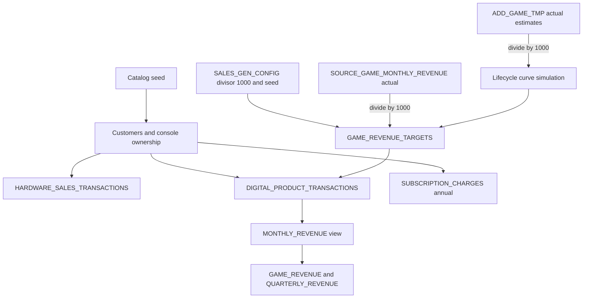
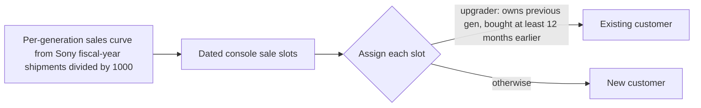

# Plan: Synthetic Sales Data at 1/1000 Scale

## The scale rule

All generated sales are **1/1000 of real-world revenue**, and the stored numbers are final: nothing downstream multiplies them back up. Prices stay real ($69.99 game, $499.99 console), so the database holds 1/1000 of the real customers and purchases.

- Ghost of Tsushima: real \~13M copies / \~$780M becomes \~13,000 buyers / \~$780K in the generated tables.
- `MONTHLY_REVENUE`, `GAME_REVENUE`, `QUARTERLY_REVENUE` and `VW_PLATFORM_REVENUE_SUMMARY` show these 1/1000 values directly.

**Where the division happens: only in the generator.**

- **Source tables keep actual real-world figures:**

  - `SOURCE_GAME_MONTHLY_REVENUE` is untouched.
  - `ADD_GAME_TMP.ESTIMATED_TOTAL_REVENUE` keeps the actual researched revenue.
  - The `add-game-data-ontology` skill continues to store actual figures.

- **The rule is recorded in project memory and in the skill.** Both say to store actual revenue in `ADD_GAME_TMP`, and that the synthetic generator divides by 1000.

## Projected row counts (computed from current data)

| Table                                | Rows (projected) | Basis                                                                                                                                                                                            |
| ------------------------------------ | ---------------- | ------------------------------------------------------------------------------------------------------------------------------------------------------------------------------------------------ |
| CUSTOMER\_ACCOUNTS                   | \~330,000        | \~290K PlayStation customers (476K consoles / \~1.64 generations owned per customer) + \~40K PC, Xbox, Switch and Apple store customers                                                          |
| HARDWARE\_PRODUCTS                   | \~25             | Console models per generation (e.g. PS4, PS4 Slim, PS4 Pro; PS5, PS5 Digital, PS5 Slim, PS5 Pro) plus controllers and VR headsets                                                                |
| HARDWARE\_SALES\_TRANSACTIONS        | \~721,000        | Consoles 475,800 (PS2 160K, PS3 87.4K, PS4 117.2K, PS5 95.3K, Vita 15.9K = real lifetime units / 1000) + \~238K extra controllers (0.5 per console) + \~7K VR headsets (PS VR \~5K, PS VR2 \~2K) |
| DIGITAL\_PRODUCTS                    | \~600            | Base game (digital + physical SKU per game), DLC, season passes, battle-pass seasons, cosmetics, MLB packs, consumables                                                                          |
| DIGITAL\_PRODUCT\_TRANSACTIONS       | \~436,000        | \~283,500 base-game purchases + \~153,000 add-on and microtransaction purchases, from $19,353,352 of game revenue after dividing by 1000                                                         |
| SUBSCRIPTION\_PLANS                  | 4                | Annual only: legacy PS Plus (2010-2022), Essential, Extra, Premium (2022 onward)                                                                                                                 |
| SUBSCRIPTION\_CHARGES                | \~492,000        | One annual charge per subscriber-year: \~492M real PS Plus subscriber-years / 1000                                                                                                               |
| GAME\_REVENUE\_TARGETS (new staging) | \~6,000          | Per game, per month, per category targets the generator must hit                                                                                                                                 |
| MONTHLY\_REVENUE (view)              | \~6,000          | Game-month-category rows across 90 games                                                                                                                                                         |
| GAME\_REVENUE / QUARTERLY\_REVENUE   | 90 / \~1,900     | Recreated from their unchanged DDL after load                                                                                                                                                    |

## Generation pipeline

Generation is set-based SQL inside stored procedures (no Python row loops), so \~1.5M rows build in minutes. Randomness is deterministic: `HASH(seed, key)` instead of `RANDOM()`, so reruns produce identical data.

### 1. Monthly revenue targets per game

- **75 researched games:** simulate a monthly curve from release date to Oct 2026 using the original `SP_GENERATE_MONTHLY_REVENUE` weights (launch spike, decay, DLC bumps at months 3/6/12/18, seasonal bumps every 3 months for live-service, holiday 1.3x). The curve is normalized over months up to today, so its total equals `ESTIMATED_TOTAL_REVENUE / 1000`.

- **6 games with no estimate** (Iron Man VR, Sons of Sparta, Midnight Murder Club, Matterfall, Concrete Genie, Knack II): impute an actual-dollar estimate from similar games (same studio, era, and type), stored in `ADD_GAME_TMP` and marked as imputed in `REVENUE_BASIS`. The generator divides it by 1000 like every other estimate.

- **Zero-revenue games** (Concord after refunds, Astro's Playroom, My First Gran Turismo): no purchase rows.

- **Category split** of each month by monetization tags, weighted by lifecycle tag:

  - launch months are mostly base game;
  - dlc\_bump months are heavy DLC;
  - seasonal months are heavy battle pass and cosmetics (Helldivers 2 warbonds, Marathon seasons);
  - MLB months include Stubs and pack purchases (its loot-box tag).

  Destruction AllStars' `subscription` tag means it launched free on PS Plus, so its revenue is base-game sales after the PS Plus period.

### 2. Customers

- Each customer is one person, not just a PSN login, so PS2-era retail buyers are customers too.
- **Created date** = first console purchase (or first store purchase for PC/Xbox/Switch/Apple customers). **Home platform** = first console. **Region**: NA 40%, Europe 35%, Japan 10%, rest of Asia 10%, other 5%.
- **Engagement score** per customer (Pareto: top 10% of spenders account for about half of add-on spend) drives who buys add-ons and microtransactions.
- `IS_ACTIVE` = any purchase or subscription in the last 24 months.

### 3. Hardware over time, one console per generation

- Each generation's units come from Sony's published fiscal-year shipments (researched during build, stored as actual units in config) divided by 1000, spread within each year with real seasonality (Nov-Dec about 2-3x a normal month, launch months spiking).
- **One console per generation per customer, by construction:** a customer is assigned at most one slot per generation. Model mix follows real timing (PS4 Pro only from Nov 2016; PS5 Slim from Nov 2023; PS5 Pro from Nov 2024).
- About 60% of each generation's buyers are upgraders from the previous generation; the rest are new customers.
- Extra controllers: 0 to 2 per console owned, bought with or after the console. VR: at most one PS VR per PS4 owner and one PS VR2 per PS5 owner.
- Prices follow real list prices at the time of sale, including price cuts.

### 4. Digital and physical game sales, no duplicates

**Schema change:** add `PLATFORM_ID NUMBER(38,0)` (foreign key to `GAMES_CORE.PLATFORMS`) to `DIGITAL_PRODUCT_TRANSACTIONS`, recording which platform version / store each purchase was for. The table is currently empty, so this is a plain `ALTER TABLE ... ADD COLUMN`. The DDL file in `sql/game_sales/tables/` is updated to match.

For each target (game, month, category), the generator picks distinct buyers:

- **Eligible customers** own a compatible console by that month: a PS5 version needs a PS5; a PS4 version can be bought by PS4 or PS5 owners; PS2/PS3 versions by those owners. PC, Xbox, Switch and Apple versions go to customers of that store, only after that version's release date (from `GAME_PLATFORMS` exclusivity end dates; PC share about 25% of post-release units).

- **No duplicates:**

  - one base game per customer per `GAME_ID`, across all platforms and both physical and digital (remasters are separate `GAME_ID`s, so allowed);
  - one copy per customer of every non-consumable SKU (DLC, season pass, each battle-pass season, each cosmetic);
  - consumables, MLB packs, and virtual currency may repeat.

- **Dependencies:** DLC, passes, cosmetics, and consumables are only sold to customers who already own the base game, with a later purchase date.

- **Physical vs digital split by year:** up to 2012 about 5% digital, 2013-2016 25%, 2017-2019 45%, 2020-2022 65%, 2023 onward 75%. Physical copies are still assigned to a customer, so the no-duplicate rule covers them.

- **Prices:** real list price ($59.99 up to Nov 2020, $69.99 for PS5-era first-party, remasters $9.99-$19.99), with periodic sale discounts (25-50% off) in later months.

- **Timing within a month:** launch week takes about 40% of a launch month; weekends weighted higher.

- **Store cut, set from `PLATFORM_ID`:** Sony publishes every game, so PlayStation platform and physical sales carry 0% platform commission. Steam (Pc\_gaming), Xbox, Nintendo and Apple sales carry 30%.

### 5. Exact revenue matching

For each (game, month, category) target T at effective price p:

- n = floor(T / p) units at price p; the remainder r is spread across those n units as cent-level price variance (regional pricing), so the target is hit to the cent.

### 6. PS Plus subscriptions (annual billing only)

- **Subscribers per year** from published PS Plus history (actual counts stored in config), divided by 1000, reaching \~47,000 now. Drawn from customers who own a console at the time.

- **One `SUBSCRIPTION_CHARGES` row per subscriber per year.** The billing period runs from the charge date to one year later, with churn and renewals.

- **Plans (4, all `BILLING_CYCLE = 'ANNUAL'`):**

  - Legacy PS Plus, 2010 to June 2022: $49.99/year, later $59.99.
  - Essential, Extra and Premium from June 2022 (about 60/25/15 mix), including the Sept 2023 price increase. The charge amount follows the price in effect on the charge date.

- These are platform-wide plans, so they feed only `VW_PLATFORM_REVENUE_SUMMARY`.

## Implementation steps

1. Record the rule in project memory and the `add-game-data-ontology` skill: `ADD_GAME_TMP` stores actual researched revenue, and the synthetic generator divides all source figures by 1000.
2. Impute actual-dollar estimates for the 6 games with no estimate in `ADD_GAME_TMP`. Existing estimates stay as is.
3. Create `SALES_GEN_CONFIG` (divisor, seed, console shipment and PS Plus history) and `GAME_REVENUE_TARGETS`; add `PLATFORM_ID` to `DIGITAL_PRODUCT_TRANSACTIONS`.
4. Seed catalogs: `HARDWARE_PRODUCTS`, 4 annual `SUBSCRIPTION_PLANS`, and `DIGITAL_PRODUCTS` (researching real list prices).
5. Build and run the generators: customers and hardware; revenue targets; digital sales; annual subscriptions.
6. Recreate `GAME_REVENUE` and `QUARTERLY_REVENUE` from their DDL (clears the stale pre-deletion rows and re-initializes against the view); retire `SP_GENERATE_MONTHLY_REVENUE`; mark `ADD_GAME_TMP` rows `REVENUE_LOADED`.
7. Save all new SQL to `sql/game_sales/` and verify.

## Verification

- **Revenue:**

  - Each game's lifetime total matches to the cent.
  - Each researched game matches `ESTIMATED_TOTAL_REVENUE / 1000`.
  - Source tables are unchanged: `SOURCE_GAME_MONTHLY_REVENUE` still totals $8,900,181,986, and `ADD_GAME_TMP` estimates are untouched apart from the 6 imputations.

- **Ownership rules:** zero rows for `(ACCOUNT_ID, console generation)` with count > 1; zero duplicate `(ACCOUNT_ID, DIGITAL_PRODUCT_ID)` for non-consumables; zero duplicate `(ACCOUNT_ID, GAME_ID)` base-game ownership.

- **Consistency:** no purchase before the buyer owned a compatible console or the base game; no sale before a product's release date or that platform's availability; `PLATFORM_ID` is always one of the game's `GAME_PLATFORMS`; every account's first purchase is on or after its created date.

- **Subscriptions:** every charge is annual, no account has overlapping billing periods.

- **Scale:** console totals per generation equal real lifetime units / 1000.

- **Determinism:** a rerun with the same seed reproduces identical row counts and totals.

## Critical files

- `sql/game_sales/stored_procedures/` (new generator procedures) - all generation logic, including the divide-by-1000.
- sql/game\_sales/tables/DIGITAL\_PRODUCT\_TRANSACTIONS.sql - gains `PLATFORM_ID`; largest game-revenue fact table.
- sql/game\_sales/views/MONTHLY\_REVENUE.sql - per-game rollup the targets must reproduce.
- `~/.snowflake/cortex/skills/add-game-data-ontology/SKILL.md` - documents actual-revenue storage and the generator's divide-by-1000.
- sql/game\_sales/stored\_procedures/SP\_GENERATE\_MONTHLY\_REVENUE.sql - source of the lifecycle curve logic; retired after.
