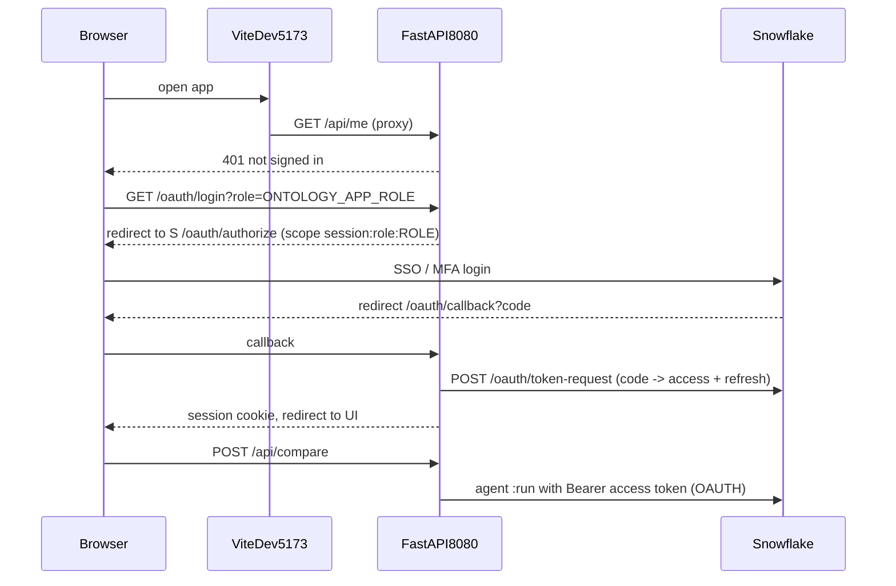

# Plan: Local React UI with Snowflake OAuth (no SPCS)

## Context

- The app is in app/: Vite+React frontend (app/frontend/) and FastAPI backend (app/backend/main.py). It currently deploys to SPCS through app/Dockerfile, app/service-spec.yaml and app/deploy.sh.
- app/backend/sf.py builds credentials from the SPCS token files. REST agent calls already send `Bearer` + `X-Snowflake-Authorization-Token-Type`, and with token type `OAUTH` a Snowflake OAuth access token works the same way.
- app/frontend/vite.config.ts proxies `/api` to `:8080`.
- Role: app/sql/00\_setup.sql created `ONTOLOGY_APP_ROLE`, granted to JWESTRA. Its data access is **caller grants only**: no direct USAGE on the agents, semantic view, tables or warehouse. Caller grants mean nothing outside SPCS, so that role needs real grants before an OAuth session using it can run the agents.



## Implementation steps

1. **Snowflake setup:** new app/sql/01\_local\_oauth.sql, run by you as ACCOUNTADMIN.

   - `CREATE SECURITY INTEGRATION ONTOLOGY_COMPARE_LOCAL_OAUTH TYPE=OAUTH OAUTH_CLIENT=CUSTOM OAUTH_CLIENT_TYPE='CONFIDENTIAL' OAUTH_REDIRECT_URI='http://localhost:8080/oauth/callback' OAUTH_ALLOW_NON_TLS_REDIRECT_URI=TRUE OAUTH_ISSUE_REFRESH_TOKENS=TRUE ENABLED=TRUE`
   - `SELECT SYSTEM$SHOW_OAUTH_CLIENT_SECRETS('ONTOLOGY_COMPARE_LOCAL_OAUTH')` returns the client ID and secret.
   - Direct grants to `ONTOLOGY_APP_ROLE`: USAGE on `COMPUTE_WH`, `ONTOLOGY_DEMO` and its schemas; SELECT on the tables, views and semantic views in `ONTOLOGY_DEMO`; USAGE on the agents in `ONTOLOGY_AGENTS`; plus whatever Business Ontology / glossary read access the BON agent needs. Cortex user access is already granted.
   - Keep `ALTER USER JWESTRA SET DEFAULT_SECONDARY_ROLES=('ALL')` in mind: secondary roles can still widen access in an OAuth session. If the role choice must be strict, the setup can set the integration's secondary-role behavior to block it, or you can accept the wider access. I'll flag this when we test.

2. **`.env` config:** add `app/backend/.env.example` and gitignore `.env`. Contents:
   ```
   SNOWFLAKE_ACCOUNT_URL=https://<account>.snowflakecomputing.com
   SNOWFLAKE_ACCOUNT=<account identifier>
   OAUTH_CLIENT_ID=...
   OAUTH_CLIENT_SECRET=...
   OAUTH_REDIRECT_URI=http://localhost:8080/oauth/callback
   APP_ROLES=ONTOLOGY_APP_ROLE            # comma-separated list shown in the UI
   APP_DEFAULT_ROLE=ONTOLOGY_APP_ROLE
   SNOWFLAKE_WAREHOUSE=COMPUTE_WH
   SESSION_SECRET=<random>
   ```
   Load it with `python-dotenv`, added to app/backend/requirements.txt. If `APP_DEFAULT_ROLE` isn't in `APP_ROLES`, fail at startup.

3. **OAuth backend:** new `app/backend/oauth.py`, with routes added in `main.py`.

   - `GET /oauth/login?role=`: checks the role against `APP_ROLES`. Generates `state` and a PKCE verifier, then redirects to `{ACCOUNT_URL}/oauth/authorize` with scope `refresh_token session:role:<ROLE>`.
   - `GET /oauth/callback`: verifies `state` and POSTs to `/oauth/token-request` with basic auth (client ID and secret). Stores the access token, refresh token, expiry, user and role in an in-memory session dict keyed by an HttpOnly cookie, then redirects to the UI (`http://localhost:5173` in dev).
   - `POST /oauth/logout`: clears the session.
   - A `get_token(session)` helper renews with the refresh token about 60 seconds before expiry. If renewal fails, the API returns 401.
   - `GET /api/roles` returns `APP_ROLES` and the default role.

4. **Rewrite `sf.py`:** remove the SPCS branches (token file, `Sf-Context-*` headers, `IN_SPCS`). `caller_credential(request)` returns `Credential(access_token, "OAUTH", True)` from the session. `sql_connection` uses `authenticator="oauth"`, `token=...`, account and warehouse. The AI\_COMPLETE judge in app/backend/judge.py runs as the signed-in user, since there is no separate service user anymore. `/api/me` returns the user and role from the session.

5. **Frontend sign-in:**

   - In app/frontend/src/api.ts: on a 401, show a sign-in screen in app/frontend/src/App.tsx with a role dropdown (from `/api/roles`, defaulting to `ONTOLOGY_APP_ROLE`) and a "Sign in with Snowflake" button that goes to `/oauth/login?role=...`.
   - The header shows the user and role, plus "Switch role" (a fresh login with a different role) and "Sign out".
   - Proxy `/oauth` in `vite.config.ts` too, so cookies stay on one origin. Then point `OAUTH_REDIRECT_URI` at `:5173/oauth/callback` through the proxy instead, keeping a single origin and avoiding cross-port cookie problems. The integration redirect URI gets the same value.

6. **Questions:** build `QUESTIONS` at startup from `ontology_setup/ontology_eval_set.md`, using the same call as `dev_mock.py`, and retire `app/ontology_eval_set.md`.

7. **Dev runner:** add `app/dev.sh`. It runs `uvicorn main:app --reload --port 8080` and `npm run dev`, and Ctrl-C kills both. With `--mock`, it runs `dev_mock.py`, which skips OAuth and uses a fake session. Check that SSE `/api/compare` streams through the Vite proxy without buffering.

8. **Retire SPCS:** delete `Dockerfile`, `service-spec.yaml` and `deploy.sh`, trim the SPCS-only parts of `00_setup.sql`, and rewrite app/README.md around the local OAuth workflow. Suspending or dropping `ONTOLOGY_DEMO.ONTOLOGY_AGENTS.ONTOLOGY_COMPARE_APP` and its pool happens only after you confirm.

## Verification

- `bash app/dev.sh --mock`: UI at :5173, fake streams, and HMR on edits.
- `bash app/dev.sh`: sign-in screen with the role dropdown showing `ONTOLOGY_APP_ROLE` as default. The Snowflake login completes, `/api/me` shows JWESTRA / ONTOLOGY\_APP\_ROLE, and eval Q5 streams both agents plus a verdict.
- Token refresh: wait past expiry (or force the expiry short) and confirm the next compare still works.
- Bad role in the query string returns 400. Add a second role to `APP_ROLES`, restart, and it appears in the dropdown.
- Run the existing tests: `test_compare.py` and `test_questions`.

## Critical Files

- app/backend/sf.py - credentials from the OAuth session
- app/backend/oauth.py (new) - login, callback, refresh, roles
- app/backend/main.py - routes, /api/me, questions
- app/frontend/src/App.tsx - sign-in screen and role picker
- app/sql/01\_local\_oauth.sql (new) - integration and direct grants
