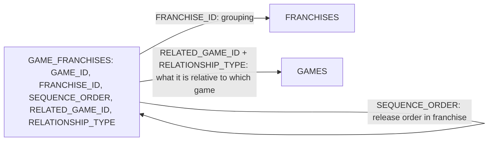

# Plan: Merge GAME\_SEQUELS into GAME\_FRANCHISES

## Context

What I checked (ONTOLOGY\_DEMO only; DEMO is untouched):

- **`GAME_CATALOG.GAME_FRANCHISES`** has `GAME_ID, FRANCHISE_ID, SEQUENCE_ORDER`.
  - 90 rows, exactly one row per game. No game belongs to two franchises.

- **`GAME_CATALOG.GAME_SEQUELS`** has `GAME_ID, SEQUEL_OF_GAME_ID, RELATIONSHIP_TYPE`.
  - 39 rows. Every game has at most one link, and every linked game is in a franchise.

- **Relationship types:** `sequel`, `prequel`, `spinoff`, `remake`, `spiritual_successor`.

- **Links don't follow `SEQUENCE_ORDER`.** For example, GoW Ascension (franchise 28, position 4) is a *prequel of* GoW (position 1), and GT Sport (position 8) is a sequel of GT6 (position 6), not of GT7.
  - A type column alone would therefore lose information. The row also needs **which game** it relates to.

- **Two links cross franchises:**

  - Saros (franchise 35) is a `spiritual_successor` of Returnal (franchise 53).
  - The Inpatient (franchise 68) is a `prequel` of Until Dawn (franchise 24).
  - So the pointer must be allowed to reference a game outside the row's franchise.

- **Dependents:**

  - No view, procedure, dynamic table or semantic view reads `GAME_SEQUELS`.
  - `VW_CANNIBALIZATION_CANDIDATES` and `SP_FIND_CANNIBALIZATION` read `GAME_FRANCHISES` by `GAME_ID` / `FRANCHISE_ID` only. Adding columns doesn't affect them.
  - The add-game skill inserts into both tables: SKILL.md lines 250-251 and 593.

Because both tables have one row per game, merging them is 1:1 and loses nothing.

## Design: two new columns on GAME\_FRANCHISES

| Column              | Type                                    | Meaning                                                                                                                                           |
| ------------------- | --------------------------------------- | ------------------------------------------------------------------------------------------------------------------------------------------------- |
| `RELATED_GAME_ID`   | NUMBER, nullable                        | The game this one directly derives from (former `SEQUEL_OF_GAME_ID`). NULL for a franchise original. It may point to a game in another franchise. |
| `RELATIONSHIP_TYPE` | VARCHAR, NOT NULL, default `'original'` | One of `original`, `sequel`, `prequel`, `spinoff`, `remake`, `spiritual_successor`.                                                               |

Example, franchise 28:

| GAME                  | SEQ | RELATED | TYPE     |
| --------------------- | --- | ------- | -------- |
| God of War (310)      | 1   | NULL    | original |
| God of War II (311)   | 2   | 310     | sequel   |
| God of War III (312)  | 3   | 311     | sequel   |
| Ascension (313)       | 4   | 310     | prequel  |
| God of War 2018 (314) | 5   | 312     | sequel   |
| Ragnarok (315)        | 6   | 314     | sequel   |
| Sons of Sparta (643)  | 7   | 310     | prequel  |

The old `GAME_SEQUELS` is now exactly `SELECT GAME_ID, RELATED_GAME_ID AS SEQUEL_OF_GAME_ID, RELATIONSHIP_TYPE FROM GAME_FRANCHISES WHERE RELATED_GAME_ID IS NOT NULL`.

**Limitation:** this model allows one relationship per game. That holds today; every game has 0 or 1 link. A future game that is, say, both a remake of X and a sequel of Y would need a second pair of columns or a bridge table. The skill will enforce one link per game.

## Implementation steps

1. **Safety copy:** `CREATE TABLE GAME_CATALOG.BACKUP_GAME_SEQUELS CLONE GAME_CATALOG.GAME_SEQUELS`. Record the row count (39) and `HASH_AGG(*)`. Keep the copy until you approve dropping it.

2. **Add the columns:**

   - `ALTER TABLE GAME_CATALOG.GAME_FRANCHISES ADD COLUMN RELATED_GAME_ID NUMBER(38,0) COMMENT '...'`
   - `ADD COLUMN RELATIONSHIP_TYPE VARCHAR DEFAULT 'original' COMMENT '...'`

3. **Migrate:**

   - `UPDATE GAME_FRANCHISES f SET RELATED_GAME_ID = s.SEQUEL_OF_GAME_ID, RELATIONSHIP_TYPE = s.RELATIONSHIP_TYPE FROM GAME_SEQUELS s WHERE f.GAME_ID = s.GAME_ID`. Expect 39 rows.
   - `UPDATE ... SET RELATIONSHIP_TYPE = 'original' WHERE RELATED_GAME_ID IS NULL`. Expect 51 rows.
   - Then `ALTER COLUMN RELATIONSHIP_TYPE SET NOT NULL`.
   - Add an informational FK: `RELATED_GAME_ID REFERENCES GAMES(GAME_ID)`. GAMES has a PK, so this works.

4. **Verify the migration** before dropping anything (see Verification).

5. **Drop the old table:** `DROP TABLE GAME_CATALOG.GAME_SEQUELS`.

6. **Update the `sql/` files:**

   - Regenerate `sql/game_catalog/tables/GAME_FRANCHISES.sql` with `GET_DDL`.
   - Delete `sql/game_catalog/tables/GAME_SEQUELS.sql`.
   - Add `sql/game_catalog/tables/BACKUP_GAME_SEQUELS.sql`.

7. **Update the add-game skill:**

   - Phase 4.5 order 1 becomes `GAME_FRANCHISES | GAME_ID, FRANCHISE_ID, SEQUENCE_ORDER, RELATED_GAME_ID, RELATIONSHIP_TYPE`.

   - Remove row 2 (`GAME_SEQUELS`) and renumber the rest.

   - Add the rules:

     - `RELATIONSHIP_TYPE` must be one of the 6 values;
     - `original` means `RELATED_GAME_ID` is NULL;
     - only one relationship per game;
     - `RELATED_GAME_ID` may point outside the franchise (spiritual successors, cross-franchise prequels).

   - Remove `GAME_SEQUELS` from the line-593 table list.

8. **Memory:** note that `GAME_SEQUELS` was merged into `GAME_FRANCHISES` and where the backup is.

## Verification

- **Lossless:** this check returns 0 rows, both before and after the drop (using the backup): `(SELECT GAME_ID, SEQUEL_OF_GAME_ID, RELATIONSHIP_TYPE FROM BACKUP_GAME_SEQUELS) EXCEPT (SELECT GAME_ID, RELATED_GAME_ID, RELATIONSHIP_TYPE FROM GAME_FRANCHISES WHERE RELATED_GAME_ID IS NOT NULL)` The reverse EXCEPT also returns 0 rows.

- **Counts:** 90 franchise rows. 39 have a link and 51 are `original`.
  - By type: sequel 25, spinoff 5, remake 5, prequel 3, spiritual\_successor 1.

- **Consistency:**

  - No `original` row has a `RELATED_GAME_ID`, and no non-original row lacks one.
  - Every `RELATED_GAME_ID` exists in GAMES.
  - No game points to itself.

- **Unchanged:** `SEQUENCE_ORDER` and `FRANCHISE_ID` match the pre-change HASH\_AGG.

- **Dependents still compile:** `SELECT COUNT(*)` from `VW_CANNIBALIZATION_CANDIDATES` works. Optionally `CALL SP_FIND_CANNIBALIZATION`.

- **Spot check:** franchise 28 matches the example table above. Saros and The Inpatient keep their cross-franchise links.

## Critical Files

- sql/games\_core/tables/GAME\_FRANCHISES.sql - table DDL to regenerate with the 2 new columns
- sql/games\_core/tables/GAME\_SEQUELS.sql - removed
- SKILL.md - bridge-table insert instructions (lines 250-251, 593)
- sql/game\_catalog/views/VW\_CANNIBALIZATION\_CANDIDATES.sql - reads GAME\_FRANCHISES; confirm unaffected
