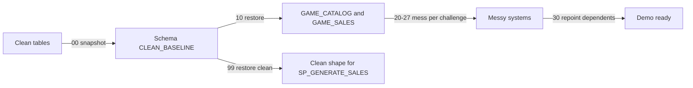

# Plan: Mess up GAME_CATALOG and GAME_SALES for the Business Ontology demo

## 1. Context

**Prompt:** [ontology_setup/mess-up-database.md](ontology_setup/mess-up-database.md), with patterns from [README_ontology_challenges.md](ontology_setup/README_ontology_challenges.md) and candidates from [challenge2_same_entity_different_names.md](ontology_setup/challenge2_same_entity_different_names.md).

**Current state:**
- GAMES_CORE is already gone. GAME_CATALOG (master) and GAME_SALES each have their own copies of GAMES, PLATFORMS, GAME_PLATFORMS, MONETIZATION_TYPES and GAME_MONETIZATION. Every copy is still clean and identical:
  - 90 games, and all 90 names match.
  - No developers, franchises or publishers are orphaned, so folding them into GAMES loses nothing.
- **Generator:** `GAME_SALES_GEN.SP_GENERATE_SALES` rewrites sales tables using fixed column lists and hardcoded IDs (category IDs 3-12, PS platform IDs).
- **Dependents that will need repointing:**
  - Catalog: `VW_CANNIBALIZATION_CANDIDATES` and `SP_FIND_CANNIBALIZATION` (they join GAMES to GAME_FRANCHISES, FRANCHISES and PUBLISHERS).
  - Sales: `MONTHLY_REVENUE`, `VW_PLATFORM_EXCLUSIVITY`, and DTs `GAME_REVENUE` and `QUARTERLY_REVENUE`.
  - Unaffected: `VW_PLATFORM_REVENUE_SUMMARY`, `VW_GAME_PROFILE` and `SP_CLASSIFY_GAMES`.
- There are no semantic views and no test files.

**User decisions:**
- Cover Challenges 1, 2, 3, 4/5, 6 and 7. Challenge 8 (wide vs long grain) is not covered.
- The mess is a **re-runnable script set**, and the generator stays unchanged.
- Dependents are **minimally repointed**: they run again, but get no cleanup logic.
- The add-game skill update is a **future TODO** only. No test question files.

**Design principles (from the prompt):**
- **No two systems get the same mess.** Catalog gets *overloading*. Sales gets *renaming, its own keys and its own codes*.
- No views or UDFs that hide the mess. The new objects are a crosswalk *table*, which real systems have, and the repointed existing objects.
- A few realistic examples per challenge. Each one maps to a Business Ontology feature: node + synonyms, representation at table or column level, relationship, metric definition, or identifier.

## 2. Messy changes by challenge

### C1: Overloaded tables (GAME_CATALOG only)

| Table | After | Entity types in one row |
|---|---|---|
| `GAME_CATALOG.GAMES` | Adds `DEVELOPER_NAME`, `DEVELOPER_IS_INDIE`, `PUBLISHER_ID`, `PUBLISHER_NAME`, `PUBLISHER_HQ`, `FRANCHISE_NAME`, and `STATUS` (C7) | Game + Developer + Publisher + Franchise |
| `GAME_CATALOG.GAME_FRANCHISES` | The merge-sequels plan, adapted: adds `RELATED_GAME_ID`, `RELATIONSHIP_TYPE` (`original`/sequel/prequel/spinoff/remake/spiritual_successor), plus `FRANCHISE_NAME`, `FIRST_RELEASE_YEAR`, `PUBLISHER_ID` | Franchise membership + Franchise + sequel graph |
| `GAME_CATALOG.STUDIO_ACQUISITIONS` | Adds `STUDIO_NAME` (copied from DEVELOPERS) | Acquisition + Studio |

Then **drop** `DEVELOPERS`, `PUBLISHERS`, `FRANCHISES` and `GAME_SEQUELS`.
- Developer, Publisher and Franchise now exist only inside other tables' rows. Franchise name is stored twice (in GAMES and GAME_FRANCHISES), as happens in real systems.
- *Ontology fix:* the classes Developer, Publisher and Franchise are separate nodes, each with column representations on GAMES / GAME_FRANCHISES. A `SEQUEL_OF` self-relationship goes on Game.

### C2: Same entity, different names (GAME_SALES renames; Catalog keeps its names)

| Ontology class | GAME_CATALOG | GAME_SALES after |
|---|---|---|
| Game | `GAMES.GAME_NAME` | table `GAMES` becomes **`TITLES`** (`TITLE_ID`, `TITLE_NAME`). 8 names are spelled differently, e.g. `God of War Ragnarok` (no o-umlaut), `Ghost of Yotei`, `DEATH STRANDING 2`, `GT7`, `Marvel's Spider-Man 2` becomes `Spider-Man 2` |
| Developer | `GAMES.DEVELOPER_NAME` = `Santa_Monica_Studio` | `TITLES.STUDIO` = `Santa Monica Studio` (spaces) |
| Publisher | `GAMES.PUBLISHER_NAME` = `Sony Interactive Entertainment` | `TITLES.PUBLISHER_LABEL` = `SIE`; `HARDWARE_PRODUCTS.MANUFACTURER` unchanged |
| Player / Customer | `GAME_MODES.MIN_PLAYERS` / `MAX_PLAYERS` (player = count) | `CUSTOMER_ACCOUNTS.ACCOUNT_ID` becomes `CUSTOMER_ID`. In `DIGITAL_PRODUCT_TRANSACTIONS` it becomes **`PLAYER_ID`**, in `SUBSCRIPTION_CHARGES` **`SUBSCRIBER_ID`**, in `HARDWARE_SALES_TRANSACTIONS` **`BUYER_ID`** |
| Platform | `PLATFORMS.PLATFORM_NAME` = `PS5`, `Pc_gaming` | `PLATFORMS.PLATFORM_NAME` = `PlayStation 5`, `PC (Steam)` (all 20 restyled) |

*Ontology fix:* one node per class, with synonyms (Studio = Developer, Player / Subscriber / Buyer = Customer, Title = Game) and representations in both domains.

### C3: Identity resolution with imperfect keys (Sales to Catalog)

Sales gets its **own key**: `TITLES.TITLE_ID = 5000 + rank by release date`. The numbers no longer match Catalog `GAME_ID`.

| Link strength | Key | Degradation |
|---|---|---|
| Strong | `TITLES.CATALOG_GAME_ID` | NULL for every 7th title (`MOD(TITLE_ID,7)=0`, about 13 titles) |
| Medium | PlayStation Store title code via `TITLE_CODE_XREF` (C4/5) | 2 of the NULL titles also have no xref row |
| Weak | Title name + release year | Needed for those 2. One of them is a renamed title, and one has a JP release date one year earlier |

- `DIGITAL_PRODUCTS.GAME_ID` becomes `TITLE_ID`, remapped to the Sales key.
- `DIGITAL_PRODUCT_TRANSACTIONS.GAME_ID` becomes `TITLE_ID`, remapped, and **NULL for every 10th transaction**. In those rows the title can only be recovered through `DIGITAL_PRODUCT_ID` to `DIGITAL_PRODUCTS.TITLE_ID`.

*Ontology fix:* identifier hierarchy on Game (catalog GAME_ID, Sales TITLE_ID, store code), a `SAME_AS` relationship, and a name+date fallback rule.

### C4/5: Code crosswalk (Sales)

New table **`GAME_SALES.TITLE_CODE_XREF`** (`TITLE_CODE`, `TITLE_ID`, `PLATFORM_CODE`, `CATALOG_GAME_ID`). It is the store's code list, like NDC_PRODUCT in the healthcare example.
- One row per title and PlayStation platform. Codes look like real ones: `PPSA0xxxx` for PS5, `CUSA0xxxx` for PS4, `NPUA` for PS3, `PCSA` for Vita, `SLUS` for PS2. Built deterministically from IDs.
- `DIGITAL_PRODUCTS` gets `SKU_CODE` = `TITLE_CODE || '-' || category suffix`, e.g. `PPSA01234-DLC01`.
- `CATALOG_GAME_ID` is filled on every xref row except the 2 dropped above. It is the only way back to the catalog for the ~11 titles with NULL `TITLES.CATALOG_GAME_ID`.

*Ontology fix:* Title Code becomes an identifier node with representations, and it links to Game and Platform.

### C6: Divergent code and value conventions (each system has its own)

| Concept | GAME_CATALOG | GAME_SALES after |
|---|---|---|
| Region | — | `CUSTOMER_ACCOUNTS.REGION`: `NA` becomes `SIEA`, `EU` `SIEE`, `JP` `SIEJ`, `ASIA` `SIEAP`, `LATAM` `SIELA`. `HARDWARE_SALES_TRANSACTIONS.REGION` **keeps** NA/EU/JP/ASIA/LATAM, so there are two conventions inside Sales |
| Platform | `PLATFORM_NAME` `PS5` | `PlayStation 5` (C2) plus new `PLATFORM_CODE` (`PS5`, `PS4`, `PSV`, `PC`...) |
| Exclusivity flag | `GAME_PLATFORMS.IS_EXCLUSIVE` BOOLEAN | Sales `GAME_PLATFORMS.IS_EXCLUSIVE` becomes VARCHAR `'Y'`/`'N'` |
| Release date | `GAMES.RELEASE_DATE` DATE | `TITLES.RELEASE_DATE` becomes VARCHAR `'YYYYMMDD'`. For 3 titles it holds the **JP** date, not the worldwide date |
| Monetization vocabulary | `MONETIZATION_TYPES.MONETIZATION_NAME` lowercase (`battle_pass`) | `REVENUE_CATEGORIES` values in UPPER case (`BATTLE_PASS`), see C7 |

*Ontology fix:* code lists (Region, Platform) with value mappings, typed attributes, and a property-level note that a release date is regional.

### C7: Overloaded column names (same name, different meaning)

| Name | Meaning A | Meaning B | Meaning C |
|---|---|---|---|
| `STATUS` | Catalog `GAMES.STATUS` = lifecycle (`RELEASED`, `DELISTED` for Concord, `REMASTERED`) | Sales `CUSTOMER_ACCOUNTS.STATUS` (replaces `IS_ACTIVE`) = `A` / `S` / `C` | Sales `DIGITAL_PRODUCTS.STATUS` = store listing (`LIVE`, `DELISTED`) |
| `MONETIZATION_TYPE` | Catalog/Sales `MONETIZATION_TYPES` = **business model tag** on a game, nothing priced | Sales `REVENUE_CATEGORIES` is renamed **`REVENUE_TYPES`** and its `CATEGORY_NAME` becomes **`MONETIZATION_TYPE`** = **what was actually sold** (`SEASON_PASS`, `LOOT_BOX`, `DLC`...) | — |
| `CATEGORY` | Catalog `GENRE_CATEGORY_MAP.CATEGORY_NAME` = genre feature group | Catalog `ACCESSIBILITY_FEATURES.FEATURE_CATEGORY` | Sales `REVENUE_TYPES.CATEGORY_GROUP` = DIGITAL / HARDWARE / SUBSCRIPTION (already exists, keep) |
| `*_DEVELOPER_*` | Catalog developer = studio | Sales `DIGITAL_PRODUCT_TRANSACTIONS.NET_DEVELOPER_REVENUE` is really the **publisher's** share after the store cut (exists today; document only) | `ENGINES.DEVELOPER_COMPANY` = engine vendor (exists today) |

*Ontology fix:* each column is a representation on a typed property of the correct class. The Monetization Model and Revenue Type nodes are linked by `REALIZED_AS`.

## 3. Script layout (re-runnable)

New folder `sql/mess/`:
- `00_snapshot_clean_baseline.sql` creates schema `ONTOLOGY_DEMO.CLEAN_BASELINE` and zero-copy clones the 16 affected tables:
  - Catalog: GAMES, DEVELOPERS, PUBLISHERS, FRANCHISES, GAME_FRANCHISES, GAME_SEQUELS, STUDIO_ACQUISITIONS.
  - Sales: GAMES, PLATFORMS, GAME_PLATFORMS, CUSTOMER_ACCOUNTS, DIGITAL_PRODUCTS, DIGITAL_PRODUCT_TRANSACTIONS, HARDWARE_SALES_TRANSACTIONS, SUBSCRIPTION_CHARGES, REVENUE_CATEGORIES.
  - Guard: it refuses to run if the live tables are already messy (checks that `GAME_CATALOG.DEVELOPERS` exists).
- `10_restore_from_baseline.sql` runs `CREATE OR REPLACE TABLE ... CLONE CLEAN_BASELINE.x` for all 16, and drops TITLES, TITLE_CODE_XREF and REVENUE_TYPES if present. This step makes the set re-runnable.
- `20_c1_overloaded_catalog.sql`, `21_c2_sales_renames.sql`, `22_c3_sales_keys.sql`, `23_c45_title_code_xref.sql`, `24_c6_codes.sql`, `25_c7_overloaded_names.sql`. Each one is deterministic: values come from MOD/rank, with no RANDOM.
- `30_repoint_dependents.sql` uses `CREATE OR REPLACE` on the messy versions of `VW_CANNIBALIZATION_CANDIDATES`, `SP_FIND_CANNIBALIZATION`, `MONTHLY_REVENUE`, `VW_PLATFORM_EXCLUSIVITY`, `GAME_REVENUE` and `QUARTERLY_REVENUE`.
  - Each change is a column or table rename only. For example, MONTHLY_REVENUE takes its title from `DIGITAL_PRODUCTS.TITLE_ID`, because the transaction TITLE_ID can be NULL; revenue DTs output `TITLE_ID`.
  - No name, region or code cleanup is added.
- `RUN_ALL.sql` runs 10, 20-25, 30 and then the checks, in order.
- `99_restore_clean.sql` runs 10, then redeploys the clean dependents from the existing `sql/game_*` files. Use it before `SP_GENERATE_SALES`.
  - Workflow after a regeneration: run 99, then generate, then 00 (re-snapshot), then RUN_ALL.

The existing clean `sql/game_*` DDL files stay as they are (the clean source of truth). The messy dependent versions live only in `sql/mess/30_*`.

## 4. Implementation steps

1. Write `00` and run it to snapshot the current clean state. Run it **on its own** and check row counts and `HASH_AGG` per table before anything else. Lesson from earlier: never run a backup in parallel with a change.
2. Write the `10` restore script and the `20-25` challenge scripts. Run `RUN_ALL` without step 30 and spot-check each challenge (verification below).
3. Write `30_repoint_dependents.sql`, run it, and refresh the DTs.
4. Write `99_restore_clean.sql`. **Test the round trip:** 99, then confirm clean hashes match the baseline, then RUN_ALL again and confirm the messy hashes are the same as the first run (idempotent).
5. Write `ontology_setup/messy_data_design.md`: per-challenge tables (system A vs B, examples, the BO feature that resolves it), the script map, the regeneration workflow, and a **TODO: update add-game-data-ontology skill to write the messy shape**.
6. Update [ontology-overview.md](ontology-overview.md) with a short "Messy source systems" pointer section, and update project memory (layout, CLEAN_BASELINE, RUN_ALL/99 workflow, generator caveat).

## 5. Verification

- **Lossless:** totals still match the baseline.
  - Digital `SUM(GROSS_REVENUE)` = $19,231,852.01 by joining through products.
  - Hardware and subscription sums unchanged.
  - Every baseline catalog game, developer, publisher and franchise name is recoverable from GAMES / GAME_FRANCHISES / STUDIO_ACQUISITIONS (EXCEPT queries return 0 rows).
- **Mess present:**
  - No GAME_CATALOG.DEVELOPERS / PUBLISHERS / FRANCHISES / GAME_SEQUELS tables.
  - About 13 titles have NULL `CATALOG_GAME_ID`, and 2 of them have no xref row.
  - About 53k transactions have NULL `TITLE_ID`.
  - 8 title names differ from the catalog.
  - The two systems use different region code sets.
- **Answerable the hard way.** Revenue per catalog game (resolved via CATALOG_GAME_ID, then xref, then name+year) equals the baseline `GAME_REVENUE` for all 87 games with revenue. This proves an ontology mapping can still reach the correct answer.
- **Dependents run:**
  - `SELECT COUNT(*)` works on all 6 repointed objects.
  - `CALL SP_FIND_CANNIBALIZATION(0.3)` runs.
  - `SP_CLASSIFY_GAMES` still gives 3,420 rows / 258 FULL.
  - `GAME_SIMILARITY_SCORES` is unchanged.
- **Round trip:** 99 then RUN_ALL is idempotent (hashes match).

## 6. Critical Files

- sql/mess/20_c1_overloaded_catalog.sql through 25_c7_overloaded_names.sql - the mess itself
- sql/mess/30_repoint_dependents.sql - messy versions of existing views/DTs/procs
- sql/mess/10_restore_from_baseline.sql and 99_restore_clean.sql - re-runnability
- ontology_setup/messy_data_design.md - per-challenge summary and ontology resolution
- [sql/game_sales/views/MONTHLY_REVENUE.sql](sql/game_sales/views/MONTHLY_REVENUE.sql) and [sql/game_catalog/views/VW_CANNIBALIZATION_CANDIDATES.sql](sql/game_catalog/views/VW_CANNIBALIZATION_CANDIDATES.sql) - clean originals that get repointed
