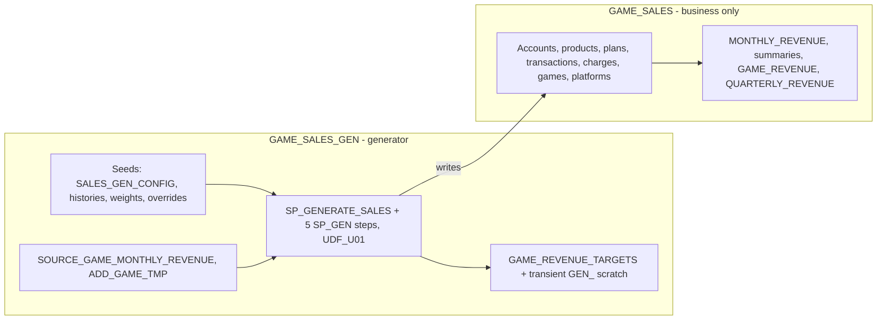

# Plan: GAME\_SALES holds only business objects; everything for generating data goes to GAME\_SALES\_GEN

## Context

**Where the previous request stopped.** The seed move is partly done:

- The 6 seed/config tables are already in GAME\_SALES\_GEN, and the 6 generator procedures were redeployed to read them there.
- The verification run of `SP_GENERATE_SALES` was cancelled partway through. The hardware step re-ran and matches the baseline. But **`CUSTOMER_ACCOUNTS` lost its 3,057 store-only accounts** (289,225 down to 286,168), because the digital step that recreates them never ran.
- `DIGITAL_PRODUCT_TRANSACTIONS` still references those account IDs, so the data is currently inconsistent. A complete generator run fixes this, since the generator is deterministic.
- The seed DDL files and the seed-data file haven't been moved yet.

**GAME\_SALES inventory, classified:**

| Keep in GAME\_SALES (business)                                                                                                                                                                                                                                                                                                       | Move to GAME\_SALES\_GEN (generation)                                                                                                                            |
| ------------------------------------------------------------------------------------------------------------------------------------------------------------------------------------------------------------------------------------------------------------------------------------------------------------------------------------ | ---------------------------------------------------------------------------------------------------------------------------------------------------------------- |
| Tables: CUSTOMER\_ACCOUNTS, DIGITAL\_PRODUCTS, DIGITAL\_PRODUCT\_TRANSACTIONS, HARDWARE\_PRODUCTS, HARDWARE\_SALES\_TRANSACTIONS, SUBSCRIPTION\_PLANS, SUBSCRIPTION\_CHARGES, REVENUE\_CATEGORIES, GAMES, PLATFORMS, GAME\_PLATFORMS, MONETIZATION\_TYPES, GAME\_MONETIZATION (the last two kept as business reference, your choice) | `GAME_REVENUE_TARGETS`: the generator's per game-month targets                                                                                                   |
| Views: MONTHLY\_REVENUE, VW\_PLATFORM\_EXCLUSIVITY, VW\_PLATFORM\_REVENUE\_SUMMARY                                                                                                                                                                                                                                                   | `SOURCE_GAME_MONTHLY_REVENUE`: source revenue the targets come from; protected, so it's moved, never copied or edited                                             |
| Dynamic tables: GAME\_REVENUE, QUARTERLY\_REVENUE                                                                                                                                                                                                                                                                                    | `ADD_GAME_TMP`: add-game skill staging; the generator reads its revenue estimates                                                                                |
|                                                                                                                                                                                                                                                                                                                                      | Procedures: SP\_GENERATE\_SALES, SP\_GEN\_CATALOG, SP\_GEN\_CUSTOMERS\_AND\_HARDWARE, SP\_GEN\_REVENUE\_TARGETS, SP\_GEN\_DIGITAL\_SALES, SP\_GEN\_SUBSCRIPTIONS |
|                                                                                                                                                                                                                                                                                                                                      | Function: UDF\_U01                                                                                                                                               |

**Dependency direction afterwards.** GAME\_SALES\_GEN reads and writes GAME\_SALES; that's the generator's job. Nothing in GAME\_SALES references GAME\_SALES\_GEN.

- `ADD_GAME_TMP` keeps its FK to `GAME_SALES.GAMES`, which is allowed in that direction.
- No GAME\_SALES view or dynamic table reads any table being moved (checked).

## Implementation steps

1. **Move 3 tables** with `ALTER TABLE ... RENAME TO ONTOLOGY_DEMO.GAME_SALES_GEN.<name>`: `GAME_REVENUE_TARGETS`, `SOURCE_GAME_MONTHLY_REVENUE` and `ADD_GAME_TMP`.

   - Data, keys and comments carry over unchanged.
   - Check `SOURCE_GAME_MONTHLY_REVENUE` before and after: 587 rows, $8,900,181,986.02.

2. **Move the code files:**

   - `sql/game_sales/stored_procedures/{SP_GENERATE_SALES,SP_GEN_*}.sql` go to `sql/game_sales_gen/stored_procedures/`.
   - `sql/game_sales/functions/UDF_U01.sql` goes to `sql/game_sales_gen/functions/`.
   - In those files, switch the procedure and function names, and their references to the moved tables (UDF\_U01, GAME\_REVENUE\_TARGETS, SOURCE\_GAME\_MONTHLY\_REVENUE, ADD\_GAME\_TMP, and the step calls inside the orchestrator), from `GAME_SALES.` to `GAME_SALES_GEN.`. References to real Sales tables keep `GAME_SALES.`.
   - Update the procedure comments that mention the old locations.

3. **Create the code in GAME\_SALES\_GEN** from those files: the UDF first, then the 5 steps, then the orchestrator. Then drop the old `GAME_SALES` copies: 6 procedures and `UDF_U01(NUMBER, VARCHAR)`.

4. **Run `CALL ONTOLOGY_DEMO.GAME_SALES_GEN.SP_GENERATE_SALES()`** through the SQL tool (timeout 1200 s; about 4 minutes) rather than the `snow` CLI, which is where the earlier cancellation happened. This both repairs `CUSTOMER_ACCOUNTS` and proves the moved generator works.

5. **Project files:**

   - Move `sql/game_sales/seeds/` to `sql/game_sales_gen/seeds/`. Inside, change the 6 seed tables' `DELETE`/`INSERT` targets to `GAME_SALES_GEN`. `HARDWARE_PRODUCTS` and `SUBSCRIPTION_PLANS` rows still target `GAME_SALES`.
   - Move the DDL files to `sql/game_sales_gen/tables/`: the 6 seed tables plus `GAME_REVENUE_TARGETS`, `SOURCE_GAME_MONTHLY_REVENUE` and `ADD_GAME_TMP`, regenerated from `GET_DDL`.
   - Update `sql/game_sales_gen/SCHEMA.sql` to the new schema comment (seeds, inputs, code and scratch).
   - Leave `sql/game_sales/retired/` as is.

6. **Skill:**

   - Change every `GAME_SALES.ADD_GAME_TMP` to `GAME_SALES_GEN.ADD_GAME_TMP`.
   - Phase 6 calls `GAME_SALES_GEN.SP_GENERATE_SALES`.
   - The config and override references point to `GAME_SALES_GEN.SALES_GEN_CONFIG`, `GEN_PRICE_OVERRIDES` and `GEN_PLATFORM_DATE_OVERRIDES`.
   - The schema-routing rule lists what's in each schema.

7. **Memory and cleanup:**

   - Drop the `TMP_SEED_MOVE_BASELINE` scratch table after verification.

## Verification

- **Regenerated data matches the pre-move baseline** (`TMP_SEED_MOVE_BASELINE`, taken before the seed move):

  - `DIGITAL_PRODUCT_TRANSACTIONS`, `SUBSCRIPTION_CHARGES`, `HARDWARE_SALES_TRANSACTIONS` and `DIGITAL_PRODUCTS` have identical row counts and hashes;
  - `CUSTOMER_ACCOUNTS` is back to 289,225 rows with the baseline hash;
  - `GAME_REVENUE_TARGETS` (now in GAME\_SALES\_GEN) is identical;
  - the seed tables are identical.

- **Totals:** digital $19,231,852.01, matching targets to the cent, with 0 unassigned units; subscriptions $35,634,616.54; `MONTHLY_REVENUE` = `GAME_REVENUE` = `QUARTERLY_REVENUE`.

- **Referential integrity:** no transaction, charge or hardware row references an account that doesn't exist.

- **Clean separation:**

  - `GAME_SALES` contains only the 13 business tables, 3 views, 2 dynamic tables, and no procedures or functions.
  - No `GAME_SALES` object definition contains `GAME_SALES_GEN`.
  - No live object or file still uses the old `GAME_SALES.` names for moved objects.
  - `grep` on the skill finds no `GAME_SALES.ADD_GAME_TMP`.

## Critical Files

- sql/game\_sales/stored\_procedures/SP\_GENERATE\_SALES.sql - orchestrator; moves and its step calls change schema
- sql/game\_sales/stored\_procedures/SP\_GEN\_REVENUE\_TARGETS.sql - reads SOURCE\_GAME\_MONTHLY\_REVENUE and writes GAME\_REVENUE\_TARGETS (both moving)
- sql/game\_sales/stored\_procedures/SP\_GEN\_CATALOG.sql - reads ADD\_GAME\_TMP and the override tables
- sql/game\_sales/seeds/GENERATOR\_SEED\_DATA.sql - seed inserts whose targets change
- SKILL.md - ADD\_GAME\_TMP, config and Phase 6 references
