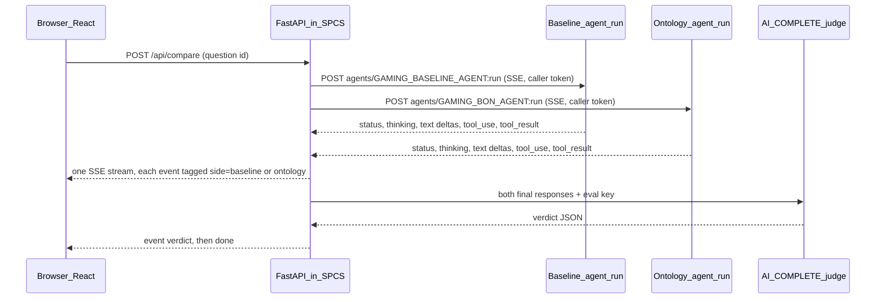

# Ontology vs Baseline agent comparison app (SPCS, streaming)

## Context

- **Agents (already deployed):** `ONTOLOGY_DEMO.ONTOLOGY_AGENTS.GAMING_BASELINE_AGENT` ([yamls/gaming_baseline_agent.yaml](yamls/gaming_baseline_agent.yaml)) and `GAMING_BON_AGENT` ([yamls/gaming_bon_agent.yaml](yamls/gaming_bon_agent.yaml)). Both use `GAMING_BASELINE_SV`.
- **Streaming:** `POST https://$SNOWFLAKE_HOST/api/v2/databases/ONTOLOGY_DEMO/schemas/ONTOLOGY_AGENTS/agents/{name}:run` streams server-sent events by default:
  - `response.status` (planning, executing_tool, ...)
  - `response.thinking.delta`
  - `response.text.delta`
  - `response.tool_use` (`business_ontology`, `query_data`, `system_execute_sql` with `input.sql`)
  - `response.tool_result`
  - `response.table`, `response.chart`
  - `response`: the final aggregate, the last event
  - `error`
  - The default timeout is 15 minutes.
  - The SQL `DATA_AGENT_RUN` used earlier this session is non-streaming only.
- **Questions:** [ontology_setup/ontology_eval_set.md](ontology_setup/ontology_eval_set.md) has 23 rows (#, Question, Challenge, Expected answer, Naive trap, Ontology nodes that fix it) plus a reference-SQL table keyed by #.
- **Auth (SPCS docs):**
  - A public endpoint forces a Snowflake login.
  - `executeAsCaller: true` adds the `Sf-Context-Current-User` and `Sf-Context-Current-User-Token` headers to each request. The caller credential is `<service oauth token>.<user token>`.
  - The session runs with the user's default role plus `DEFAULT_SECONDARY_ROLES`, and roles can't be switched. So there is **no role dropdown**: the header shows the user, the active role and the secondary roles.
  - The service owner role needs `GRANT CALLER ...` grants for everything the agents touch.
- **Open risk (verify in step 3):**
  - The docs show the caller token being used with SQL drivers only, not with the REST API.
  - The spike sends `Authorization: Bearer <service>.<user>` plus `X-Snowflake-Authorization-Token-Type: OAUTH` to `:run` from inside the container.
  - **Fallback A:** stream as the service user (service-owner role). Show that role in the header and say plainly that agent calls don't run as the viewer.
  - **Fallback B:** the user stores a PAT, which the app sends as the bearer token.
  - Either fallback goes to you for a decision before I build further.
- **Decisions (user):** AI_COMPLETE judge grounded in the eval key. Responses stream. No role dropdown; the logged-in role is shown in the header.
- **Constraints:**
  - The service owner can't be ACCOUNTADMIN, so use a dedicated `ONTOLOGY_APP_ROLE`.
  - Don't touch the DEMO database.
  - New code goes in `app/`.

## Architecture



- **One container:** FastAPI serves the built React app at `/` and the API under `/api`. One public endpoint `ui`, port 8080, service role `app_user`.
- **One stream to the browser:**
  - `POST /api/compare` returns `text/event-stream`.
  - The backend opens both agent streams at the same moment with `httpx.AsyncClient` and `asyncio` tasks.
  - It merges both into one outgoing SSE stream, re-emitting each event as `{side, type, payload}`.
  - Heartbeat comments every 15s stop the ingress proxy from timing out an idle connection.
- **Browser side:**
  - Reads the stream with `fetch` + `ReadableStream`, since EventSource can't POST.
  - Text deltas append to the right pane as a typewriter effect.
  - Status and tool events show as small step chips: "Searching ontology", "Generating SQL", "Running SQL".
- **Judge:**
  - Runs as the service user after both `response` events arrive, then streams a final `verdict` event.
  - Skipped when both answers match the expected answer.
- **Token handling:**
  - The caller token is valid for 2 minutes by default, but it's only needed to open each `:run` request; the stream can outlast it.
  - Each question builds a fresh token from the current request's header.

## Implementation steps

1. **Scaffold `app/`**
   - `app/frontend/`: Vite + React + TypeScript.
   - `app/backend/`: FastAPI, `httpx`, `snowflake-connector-python`.
   - `app/Dockerfile`: multi-stage — node builds the UI, then python:3.11-slim runs uvicorn on port 8080.
   - `app/service-spec.yaml`, `app/README.md`.
2. **Questions loader** (`app/backend/questions.py`):
   - At image build, parse `ontology_setup/ontology_eval_set.md` (both tables, joined on #) into `questions.json`.
   - A unit test asserts 23 questions and that Q21's expected answer contains "14,642,492.04".
3. **Auth + streaming spike first** (`app/backend/sf.py`, `app/backend/agents.py`):
   - `caller_bearer(request)` reads `/snowflake/session/token` and joins it with `"." + Sf-Context-Current-User-Token`.
   - `service_bearer()` returns the service token alone.
   - `stream_agent(name, question, bearer)` POSTs `:run` with `{"messages":[...], "stream": true}` and yields parsed SSE events.
   - Deploy a minimal build, run Q7 and confirm it streams.
   - If REST rejects the caller token, stop and ask which fallback to use.
   - **Local dev:** a connection or PAT from `~/.snowflake/connections.toml`, host taken from the account.
4. **API** (`app/backend/main.py`):
   - `GET /api/me` (caller SQL session) returns `CURRENT_USER()`, `CURRENT_ROLE()`, `CURRENT_SECONDARY_ROLES()` and `CURRENT_WAREHOUSE()`.
   - `GET /api/questions` returns the parsed questions.
   - `POST /api/compare {question_id | text}` returns a merged SSE stream:
     - `start`
     - per side: `status`, `thinking`, `text`, `tool_use`, `tool_result`, `table`, `error`, `final`
     - then `verdict`, then `done`
   - The server keeps each side's final response so the judge can use it.
   - `POST /api/compare/cancel` cancels both runs (`POST /api/v2/cortex/agent/runs/{run_id}/cancel`, with run_id taken from the `metadata` event).
5. **Judge** (`app/backend/judge.py`):
   - Load the `cortex-ai-function-studio` skill before writing this SQL.
   - One `AI_COMPLETE` call. Inputs: the question, the expected answer, the naive trap, the fixing nodes, both final texts and both SQL lists (each cut to about 4k characters).
   - Output via `TRY_PARSE_JSON`: `{baseline_correct, ontology_correct, differ, summary, evidence[]}`.
   - The prompt forbids calling the ontology agent right unless its numbers match the expected answer.
   - Free-text questions get a comparison only, labelled "no expected answer".
   - Not called when both answers match the expected answer.
6. **React UI** (`app/frontend/src/`):
   - `Header`: app title, then read-only `User: JWESTRA`, `Role: ACCOUNTADMIN`, `Secondary: ALL`, `Warehouse: ...`. No dropdown.
   - `QuestionPicker`: searchable and grouped by Challenge, plus a free-text box. Picking a question starts both runs immediately.
   - `AgentPane` ×2: streaming chat on top (typewriter text, step chips, an expandable "Thinking" section). Under it, a results card with the answer, a Correct/Wrong badge, the expected answer, tools used, ontology nodes hit, a "Show SQL" toggle, any result table and the elapsed time.
   - `VerdictPanel`: the streamed judge summary and evidence.
   - `ScoreStrip`: running session score.
   - `Stop` button: cancels both runs.
7. **Setup SQL** (`app/sql/00_setup.sql`):
   - Role `ONTOLOGY_APP_ROLE`, compute pool `ONTOLOGY_APP_POOL` (CPU_X64_XS), image repo `ONTOLOGY_DEMO.ONTOLOGY_AGENTS.APP_REPO`.
   - Owner grants: USAGE on the DB, schemas and warehouse; BIND SERVICE ENDPOINT on the account; the CORTEX_USER database role; USAGE on both agents.
   - Caller grants:
     - CALLER USAGE on the DB, the ONTOLOGY_AGENTS / GAME_CATALOG / GAME_SALES schemas and the warehouse.
     - CALLER USAGE on both agents.
     - CALLER SELECT on the semantic view.
     - INHERITED CALLER SELECT on all tables and views in GAME_CATALOG and GAME_SALES.
   - Demo users: `DEFAULT_SECONDARY_ROLES = ('ALL')` and a DEFAULT_WAREHOUSE.
8. **Build, push, deploy**
   - `snow spcs image-registry login`, then `docker build --platform linux/amd64` and push.
   - `CREATE SERVICE ONTOLOGY_DEMO.ONTOLOGY_AGENTS.ONTOLOGY_COMPARE_APP` with `executeAsCaller: true`, readiness `/healthz` and service role `app_user`.
   - `GRANT SERVICE ROLE ...!app_user` to ACCOUNTADMIN and any other demo roles.
   - Updates use `ALTER SERVICE ... FROM SPECIFICATION`.
9. **Find missing caller grants:** run Q7 as ACCOUNTADMIN. For each not-authorized error, add the `GRANT CALLER` to `00_setup.sql` and rerun.

## Wireframe

### 1. Initial load (after Snowflake login at ingress)

```text
+------------------------------------------------------------------------------------------+
| Ontology vs Baseline - Gaming agents                                                     |
|                     User: JWESTRA   Role: ACCOUNTADMIN   Secondary: ALL   WH: COMPUTE_WH |
+------------------------------------------------------------------------------------------+
| Question [ Search eval questions...                                  ]   23 questions    |
|   C3 imperfect keys    1. What is our total digital game revenue?                        |
|   genre roll-up        13. How many RPG games are there?                                 |
|                        21. Which genre has the most revenue?                             |
|                        22. How much revenue did RPG games make?                          |
|   Or type your own: [                                                        ] [ Ask ]   |
+--------------------------------------------+---------------------------------------------+
| BASELINE  GAMING_BASELINE_AGENT            | WITH ONTOLOGY  GAMING_BON_AGENT             |
| semantic view only                         | semantic view + Business Ontology search    |
|--------------------------------------------|---------------------------------------------|
|  Pick a question to run both agents.       |  Pick a question to run both agents.        |
+--------------------------------------------+---------------------------------------------+
| Session score: Baseline 0/0   Ontology 0/0                                               |
+------------------------------------------------------------------------------------------+
```

### 2. Q21 picked: both streaming at the same time

```text
+--------------------------------------------+---------------------------------------------+
| BASELINE                  streaming 0:38   | WITH ONTOLOGY              streaming 0:38   |
|--------------------------------------------|---------------------------------------------|
| You: Which genre has the most revenue?     | You: Which genre has the most revenue?      |
| [v] Planning  [v] Generating SQL           | [v] Searching ontology  [v] Generating SQL  |
| [>] Running SQL (4th query)                | [>] Running SQL                             |
| > Thinking (expand)                        | > Thinking (expand)                         |
| Agent: Action is the top genre, with       | Agent: Action has the most revenue:         |
| about $13.2M in gross digital rev|         | $14,642,49|                                 |
|                                            |                                             |
|                                 [ Stop ]   |                                  [ Stop ]   |
+--------------------------------------------+---------------------------------------------+
| Verdict: waiting for both agents...                                                      |
+------------------------------------------------------------------------------------------+
```
`|` marks the live typing cursor. Chips turn [v] as `response.status` and `tool_result` events arrive.

### 3. Both done: chat above, results card underneath each, verdict at the bottom

```text
+--------------------------------------------+---------------------------------------------+
| BASELINE                       done 1:51   | WITH ONTOLOGY                   done 2:34   |
|--------------------------------------------|---------------------------------------------|
| Agent: Action is the top genre, with about | Agent: Action has the most revenue:         |
| $13.2M in gross digital revenue, more than | $14,642,492.04 across 66 games. RPG is next |
| double Horror ($6.1M)...                   | at $13,436,693.28 (RPG + Roguelike +        |
|                                            | ActionRPG + Soulslike)...                   |
|--------------------------------------------|---------------------------------------------|
| RESULT                         [ WRONG ]   | RESULT                         [ CORRECT ]  |
| Answer:   Action, ~$13.2M                  | Answer:   Action, $14,642,492.04            |
| Expected: Action, $14,642,492.04           | Expected: Action, $14,642,492.04            |
| Tools: query_data x4                       | Tools: business_ontology, query_data        |
| Ontology nodes: -                          | Ontology nodes: Genre Revenue, Genre Roll-up|
|                                            |   Rule, Game Identity Match Rule            |
| [ Show SQL (4) ]  [ Table ]                | [ Show SQL (1) ]  [ Table ]                 |
+--------------------------------------------+---------------------------------------------+
| WHY THE ANSWERS DIFFER                                     Expected: Action $14,642,492.04 |
| The ontology agent is correct; the baseline was naive.                                   |
| - Identity trap: the baseline matched sales titles to games only by CATALOG_GAME_ID,     |
|   dropping titles that resolve only via the title-code crosswalk or name + year          |
|   (eval trap: strong key only -> Action $13,217,013.28).                                 |
| - The ontology agent applied the Game Identity Match Rule and the Genre Roll-up Rule.    |
| - Nodes that fixed it: Genre Roll-up Rule, Genre Revenue, Game Identity Match Rule.      |
+------------------------------------------------------------------------------------------+
| Session score: Baseline 0/1   Ontology 1/1                                               |
+------------------------------------------------------------------------------------------+
```

### 4. Edge cases

```text
Both match expected   -> green banner "Both agents agree with the expected answer." (no judge call)
Both wrong            -> "Neither agent matched the expected answer ($X)." The summary explains both.
Ontology agent wrong  -> red badge on the right; the summary says so (e.g. the current Ghost of Yotei gap).
Free-text question    -> no Expected line; the verdict compares the two answers only.
One side errors       -> that pane shows the SSE error and Retry; the other keeps streaming.
Stop pressed          -> both runs cancelled; panes show "cancelled" with the partial text kept.
```

## Verification

- **Spike (step 3):** inside SPCS, `:run` streams with the caller token. The query history shows the agent's SQL under JWESTRA, not the service user.
- **Parser:** the unit test passes (23 questions; Q21 expected value present).
- **Header:** shows the actual `CURRENT_ROLE()` (for example ACCOUNTADMIN when that is JWESTRA's default role) and the secondary roles.
- **Streaming:** text appears within seconds of picking a question, and both panes update at the same time. The first-event timestamps for the two sides are within about 1s.
- **Long runs:** a 2–3 minute run doesn't drop the connection (heartbeats).
- **Judge:**
  - Q21 gives a "differ" verdict citing the strong-key trap.
  - Q7 shows "Both agents agree".
  - Q3 is not called correct while the ontology agent's Ghost of Yotei gap remains.
- **Auth:** a role without the `app_user` service role gets 403 at ingress.

## Critical files
- [app/backend/agents.py](app/backend/agents.py) - REST `:run` SSE client with caller token
- [app/backend/main.py](app/backend/main.py) - merged SSE stream, me/questions endpoints, cancel
- [app/backend/judge.py](app/backend/judge.py) - AI_COMPLETE verdict grounded in the eval key
- [app/frontend/src/App.tsx](app/frontend/src/App.tsx) - header, picker, two streaming panes, verdict
- [app/service-spec.yaml](app/service-spec.yaml) - executeAsCaller, endpoint, service role
