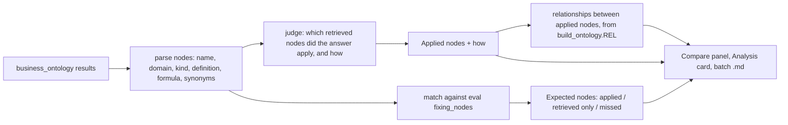

# Plan: show how the Business Ontology contributed to each answer

## Context

What I found:

- **The data is thrown away today.** scripts/batch\_eval.py and Live mode both use `parse_response` in app/backend/agents.py.

  - For a `business_ontology` step it keeps only the search query, for example `{"query": "Game Identity Match Rule"}`. That is all the UI can show today.
  - It extracts nothing from the search *result*. `ontology_hits` is only names, and the recorded `latest.json` has none, because it was produced before that field existed.

- **What a search actually returns** (checked live on Q6). The `tool_result` content is `[{"type":"json","json":{"message":"Found 15 object(s):\n\n1. Game Catalog.Engine (ENTITY)\n Name: ...\n Domain: ...\n Definition: ...\n Formula: ...\n Synonyms: ..."}]`.

  - Every search returns about 15 nodes, and many are irrelevant. Q6's first search returned Battle Pass Sales Revenue and Hardware Revenue.
  - Each node has a kind (ENTITY, METRIC or TERM), a definition, an optional formula and synonyms.
  - Relationships are **not** returned.
  - So "retrieved" is not the same as "contributed". Listing all 15 nodes would mislead.

- **What the repo already has:**

  - The eval set's `fixing_nodes` per question, for example Q6: "Game Identity Match Rule (crosswalk route); Title Code; Engine; Game Revenue".
  - All 98 relationships (`REL`) and 72 terms (`TERMS`) in scripts/build\_ontology.py.

- **The judge already sees the answer text and SQL** (app/backend/judge.py). Adding the retrieved node list lets it say which nodes the SQL or answer actually applied.

How "contributed" is decided:

Display mapping:

| Ontology kind                  | Shown as                                   |
| ------------------------------ | ------------------------------------------ |
| ENTITY                         | Class                                      |
| METRIC                         | Metric (with its formula)                  |
| TERM whose name ends in "Rule" | Rule                                       |
| Other TERM                     | Term (code, column or synonym definitions) |

## Implementation steps

1. **Parse the ontology results** in app/backend/agents.py.

   - Add `parse_ontology_result(content) -> list[node]`. It reads the `json.message` text into `{name, domain, kind, definition, formula, synonyms}`, splitting on the `N. Domain.Name (KIND)` headers and the indented `Field:` lines.
   - On each `business_ontology` step, store `nodes: [names]`.
   - On the answer, add `ontology_retrieved: [node]`, deduplicated by name. This replaces `ontology_hits`. Definitions are truncated to about 500 characters to keep `latest.json` reasonable.
   - This shared parser covers both Live mode and the batch eval.

2. **Extend the judge** (app/backend/judge.py).

   - Pass the ontology agent's retrieved nodes into the prompt as name, kind and formula only.
   - Add an `ontology_contributions` array to the response schema, with entries `{node, how}` and a one-sentence `how`. The prompt tells the judge to list only nodes whose definition, formula or rule is visibly reflected in the ontology answer's SQL or text (for example COALESCE over the crosswalk, or COLLATE en-ci-ai), and to cite the evidence.
   - Validation: drop any `node` that wasn't retrieved, so the judge can't invent nodes.
   - The batch eval inherits this automatically through `shared_judge`.

3. **Add a contribution helper** in a new app/backend/ontology\_trace.py.

   - `contribution(question, answer, verdict)` returns:

     - **applied:** judge contributions joined to node kind, formula and definition.
     - **expected:** each of the question's `fixing_nodes` (text before any "(") marked `applied`, `retrieved` or `missed`.
     - **relationships:** `REL` edges from `build_ontology.py` whose two ends are both applied or expected nodes, for example "Game Identity Match Rule APPLIES\_TO Game Revenue". They are labeled as coming from the ontology model, since the agent never sees edges.

   - Main.py calls it after the verdict and sends it with the verdict event as `ontology_trace`. `batch_eval.py` stores it on `answers.ontology.ontology_trace`.

4. **Add the "How the ontology helped" section to the batch Markdown** (scripts/batch\_eval.py summary). Per question, grouped C1–C7:

   - applied nodes as kind, name and how;
   - expected-node coverage;
   - relationships.

   `--summarize` handles old runs without the field by skipping the section.

5. **Update the frontend types and add a component.**

   - In app/frontend/src/api.ts, add the `OntologyNode` and `OntologyTrace` types, and the `nodes` field on `Step`.

   - In app/frontend/src/components/common.tsx, add an `OntologyContribution` component:

     - **"How the ontology helped" box:** a kind pill per applied node (Class, Metric, Rule, Term), the node name, the judge's "how", and an expandable definition and formula.
     - **"Expected nodes" checklist:** each node marked applied, retrieved but not applied, or missed.
     - **Relationships:** edges shown as "A -> TYPE -> B".

   - `StepRow`: an ontology search step now lists the node names it returned, with applied nodes highlighted.

6. **Wire it into Compare and Analysis.**

   - CompareView\.tsx: render `OntologyContribution` in the ontology agent's panel. Recorded mode takes it from `latest.json`; Live mode takes it from the verdict event.

   - AnalysisView\.tsx:

     - Add an "Ontology nodes applied" column to the behaviour table, with a count and kinds.
     - Show the contribution box in each question card.
     - Add a stat card for expected-node coverage across all questions.

7. **Refresh the recorded run.** The current `latest.json` has no node results, so the new UI would show nothing in Recorded mode until the eval is re-run.

   - Re-run `python3 scripts/batch_eval.py`: 26 agent runs plus 13 judge calls, several minutes, uses credits.
   - Commit the new `latest.json` so Recorded mode and Analysis show contributions.
   - Until it's re-run, the UI shows "Not recorded in this run; re-run the batch eval" instead of an empty box.

8. **Tests and docs.**

   - Extend app/backend/test\_compare.py:

     - parse a real-shaped `message` (taken from the Q6 output above) into nodes;
     - check that unknown judge nodes are dropped;
     - check expected-node matching and relationship selection.

   - Update `dev_mock.py` with fake nodes and contributions.

   - Add a short note to app/README.md and the README's batch eval section.

## Verification

- `python3 app/backend/test_compare.py && python3 app/backend/test_questions.py` pass.
- `npx tsc --noEmit` passes in `app/frontend`.
- A Live run of Q6 in the UI shows applied nodes such as Game Identity Match Rule (Rule), Title Code (Term), Engine (Class) and Game Revenue (Metric), each with a "how" citing the crosswalk join or engine filter. Relationships include "Game Identity Match Rule APPLIES\_TO Game Revenue". Irrelevant retrieved nodes like Battle Pass Sales Revenue are not listed as applied.
- After the batch re-run, the Analysis tab shows contributions for all 13 questions, and the `.md` has the "How the ontology helped" section.
- Spot-check 3 questions, Q5, Q8 and Q11, comparing the judge's claimed evidence with the actual SQL.

## Critical files

- app/backend/agents.py - parse ontology search results into nodes (shared by Live and batch)
- app/backend/judge.py - judge returns which nodes were applied and how
- app/backend/ontology\_trace.py - expected-node coverage and relationships from build\_ontology
- app/frontend/src/components/common.tsx - OntologyContribution component used by Compare and Analysis
- scripts/batch\_eval.py - store trace per answer and add it to the Markdown summary
