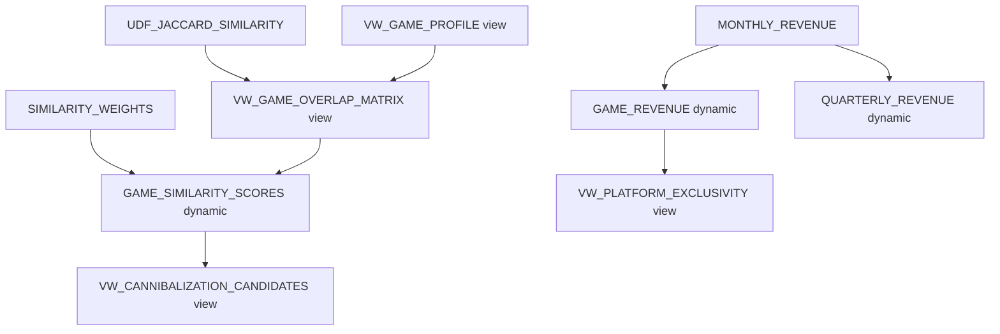

# Plan: Add Views + Dynamic Tables to ONTOLOGY\_DEMO, and Reconcile Diffs

## Context

I did not plan ahead on the first pass, which caused two problems the user is now asking me to fix properly:

1. Views and dynamic tables in `DEMO` were skipped/flattened without asking.
2. No systematic diff was done between the two sets of schemas.

I've now inventoried both sides read-only. Findings below.

### Objects in DEMO (source) not yet properly reproduced in ONTOLOGY\_DEMO

**Views (5 total, none exist in ONTOLOGY\_DEMO today):**

| Schema        | View                            | Depends on                                                                                                                                   |
| ------------- | ------------------------------- | -------------------------------------------------------------------------------------------------------------------------------------------- |
| GAME\_CATALOG | `DISJOINT_GENRE_PAIRS`          | `GENRE_RULES`                                                                                                                                |
| GAME\_CATALOG | `VW_ACCESSIBILITY_GAPS`         | `GAMES`, `ACCESSIBILITY_FEATURES`, `GAME_ACCESSIBILITY`                                                                                      |
| GAME\_CATALOG | `VW_GAME_PROFILE`               | `GAMES`, `NARRATIVE_STRUCTURES`, `GAME_GAMEPLAY`, `GAMEPLAY_TYPES`, `GAME_MECHANICS`, `MECHANICS`, `GAME_CONTEXTS`, `CONTEXTS`, `GAME_MODES` |
| GAME\_CATALOG | `VW_GAME_OVERLAP_MATRIX`        | `GAME_GENRE_CLASSIFICATION`, `GAME_PLATFORMS`, `PLATFORMS`, `VW_GAME_PROFILE`, **and function `UDF_JACCARD_SIMILARITY(ARRAY, ARRAY)`**       |
| GAME\_CATALOG | `VW_CANNIBALIZATION_CANDIDATES` | `GAMES`, `GAME_FRANCHISES`, `FRANCHISES`, `PUBLISHERS`, `GAME_SIMILARITY_SCORES`                                                             |
| GAME\_SALES   | `VW_PLATFORM_EXCLUSIVITY`       | `GAME_PLATFORMS`, `GAMES`, `PLATFORMS`, `GAME_REVENUE`                                                                                       |

**Function dependency (new finding, not previously surfaced):**

- `DEMO.GAME_CATALOG.UDF_JACCARD_SIMILARITY(ARRAY, ARRAY) RETURN FLOAT` — plain SQL UDF, no further dependencies, required by `VW_GAME_OVERLAP_MATRIX`. Must be created in `ONTOLOGY_DEMO.GAME_CATALOG` before that view compiles.

**Dynamic tables (4 total) — currently materialized as static snapshot tables in ONTOLOGY\_DEMO, per my earlier (unapproved) shortcut:**

| Schema        | Table                       | Source query depends on                                                    |
| ------------- | --------------------------- | -------------------------------------------------------------------------- |
| GAME\_CATALOG | `GAME_SIMILARITY_SCORES`    | `SIMILARITY_WEIGHTS`, `VW_GAME_OVERLAP_MATRIX` (a view — chain dependency) |
| GAME\_CATALOG | `GENRE_WHITESPACE_ANALYSIS` | `GENRE_RULES`, `GAME_GENRE_CLASSIFICATION`                                 |
| GAME\_SALES   | `GAME_REVENUE`              | `MONTHLY_REVENUE`                                                          |
| GAME\_SALES   | `QUARTERLY_REVENUE`         | `MONTHLY_REVENUE`                                                          |

All 4 use `target_lag = '1 hour'`, `refresh_mode = AUTO`, `warehouse = COMPUTE_WH`. `COMPUTE_WH` exists and is running in this account, so it can be reused.

**Dependency ordering implied by the above:**

So creation order must be: UDF -> `VW_GAME_PROFILE` -> `VW_GAME_OVERLAP_MATRIX` -> `GAME_SIMILARITY_SCORES` (dynamic) -> `VW_CANNIBALIZATION_CANDIDATES`; and independently `GAME_REVENUE`/`QUARTERLY_REVENUE` (dynamic) -> `VW_PLATFORM_EXCLUSIVITY`. `DISJOINT_GENRE_PAIRS`, `VW_ACCESSIBILITY_GAPS`, `GENRE_WHITESPACE_ANALYSIS` have no cross-view dependencies and can be created any time after their base tables exist (they already do).

### Diff summary across all 3 schemas (GAMES\_CORE, GAME\_CATALOG, GAME\_SALES)

- **GAMES\_CORE**: no object differences — all 14 base tables present in both, structurally identical (DDL was copied verbatim), row counts verified equal.
- **GAME\_CATALOG**: 23 base tables present in both and row-count-verified equal; but 2 of those (`GAME_SIMILARITY_SCORES`, `GENRE_WHITESPACE_ANALYSIS`) are DYNAMIC TABLEs in DEMO vs plain static TABLEs in ONTOLOGY\_DEMO (won't auto-refresh); 5 views missing entirely; 1 UDF missing entirely.
- **GAME\_SALES**: 1 base table (`MONTHLY_REVENUE`) identical; 2 of the 3 "tables" (`GAME_REVENUE`, `QUARTERLY_REVENUE`) are DYNAMIC TABLEs in DEMO vs static in ONTOLOGY\_DEMO; 1 view missing.
- Autoincrement columns: DDL was reproduced identically (`autoincrement start 1 increment 1 noorder`) but actual next-sequence-value in Snowflake's internal counter was not synced — new inserts into `GAMES`, `DEVELOPERS`, `PLATFORMS`, etc. in ONTOLOGY\_DEMO would start renumbering from whatever counter state exists post-bulk-insert (Snowflake does not auto-bump the sequence counter when explicit values are inserted). This only matters if someone inserts new rows later without specifying an ID; flagging as a known latent diff, not fixing unless you want it addressed.
- Also noted (out of scope, FYI only): ONTOLOGY\_DEMO already contains an unrelated `VIDEOWL` schema (ontology/knowledge-graph objects) that predates this work and is unrelated to the DEMO/GAMES comparison.

## Key decision needed before implementing

The source views/dynamic tables all reference tables with fully-qualified names like `DEMO.GAMES_CORE.GAMES`. If I recreate them verbatim, the new objects in `ONTOLOGY_DEMO` would silently read from `DEMO` tables, not from the copies I just made — defeating the purpose of having an independent copy, and creating a cross-database runtime dependency.

I will rewrite every view/dynamic-table definition to reference `ONTOLOGY_DEMO.*` instead of `DEMO.*`, unless told otherwise.

## Implementation steps

1. Create `UDF_JACCARD_SIMILARITY(ARRAY, ARRAY)` in `ONTOLOGY_DEMO.GAME_CATALOG` (verbatim SQL body, no rewrite needed — no table references inside).
2. Create `VW_GAME_PROFILE` view in `ONTOLOGY_DEMO.GAME_CATALOG`, rewritten to reference `ONTOLOGY_DEMO.*` tables.
3. Create `VW_GAME_OVERLAP_MATRIX` view, rewritten to reference `ONTOLOGY_DEMO.*` tables/views and the new local UDF.
4. Drop the existing static `GAME_SIMILARITY_SCORES` table and recreate it as a `DYNAMIC TABLE` (`target_lag='1 hour'`, `warehouse=COMPUTE_WH`, `refresh_mode=AUTO`), query rewritten to reference `ONTOLOGY_DEMO.*`.
5. Create `VW_CANNIBALIZATION_CANDIDATES` view, rewritten.
6. Create `DISJOINT_GENRE_PAIRS` and `VW_ACCESSIBILITY_GAPS` views, rewritten (no ordering constraint).
7. Drop static `GENRE_WHITESPACE_ANALYSIS` and recreate as `DYNAMIC TABLE`, rewritten.
8. Drop static `GAME_REVENUE` and `QUARTERLY_REVENUE` in `GAME_SALES` and recreate both as `DYNAMIC TABLE`s, rewritten to reference `ONTOLOGY_DEMO.GAME_SALES.MONTHLY_REVENUE`.
9. Create `VW_PLATFORM_EXCLUSIVITY` view in `GAME_SALES`, rewritten.
10. Trigger/await initial dynamic table refresh (`ALTER DYNAMIC TABLE ... REFRESH` or wait for `initialize = ON_CREATE`) and confirm state is not `FAILED`.

## Verification

- `SHOW DYNAMIC TABLES IN DATABASE ONTOLOGY_DEMO;` — confirm 4 dynamic tables exist, state healthy.
- For each of the 5 views and 4 dynamic tables, run row-count and spot-check queries against the DEMO equivalents (same approach as the base-table verification already done) to confirm matching results.
- `SELECT GET_DDL('FUNCTION', ...)` to confirm the UDF compiled correctly in the new schema.
- Re-run the full object inventory query to confirm GAME\_CATALOG/GAME\_SALES in ONTOLOGY\_DEMO now have the same object counts and types as DEMO (minus intentional differences, if any remain by choice).

## Critical files

This is a pure Snowflake SQL/DDL task with no local repo files involved — all "files" are Snowflake objects:

- `DEMO.GAME_CATALOG.VW_GAME_OVERLAP_MATRIX` — most complex dependency, pulls in the UDF and another view.
- `DEMO.GAME_CATALOG.GAME_SIMILARITY_SCORES` — dynamic table depending on the above view; must be created last in that chain.
- `DEMO.GAME_SALES.GAME_REVENUE` / `QUARTERLY_REVENUE` — dynamic tables depending on `MONTHLY_REVENUE`.
- `DEMO.GAME_CATALOG.UDF_JACCARD_SIMILARITY` — must exist before `VW_GAME_OVERLAP_MATRIX` is created.
