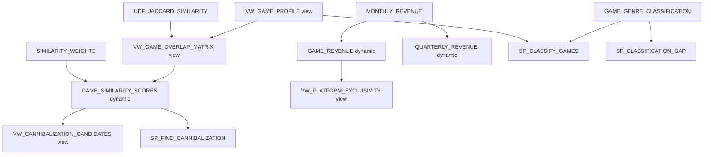

# Plan: Add Views + Dynamic Tables + Stored Procedures to ONTOLOGY_DEMO

## Context

Prior pass only copied base tables, without planning ahead or diffing systematically — this revision fixes that. Full read-only diff of DEMO vs ONTOLOGY_DEMO across GAMES_CORE, GAME_CATALOG, GAME_SALES is complete, and all open blockers are resolved:

- **Procedure source recovered.** `GET_DDL`/`DESCRIBE PROCEDURE` returned empty bodies for all 4 procedures (confirmed via `LENGTH()`, confirmed OWNERSHIP as ACCOUNTADMIN — a genuine Snowflake-side gap, not a privilege issue). Per your direction I searched `~/projects/gaming` and found complete, matching source for all 4:
  - `~/projects/gaming/game_catalog/stored_procedures/SP_CLASSIFY_GAMES.sql`
  - `~/projects/gaming/game_catalog/stored_procedures/SP_FIND_CANNIBALIZATION.sql`
  - `~/projects/gaming/game_catalog/stored_procedures/SP_CLASSIFICATION_GAP.sql`
  - `~/projects/gaming/game_sales/stored_procedures/SP_GENERATE_MONTHLY_REVENUE.sql`
  - Confirmed no additional procedures exist for `GAMES_CORE` (no `stored_procedures` dir there), matching the account-side finding of exactly 4 relevant procedures.
- **Reference strategy decided:** rewrite all views/dynamic tables/procedures to reference `ONTOLOGY_DEMO.*` instead of `DEMO.*` — fully independent copy.
- **Dynamic tables decided:** recreate as true `DYNAMIC TABLE`s matching source (`target_lag='1 hour'`, `refresh_mode=AUTO`, `warehouse=COMPUTE_WH`, confirmed running).

### Views (5 total)
| Schema | View | Depends on |
|---|---|---|
| GAME_CATALOG | `DISJOINT_GENRE_PAIRS` | `GENRE_RULES` |
| GAME_CATALOG | `VW_ACCESSIBILITY_GAPS` | `GAMES`, `ACCESSIBILITY_FEATURES`, `GAME_ACCESSIBILITY` |
| GAME_CATALOG | `VW_GAME_PROFILE` | `GAMES`, `NARRATIVE_STRUCTURES`, `GAME_GAMEPLAY`, `GAMEPLAY_TYPES`, `GAME_MECHANICS`, `MECHANICS`, `GAME_CONTEXTS`, `CONTEXTS`, `GAME_MODES` |
| GAME_CATALOG | `VW_GAME_OVERLAP_MATRIX` | above + function `UDF_JACCARD_SIMILARITY(ARRAY, ARRAY)` |
| GAME_CATALOG | `VW_CANNIBALIZATION_CANDIDATES` | `GAMES`, `GAME_FRANCHISES`, `FRANCHISES`, `PUBLISHERS`, `GAME_SIMILARITY_SCORES` |
| GAME_SALES | `VW_PLATFORM_EXCLUSIVITY` | `GAME_PLATFORMS`, `GAMES`, `PLATFORMS`, `GAME_REVENUE` |

### Function
- `UDF_JACCARD_SIMILARITY(ARRAY, ARRAY) RETURN FLOAT` — plain SQL, no table deps, body fully retrieved via GET_DDL already. Required by `VW_GAME_OVERLAP_MATRIX`.

### Dynamic tables (4 total)
| Schema | Table | Depends on |
|---|---|---|
| GAME_CATALOG | `GAME_SIMILARITY_SCORES` | `SIMILARITY_WEIGHTS`, `VW_GAME_OVERLAP_MATRIX` |
| GAME_CATALOG | `GENRE_WHITESPACE_ANALYSIS` | `GENRE_RULES`, `GAME_GENRE_CLASSIFICATION` |
| GAME_SALES | `GAME_REVENUE` | `MONTHLY_REVENUE` |
| GAME_SALES | `QUARTERLY_REVENUE` | `MONTHLY_REVENUE` |

### Stored procedures (4 total, source recovered)
| Schema | Procedure | Language | Notes on rewrite needed |
|---|---|---|---|
| GAME_CATALOG | `SP_CLASSIFY_GAMES()` | Python/Snowpark | Hardcodes `DEMO.GAME_CATALOG.GENRE_RULES`, `DEMO.GAME_CATALOG.GENRE_CATEGORY_MAP`, `DEMO.GAME_CATALOG.VW_GAME_PROFILE`, `DEMO.GAMES_CORE.GAMES/GAME_MONETIZATION/MONETIZATION_TYPES`, writes to `DEMO.GAME_CATALOG.GAME_GENRE_CLASSIFICATION` (TRUNCATE + batched INSERT). All `DEMO.` -> `ONTOLOGY_DEMO.`. **Destructive**: truncates and repopulates the classification table when called. |
| GAME_CATALOG | `SP_FIND_CANNIBALIZATION(FLOAT DEFAULT 0.4)` | SQL (scripting) | Hardcodes `DEMO.GAMES_CORE.*` and `DEMO.GAME_CATALOG.GAME_SIMILARITY_SCORES`. Read-only. Rewrite `DEMO.` -> `ONTOLOGY_DEMO.`. |
| GAME_CATALOG | `SP_CLASSIFICATION_GAP(NUMBER, VARCHAR)` | SQL (scripting) | References unqualified `GAME_GENRE_CLASSIFICATION` (resolves via caller's session schema at runtime, matching original behavior) — no rewrite needed, just recreate verbatim in `ONTOLOGY_DEMO.GAME_CATALOG`. |
| GAME_SALES | `SP_GENERATE_MONTHLY_REVENUE(NUMBER DEFAULT NULL, FLOAT DEFAULT NULL)` | Python/Snowpark | Hardcodes `DEMO.GAMES_CORE.GAMES/GAME_MONETIZATION/MONETIZATION_TYPES`, `DEMO.GAME_SALES.GAME_REVENUE`, writes to `DEMO.GAME_SALES.MONTHLY_REVENUE` (DELETE/TRUNCATE + batched INSERT). All `DEMO.` -> `ONTOLOGY_DEMO.`. **Destructive**: deletes/truncates and regenerates `MONTHLY_REVENUE` rows when called. Uses `random.seed(42)` so output is deterministic/reproducible. |

**Caution:** `SP_CLASSIFY_GAMES` and `SP_GENERATE_MONTHLY_REVENUE` both mutate data when run (truncate + regenerate). I will create them but will NOT execute them against the copied data (which already matches DEMO row-for-row) unless you ask — running them would regenerate `GAME_GENRE_CLASSIFICATION` / `MONTHLY_REVENUE` from scratch and could produce slightly different results than the current copied snapshot (e.g. `SP_GENERATE_MONTHLY_REVENUE`'s date-window logic depends on `date.today()`, so values generated today will differ from whenever DEMO's data was first generated).

## Dependency ordering

`DISJOINT_GENRE_PAIRS`, `VW_ACCESSIBILITY_GAPS`, `GENRE_WHITESPACE_ANALYSIS`, `SP_CLASSIFICATION_GAP` have no further cross-object dependencies beyond base tables that already exist.

## Implementation steps

1. Create `UDF_JACCARD_SIMILARITY(ARRAY, ARRAY)` in `ONTOLOGY_DEMO.GAME_CATALOG` (verbatim body, no rewrite needed).
2. Create `VW_GAME_PROFILE` in `ONTOLOGY_DEMO.GAME_CATALOG`, rewritten to `ONTOLOGY_DEMO.*`.
3. Create `VW_GAME_OVERLAP_MATRIX`, rewritten.
4. Drop static `GAME_SIMILARITY_SCORES`; recreate as `DYNAMIC TABLE`, rewritten.
5. Create `VW_CANNIBALIZATION_CANDIDATES`, rewritten.
6. Create `DISJOINT_GENRE_PAIRS` and `VW_ACCESSIBILITY_GAPS`, rewritten.
7. Drop static `GENRE_WHITESPACE_ANALYSIS`; recreate as `DYNAMIC TABLE`, rewritten.
8. Drop static `GAME_REVENUE`, `QUARTERLY_REVENUE`; recreate both as `DYNAMIC TABLE`s, rewritten.
9. Create `VW_PLATFORM_EXCLUSIVITY`, rewritten.
10. Create `SP_CLASSIFY_GAMES()` in `ONTOLOGY_DEMO.GAME_CATALOG`, with all `DEMO.` references rewritten to `ONTOLOGY_DEMO.`.
11. Create `SP_FIND_CANNIBALIZATION(FLOAT DEFAULT 0.4)`, rewritten.
12. Create `SP_CLASSIFICATION_GAP(NUMBER, VARCHAR)` verbatim (unqualified reference, no rewrite).
13. Create `SP_GENERATE_MONTHLY_REVENUE(NUMBER DEFAULT NULL, FLOAT DEFAULT NULL)` in `ONTOLOGY_DEMO.GAME_SALES`, rewritten.
14. Trigger/await initial dynamic table refresh; confirm no `FAILED` state.

## Verification

- `SHOW DYNAMIC TABLES IN DATABASE ONTOLOGY_DEMO;` — 4 dynamic tables, healthy state.
- Row-count and spot-check queries for each of the 5 views and 4 dynamic tables against DEMO equivalents.
- `SHOW PROCEDURES IN DATABASE ONTOLOGY_DEMO;` — confirm all 4 signatures exist.
- Call `SP_FIND_CANNIBALIZATION()` and `SP_CLASSIFICATION_GAP(<some game_id>, <some genre>)` (both read-only) against ONTOLOGY_DEMO and spot-compare to the same call against DEMO.
- Do NOT call `SP_CLASSIFY_GAMES()` or `SP_GENERATE_MONTHLY_REVENUE()` during verification since they mutate data — confirm with you first if you want them actually run.
- Re-run the full object inventory to confirm GAME_CATALOG/GAME_SALES object counts/types now match DEMO.

## Critical files
- [`~/projects/gaming/game_catalog/stored_procedures/SP_CLASSIFY_GAMES.sql`](~/projects/gaming/game_catalog/stored_procedures/SP_CLASSIFY_GAMES.sql) — source of truth for the classification engine; needs `DEMO.` -> `ONTOLOGY_DEMO.` rewrite in ~6 places.
- [`~/projects/gaming/game_sales/stored_procedures/SP_GENERATE_MONTHLY_REVENUE.sql`](~/projects/gaming/game_sales/stored_procedures/SP_GENERATE_MONTHLY_REVENUE.sql) — revenue generator; needs `DEMO.` -> `ONTOLOGY_DEMO.` rewrite in ~6 places.
- `DEMO.GAME_CATALOG.VW_GAME_OVERLAP_MATRIX` (DDL already captured) — most complex view dependency chain.
- `DEMO.GAME_CATALOG.GAME_SIMILARITY_SCORES` / `DEMO.GAME_SALES.GAME_REVENUE` / `QUARTERLY_REVENUE` (DDL already captured) — dynamic tables to recreate.
