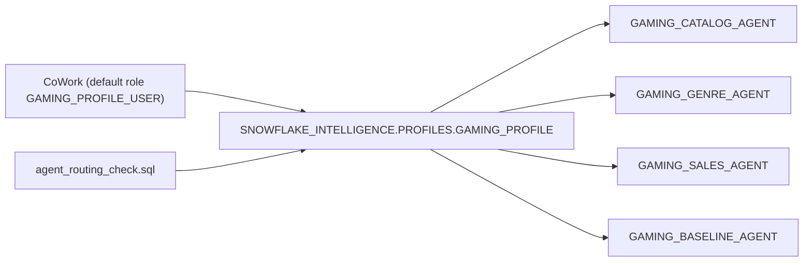

# Plan: Router demo as a CoWork Profile (patterned on cowork_profiles_demo)

## Context
- **Reference used:** `~/projects/cowork_profiles_demo/PROFILE_SETUP.sql`, plus the LIMITEDACCESS docs (About profiles, Set up profile routing, Call a profile from the API).
- **Patterns the example uses:**
  - Profiles are `CREATE OR REPLACE AGENT SNOWFLAKE_INTELLIGENCE.PROFILES.<X>_PROFILE`, run as ACCOUNTADMIN, after `CREATE SCHEMA IF NOT EXISTS SNOWFLAKE_INTELLIGENCE.PROFILES`.
  - The router tool is named `router`, with a matching `tool_resources.router.subagents` key. Every subagent entry needs **all 4 fields**: `name`, `display_name`, `description` and `source`. If any one is missing, the whole list is dropped silently.
  - Tools are `router` plus `code_execution` (the example also adds `web_search`). Orchestration instructions cover SCOPE, REFUSAL, ROUTING, MULTI-AGENT and CLARIFICATION.
  - **One role per profile** gets `SNOWFLAKE.CORTEX_USER`, USAGE on the `SNOWFLAKE_INTELLIGENCE` database, the `PROFILES` schema and the profile, plus data/agent grants and warehouse usage.
  - The profile is attached with `ALTER SNOWFLAKE INTELLIGENCE SNOWFLAKE_INTELLIGENCE_OBJECT_DEFAULT ADD AGENT ...`. To redeploy, DROP AGENT from the CoWork object first. **The specialists are attached too**, so they can be opened from direct links.
  - **CoWork uses the user's DEFAULT_ROLE, not the session role.** To test, you grant the role to your user and set it as your default.
- **This account:** CoWork object `SNOWFLAKE_INTELLIGENCE_OBJECT_DEFAULT`. `SNOWFLAKE_INTELLIGENCE.PROFILES` already holds that demo's profiles (SALES_OPS_PROFILE, ENGINEERING_PROFILE, SBX_*), so it's already on profiles.
- **Repo today:** `agents/router/GAMING_ROUTER_AGENT.yaml` already gives all 4 fields for each of its 4 subagents, but its tool is named `agent_router`. `scripts/generate_install_sql.py` (AGENT_META, `gen_03`) builds every agent in `ONTOLOGY_DEMO.AGENTS`. `scripts/agent_routing_check.sql` runs DATA_AGENT_RUN against the router agent.

## Design

- `GAMING_PROFILE` replaces `GAMING_ROUTER_AGENT`, which gets dropped (and detached, if it was ever attached). The specialists and BASELINE stay in `ONTOLOGY_DEMO.AGENTS`.
- New role **`GAMING_PROFILE_USER`**, following the example's CPD_SALES pattern:
  - `CORTEX_USER`
  - USAGE on the SI database, the PROFILES schema and GAMING_PROFILE
  - `GRANT ROLE ONTOLOGY_APP_ROLE TO ROLE GAMING_PROFILE_USER`, which reuses the existing data, SV, agent and warehouse grants instead of duplicating them

  The routing check then runs as GAMING_PROFILE_USER.
- **Your user isn't changed automatically.** Like the example, the SQL only ships commented-out `GRANT ROLE GAMING_PROFILE_USER TO USER <you>` and `ALTER USER ... SET DEFAULT_ROLE` lines. ACCOUNTADMIN can already see the profile in the CoWork picker, because it owns the profile.

## Implementation steps
1. **Profile spec.** Rename `agents/router/GAMING_ROUTER_AGENT.yaml` to `agents/router/GAMING_PROFILE.yaml`.
   - Rename the tool `agent_router` -> `router`, and the `tool_resources` key with it.
   - Keep the 4 subagents and their 4 fields, and keep `code_execution`.
   - Restructure the orchestration into SCOPE, REFUSAL, ROUTING, MULTI-AGENT and CLARIFICATION, like the example.
   - Leave out `web_search`, since this is a data-only demo.
   - Update the header comment to `# CoWork profile SNOWFLAKE_INTELLIGENCE.PROFILES.GAMING_PROFILE`.
2. **Generator** (`scripts/generate_install_sql.py`).
   - Remove GAMING_ROUTER_AGENT from AGENT_META.
   - Add constants `PROFILE_SCHEMA = "SNOWFLAKE_INTELLIGENCE.PROFILES"`, `COWORK_OBJECT = "SNOWFLAKE_INTELLIGENCE_OBJECT_DEFAULT"` and `PROFILE_ROLE = "GAMING_PROFILE_USER"`, plus a PROFILE_META entry for display name and comment.
   - Add a validation that fails the build if any subagent lacks one of the 4 fields, or if the `tool_resources` key doesn't match the router tool name.
   - After the agent grants, `gen_03` emits:
     - `ALTER SNOWFLAKE INTELLIGENCE <si> DROP AGENT IF EXISTS` for the old router and the profile. If the DROP `IF EXISTS` form isn't supported, I'll emit it as a separate tolerant step: install.sh already runs statements through snow sql, and I'll check how that runner handles errors.
     - `DROP AGENT IF EXISTS ONTOLOGY_DEMO.AGENTS.GAMING_ROUTER_AGENT`
     - `CREATE SCHEMA IF NOT EXISTS` + `CREATE OR REPLACE AGENT ...GAMING_PROFILE`
     - the role and its grants
     - `ADD AGENT` for the profile and the 3 specialists. BASELINE is already shown in the app; I'll attach it too so it can be opened directly.
3. **App role SQL** (`app/sql/01_app_role.sql`, install step 05): add the GAMING_PROFILE_USER role and its grants, so step 05 stays the full grant set. The grants are idempotent.
4. **Routing check** (`scripts/agent_routing_check.sql`):
   - Run as `GAMING_PROFILE_USER` with secondary roles NONE.
   - Tests 1-5 call `SNOWFLAKE_INTELLIGENCE.PROFILES.GAMING_PROFILE` with `TRY_PARSE_JSON(DATA_AGENT_RUN(...))`, and filter `tool_use` items where `tool_use:type = 'agent_router'` to read `input:subagent_name`, the documented profile API shape.
   - Add test 0: `DESCRIBE AGENT` sanity check that the subagent list survived.
   - Test 6 (catalog isolation) stays.
5. **Teardown + listing.** Add profile detach and drop plus role drop wherever the repo drops agents; I'll check install.sh for an uninstall path. `app/backend/setup_info.py` lists the profile with its FQN.
6. **Docs.** Rewrite `documentation/how-to-demo-optional-agent_router.md` as the CoWork profile demo: what gets deployed, how to test in CoWork (default-role caveat), the API call, and the 4-field gotcha. Update the README (step 03 row, router section, tree) and `how-database-is-designed.md`. Add the example repo path to `limitedaccess-links.md`. Avoid personal account names.
7. **Deploy.** Run `python3 scripts/generate_install_sql.py`, then `SNOWFLAKE_CONNECTION_NAME=JWESTRA_AWS1 bash install.sh --only 03`, then `--only 05`, through the snow CLI as ACCOUNTADMIN.

## Verification
- `DESCRIBE AGENT SNOWFLAKE_INTELLIGENCE.PROFILES.GAMING_PROFILE` shows `tool_resources.router.subagents` with 4 entries.
- `SHOW AGENTS IN SNOWFLAKE INTELLIGENCE SNOWFLAKE_INTELLIGENCE_OBJECT_DEFAULT` lists GAMING_PROFILE and the 3 specialists.
- `SHOW AGENTS IN SCHEMA ONTOLOGY_DEMO.AGENTS` no longer lists GAMING_ROUTER_AGENT.
- `scripts/agent_routing_check.sql` as GAMING_PROFILE_USER returns catalog, genre, sales, baseline, a genre+sales split, and the catalog agent declining.
- For you in CoWork: open the profile picker, choose the gaming profile, and ask the 5 routing questions. As ACCOUNTADMIN you'll see it next to the other profiles. For the single-profile view, grant GAMING_PROFILE_USER and make it your default role.
- `batch_eval.py` is unaffected.

## Assumptions
- Replace the router agent rather than keeping both.
- Use a dedicated GAMING_PROFILE_USER role that inherits ONTOLOGY_APP_ROLE. No PUBLIC grant, and no automatic change to your user.
- Attach the specialists to CoWork too, as the example does.

## Critical Files
- [agents/router/GAMING_ROUTER_AGENT.yaml](agents/router/GAMING_ROUTER_AGENT.yaml) - becomes GAMING_PROFILE.yaml
- [scripts/generate_install_sql.py](scripts/generate_install_sql.py) - profile, role, grants and CoWork attach in step 03
- [app/sql/01_app_role.sql](app/sql/01_app_role.sql) - GAMING_PROFILE_USER grants
- [scripts/agent_routing_check.sql](scripts/agent_routing_check.sql) - calls the profile through the profile API
- [documentation/how-to-demo-optional-agent_router.md](documentation/how-to-demo-optional-agent_router.md) - CoWork profile demo docs
