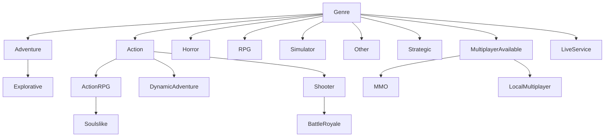

# Plan: Single-parent genre hierarchy in GAME\_CATALOG

## 1. Context

- `ONTOLOGY_DEMO.GAME_CATALOG.GENRE_RULES.PARENT_GENRES` is a JSON-array VARCHAR. 4 genres have 2 parents: ActionRPG, DynamicAdventure, Soulslike, BattleRoyale.

- `ONTOLOGY_DEMO.VIDEOWL.ONT_CLASS` is strictly single-parent (`PARENT_CLASS_NAME`). Its 47 `KG_EDGE subClassOf` edges each have 1 parent. VIDEOWL is read only, as the reference. It is not modified.

- Objects that read GENRE\_RULES (searched both the repo and `information_schema`):

  - DISJOINT\_GENRE\_PAIRS.sql reads `DISJOINT_WITH` only. Not affected.
  - SP\_CLASSIFY\_GAMES.sql reads `GENRE, RULE_DEFINITION` only. Not affected.
  - GENRE\_WHITESPACE\_ANALYSIS.sql **hardcodes** the list of parent genres to exclude (`'Genre','Action',...,'Multiplayer',...,'Shooter','Fighting'`). This is the only real dependent of the hierarchy. It must change to derive the list from the new column.
  - GENRE\_RULES.sql is the DDL file to update.

- No objects outside GAME\_CATALOG reference GENRE\_RULES.

## 2. Parent mapping (48 rows today: 47 genres plus the `Genre` root)

**From VIDEOWL** (genre exists in ONT\_CLASS and its parent is a genre class):

| Genre                                                                             | Current PARENT\_GENRES | New PARENT\_GENRE | Change? |
| --------------------------------------------------------------------------------- | ---------------------- | ----------------- | ------- |
| ActionRPG                                                                         | Action, RPG            | Action            | yes     |
| DynamicAdventure                                                                  | Action, Explorative    | Action            | yes     |
| Explorative                                                                       | Genre                  | **Adventure**     | yes     |
| Fighting, Platformer, Shooter, Stealth, Survival                                  | Action                 | Action            |         |
| InteractiveMovie, Metroidvania, VisualNovel                                       | Adventure              | Adventure         |         |
| FamiliarExploration, FantasyExploration                                           | Explorative            | Explorative       |         |
| Match, Scrolling                                                                  | Fighting               | Fighting          |         |
| Gore, Psychological, SurvivalHorror                                               | Horror                 | Horror            |         |
| Roguelike                                                                         | RPG                    | RPG               |         |
| FPS, TPS, Tactic                                                                  | Shooter                | Shooter           |         |
| DatingSim, DrivingSim, JobSim, Management, SandBox, Sport                         | Simulator              | Simulator         |         |
| Artistic, Educational, PuzzleGame                                                 | Other                  | Other             |         |
| Action, Adventure, Horror, MultiplayerAvailable, Other, RPG, Simulator, Strategic | Genre                  | Genre             |         |

**Best guess** (genre is not in VIDEOWL, or its VIDEOWL parent is not a genre):

| Genre                 | Current              | New                  | Rationale                                                                                                                                         |
| --------------------- | -------------------- | -------------------- | ------------------------------------------------------------------------------------------------------------------------------------------------- |
| Genre                 | (none)               | NULL (root)          | VIDEOWL says `Genre subClassOf Game`, but Game is an entity, not a genre. Keep Genre as the root.                                                 |
| BattleRoyale          | Shooter, Multiplayer | Shooter              | VIDEOWL parent `Realistic` is a Context class. Its rule requires `free_shooting`.                                                                 |
| Soulslike             | Action, RPG          | ActionRPG            | Rule = combat + character\_development + permadeath, a specialization of ActionRPG.                                                               |
| Cozy                  | Other                | Other                | Unchanged.                                                                                                                                        |
| LiveService           | Genre                | Genre                | Business-model genre with no closer parent.                                                                                                       |
| MMO                   | Multiplayer          | MultiplayerAvailable | VIDEOWL's multiplayer *genre* is MultiplayerAvailable.                                                                                            |
| LocalMultiplayer      | Multiplayer          | MultiplayerAvailable | Same reason.                                                                                                                                      |
| **Multiplayer** (row) | Genre                | **row deleted**      | In VIDEOWL, Multiplayer is a **Gameplay** class, not a genre. It stays as the feature category in GENRE\_CATEGORY\_MAP. This removes the homonym. |

Result: 47 rows (46 genres + root), every row with exactly one parent.



(Only changed or new edges are shown, plus their top levels.)

## 3. Implementation steps

1. **Backup.** Run on its own and wait for it to finish before any change (the last session's backup ran at the same time as the update and caught the new value): `CREATE TABLE GAME_CATALOG.BACKUP_GENRE_RULES_SINGLE_PARENT_20261009 CLONE GAME_CATALOG.GENRE_RULES;` Then check that the backup's ActionRPG row still has `["Action", "RPG"]`.

2. **Schema change** on GENRE\_RULES:

   - `ALTER TABLE ... ADD COLUMN PARENT_GENRE VARCHAR;`
   - `UPDATE` PARENT\_GENRE from the §2 mapping, using one `CASE` on GENRE. Rows that are unchanged copy the single value in `PARENT_GENRES[0]`. The 7 rows that change get explicit values.
   - `DELETE FROM GENRE_RULES WHERE GENRE = 'Multiplayer';`
   - Validate (step 5 checks). Then `ALTER TABLE ... DROP COLUMN PARENT_GENRES;`

3. **GENRE\_WHITESPACE\_ANALYSIS dynamic table.** Replace the hardcoded `leaf_genres` list with a derived one:

   ```sql
   WITH leaf_genres AS (
       SELECT r.GENRE FROM ONTOLOGY_DEMO.GAME_CATALOG.GENRE_RULES r
       WHERE r.RULE_DEFINITION IS NOT NULL
         AND NOT EXISTS (SELECT 1 FROM ONTOLOGY_DEMO.GAME_CATALOG.GENRE_RULES c
                         WHERE c.PARENT_GENRE = r.GENRE)
   )
   ```

   `CREATE OR REPLACE` it in Snowflake, and update the `.sql` file to match. Side effect to note: ActionRPG (now parent of Soulslike) and MultiplayerAvailable (now parent of MMO / LocalMultiplayer) stop being leaves. They drop out of the whitespace pairs. This is consistent with how Shooter and Fighting are already handled.

4. **New view `GAME_CATALOG.VW_GENRE_HIERARCHY`.** A recursive CTE over PARENT\_GENRE that returns `GENRE, PARENT_GENRE, DEPTH, PATH, IS_LEAF`. It gives the ontology one hierarchy source to read and makes cycle or orphan checks easy. Add sql/game\_catalog/views/VW\_GENRE\_HIERARCHY.sql.

5. **Update repo DDL.** In GENRE\_RULES.sql, replace `PARENT_GENRES VARCHAR` with `PARENT_GENRE VARCHAR`.

6. **Re-run classification and refresh.** Run `CALL SP_CLASSIFY_GAMES();` (no rule text changed; this confirms 37 rule rows) and `ALTER DYNAMIC TABLE GENRE_WHITESPACE_ANALYSIS REFRESH;`.

7. **Docs and memory.** In ontology-overview\.md:

   - §3.1: change "DAG / multiple inheritance" to "single-parent tree aligned to VIDEOWL".
   - §3.2: redraw the diagram.
   - §4.2: the SUBCLASS\_OF evidence becomes `GENRE_RULES.PARENT_GENRE`.
   - §7.4 and §8: update genre counts.
   - Add a VIDEOWL-vs-old-GENRE\_RULES mapping table, with the best-guess rows marked. Also add a memory note.

## 4. Verification

- `SELECT GENRE FROM GENRE_RULES WHERE PARENT_GENRE IS NULL` returns only `Genre`.
- Every PARENT\_GENRE exists as a GENRE (no orphans): an anti-join returns 0 rows.
- `VW_GENRE_HIERARCHY` resolves all 47 rows with DEPTH < 6. There are no cycles.
- A diff against VIDEOWL (`ONT_CLASS` join on name) shows a mismatch only for the best-guess rows in §2 (Genre, BattleRoyale).
- `GAME_GENRE_CLASSIFICATION` row count is unchanged (90 × 37 = 3,330; the earlier 38 included no Multiplayer rule, so expect 38 rules / 3,420 if the count is unchanged). FULL counts per genre match the backup.
- `GENRE_WHITESPACE_ANALYSIS` refreshes without error. Its pair count differs only by pairs involving ActionRPG and MultiplayerAvailable.
- `DISJOINT_GENRE_PAIRS` still returns 5 rows.

## 5. Critical Files

- sql/game\_catalog/tables/GENRE\_RULES.sql - column change
- sql/game\_catalog/dynamic\_tables/GENRE\_WHITESPACE\_ANALYSIS.sql - remove the hardcoded parent list
- sql/game\_catalog/views/VW\_GENRE\_HIERARCHY.sql - new hierarchy view
- ontology-overview\.md - documentation of the new tree
- `ONTOLOGY_DEMO.VIDEOWL.ONT_CLASS` - read-only reference for the mapping
