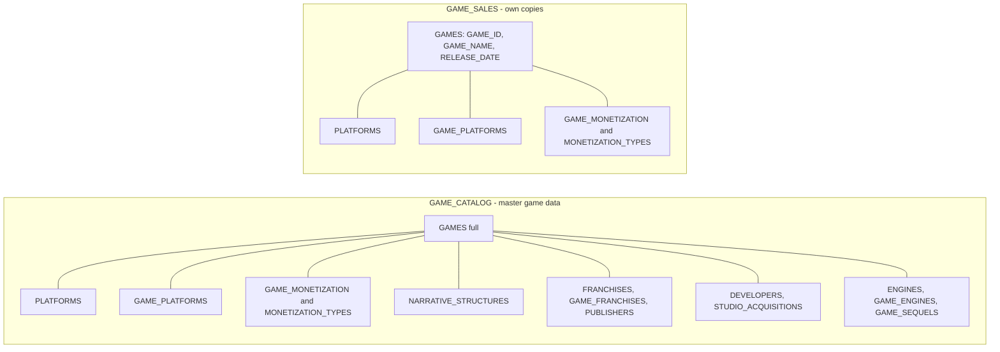

# Plan: Split GAMES_CORE into two independent systems (Sales and GameCatalog)

## Context

What I checked, all read-only:

**GAMES_CORE has 14 tables and nothing else:**
- GAMES (90 rows)
- PLATFORMS (20)
- GAME_PLATFORMS (153)
- MONETIZATION_TYPES (9)
- GAME_MONETIZATION (129)
- NARRATIVE_STRUCTURES (11)
- FRANCHISES (52)
- GAME_FRANCHISES (90)
- PUBLISHERS (1)
- DEVELOPERS (42)
- ENGINES (16)
- GAME_ENGINES (79)
- GAME_SEQUELS (39)
- STUDIO_ACQUISITIONS (19)

**What each system reads from GAMES_CORE (live object definitions):**

| System | Object | GAMES_CORE tables used |
|---|---|---|
| Catalog | `VW_GAME_PROFILE` | GAMES, NARRATIVE_STRUCTURES |
| Catalog | `VW_ACCESSIBILITY_GAPS` | GAMES |
| Catalog | `VW_GAME_OVERLAP_MATRIX` | GAME_PLATFORMS, PLATFORMS |
| Catalog | `VW_CANNIBALIZATION_CANDIDATES`, `SP_FIND_CANNIBALIZATION` | GAMES, FRANCHISES, GAME_FRANCHISES, PUBLISHERS |
| Catalog | `SP_CLASSIFY_GAMES` | GAMES, GAME_MONETIZATION, MONETIZATION_TYPES |
| Sales | `VW_PLATFORM_EXCLUSIVITY` | GAMES, GAME_PLATFORMS, PLATFORMS |
| Sales | `SP_GEN_CATALOG` | GAMES, GAME_PLATFORMS, GAME_MONETIZATION, MONETIZATION_TYPES |
| Sales | `SP_GEN_REVENUE_TARGETS`, `SP_GEN_DIGITAL_SALES` | GAMES (`RELEASE_DATE` only) |

**Other dependencies:**
- **Sales FKs into GAMES_CORE (declared, not enforced):**
  - `DIGITAL_PRODUCTS`, `DIGITAL_PRODUCT_TRANSACTIONS` and `SUBSCRIPTION_PLANS` reference GAMES.
  - `HARDWARE_PRODUCTS` and `CUSTOMER_ACCOUNTS` reference PLATFORMS.
  - `ADD_GAME_TMP` references GAMES and DEVELOPERS.
  - These must be re-pointed before GAMES_CORE can be dropped.
- **Dynamic tables:**
  - `GAME_SIMILARITY_SCORES` and `GENRE_WHITESPACE_ANALYSIS` sit on Catalog views.
  - `GAME_REVENUE` and `QUARTERLY_REVENUE` sit on `MONTHLY_REVENUE`, which doesn't touch GAMES_CORE.
- **Not affected:** VIDEOWL reads only its own `KG_NODE`, and no GAME_CATALOG table DDL references GAMES_CORE.
- **Text references:**
  - The add-game skill has 39 GAMES_CORE references.
  - In the project: `sql/games_core/` (14 files), 6 Catalog and 4 Sales view/procedure files, 6 Sales table files, the deferred `merge-sequels-into-franchises.plan.md`, and `ontology_setup/challenge2_same_entity_different_names.md`.

**Decisions you made:**
- The 5 tables nothing reads (DEVELOPERS, ENGINES, GAME_ENGINES, GAME_SEQUELS, STUDIO_ACQUISITIONS) go to **GAME_CATALOG**.
- Sales copies are **trimmed** to what Sales uses.
- New games reach both systems because **the skill writes to both**.

## Target layout

**GAME_SALES copies (5 tables):**
- `GAMES (GAME_ID, GAME_NAME, RELEASE_DATE)`.
- `PLATFORMS`, full; it has only 2 columns.
- `GAME_PLATFORMS`, full; the exclusivity view and the generator use every column.
- `MONETIZATION_TYPES (MONETIZATION_ID, MONETIZATION_NAME)`. DESCRIPTION is dropped.
- `GAME_MONETIZATION`.

`ADD_GAME_TMP` stays in GAME_SALES as the skill's staging table:
- Its GAME_ID FK re-points to `GAME_SALES.GAMES`.
- Its DEVELOPER, PUBLISHER and FRANCHISE IDs become plain columns, documented as IDs in GAME_CATALOG. Without that, Sales would depend on Catalog again.

## Implementation steps

1. **Baseline (read-only).** Record before/after fingerprints:
   - row count and `HASH_AGG(*)` for each of the 14 core tables and each affected view;
   - `GAME_SIMILARITY_SCORES` and `GENRE_WHITESPACE_ANALYSIS`;
   - `GAME_GENRE_CLASSIFICATION` (genre and match per game);
   - Sales totals: digital $19,231,852.01, subscriptions $35,634,616.54, hardware $175,660,810.62.
3. **Create the Catalog tables:**
   - For each of the 14 tables, take `GET_DDL`, rewrite `GAMES_CORE` to `GAME_CATALOG` so PKs and FKs point inside Catalog, create the table, then `INSERT ... SELECT` from the source.
   - Set autoincrement starts past the current max IDs (for example `GAME_PLATFORM_ID`). This also fixes the old counters, which were never advanced.
   - One statement per call.
4. **Create the Sales tables:** explicit DDL for the 5 trimmed tables, with PKs and FKs inside GAME_SALES, then `INSERT ... SELECT` from GAME_CATALOG's copies.
5. **Re-point the Sales FKs:**
   - On `DIGITAL_PRODUCTS`, `DIGITAL_PRODUCT_TRANSACTIONS`, `SUBSCRIPTION_PLANS`, `HARDWARE_PRODUCTS` and `CUSTOMER_ACCOUNTS`, drop the old FK constraints and add new ones pointing at `GAME_SALES.GAMES` or `GAME_SALES.PLATFORMS`.
   - On `ADD_GAME_TMP`, drop the DEVELOPER FK and re-point GAME_ID.
   - Update column comments that say `GAMES_CORE.PLATFORMS`.
6. **Re-point the Catalog objects:** recreate `VW_GAME_PROFILE`, `VW_ACCESSIBILITY_GAPS`, `VW_GAME_OVERLAP_MATRIX`, `VW_CANNIBALIZATION_CANDIDATES`, `SP_CLASSIFY_GAMES` and `SP_FIND_CANNIBALIZATION` with `GAMES_CORE.` changed to `GAME_CATALOG.`. Edit the `sql/` files first, then deploy from them.
7. **Re-point the Sales objects:** the same for `VW_PLATFORM_EXCLUSIVITY`, `SP_GEN_CATALOG`, `SP_GEN_REVENUE_TARGETS` and `SP_GEN_DIGITAL_SALES`, changing `GAMES_CORE.` to `GAME_SALES.`.
8. **Refresh the dynamic tables:** run `ALTER DYNAMIC TABLE ... REFRESH` on `GAME_SIMILARITY_SCORES` and `GENRE_WHITESPACE_ANALYSIS`, which may need re-initializing after their underlying views are replaced. Then `GAME_REVENUE` and `QUARTERLY_REVENUE`.
9. **Verify** (see Verification) while GAMES_CORE still exists. Then rename `GAMES_CORE` to `GAMES_CORE_RETIRED` and re-run the checks, which proves nothing still resolves to it.
11. **Project files:**
    - Move `sql/games_core/tables/*.sql` to `sql/game_catalog/tables/`, regenerated from `GET_DDL`.
    - Add the 5 Sales table files under `sql/game_sales/tables/`.
    - Regenerate the 6 Sales table files with changed FKs.
    - Delete `sql/games_core/`.
    - Update `ontology_setup/challenge2_same_entity_different_names.md`.
    - Update the deferred `merge-sequels-into-franchises.plan.md` to `GAME_CATALOG.GAME_FRANCHISES` / `GAME_SEQUELS`.
    - Leave the completed plans and `sql/game_sales/retired/` unchanged; they're history.
12. **Skill `add-game-data-ontology/SKILL.md`:**
    - Change the description and the schema list (lines 2, 10, 573).
    - Point all Catalog lookups, max-ID queries, inserts and verify queries at `GAME_CATALOG.*`.
    - Add a **"Sales copy"** step after Phase 4 that inserts each new game into `GAME_SALES.GAMES` (ID, name, release date), `GAME_SALES.GAME_PLATFORMS` (same GAME_PLATFORM_IDs) and `GAME_SALES.GAME_MONETIZATION`. New platforms or monetization types go into both lookup tables.
    - Add a consistency check: Sales and Catalog GAME_ID, name and release date must match.
    - Point Phase 6 at `SP_GENERATE_SALES`, which already reads only Sales tables after step 7.

## Verification

- **Data copied exactly:**
  - Each Catalog table's row count and `HASH_AGG` match the baseline.
  - Each Sales trimmed table matches `HASH_AGG` of the same columns from Catalog.
- **Outputs unchanged:**
  - Every affected view returns the same row count and `HASH_AGG` as the baseline.
  - The `GAME_SIMILARITY_SCORES` and `GENRE_WHITESPACE_ANALYSIS` hashes match.
  - `CALL SP_CLASSIFY_GAMES()` gives the same `GAME_GENRE_CLASSIFICATION` genre and match status per game.
- **Sales still reproduces:**
  - `CALL SP_GENERATE_SALES()` gives digital $19,231,852.01 (exactly matching targets), 0 unassigned units, subscriptions $35,634,616.54, and 712,438 hardware rows.
  - `MONTHLY_REVENUE` equals the `GAME_REVENUE` and `QUARTERLY_REVENUE` totals.
- **Independence:**
  - No view, procedure or function definition contains `GAMES_CORE`.
  - No GAME_SALES object references `GAME_CATALOG`, and vice versa. `SHOW IMPORTED KEYS` shows FKs only inside their own schema.
  - `grep -ri GAMES_CORE` finds matches only in history (completed plans, `retired/`) and in the memory note.
- **Retirement test:** after renaming GAMES_CORE to `GAMES_CORE_RETIRED`, every check above still passes before the final drop.

## Critical Files

- [SKILL.md](/Users/jwestra/.snowflake/cortex/skills/add-game-data-ontology/SKILL.md) - 39 GAMES_CORE references; gains the step that writes new games into both systems
- [sql/game_sales/stored_procedures/SP_GEN_CATALOG.sql](sql/game_sales/stored_procedures/SP_GEN_CATALOG.sql) - generator's main reader of game, platform and monetization data
- [sql/game_catalog/stored_procedures/SP_CLASSIFY_GAMES.sql](sql/game_catalog/stored_procedures/SP_CLASSIFY_GAMES.sql) - genre classifier that reads GAMES and monetization
- [sql/game_catalog/views/VW_CANNIBALIZATION_CANDIDATES.sql](sql/game_catalog/views/VW_CANNIBALIZATION_CANDIDATES.sql) - joins franchises and publishers (moves to Catalog)
- [sql/game_sales/tables/ADD_GAME_TMP.sql](sql/game_sales/tables/ADD_GAME_TMP.sql) - staging table whose cross-system FKs change
