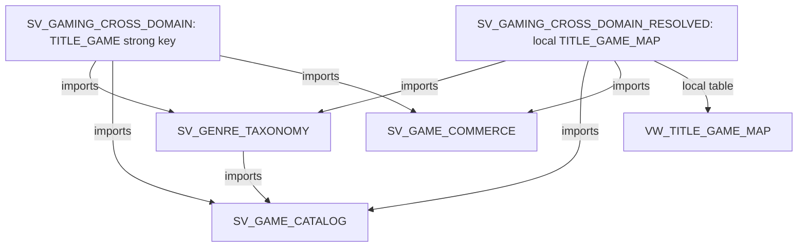
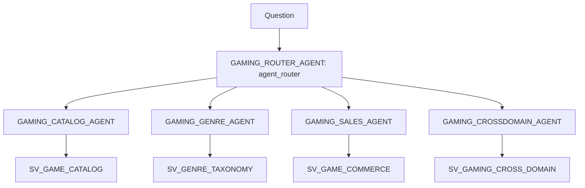

# Cross-domain composable semantic views

This subproject splits `yamls/gaming_baseline_sv.yaml` into one semantic view per Business Ontology domain, then puts them back together with **composable semantic views** (`IMPORTS`, private preview; [docs](https://docs.snowflake.com/en/LIMITEDACCESS/composable-semantic-views)).

Everything lives in `ONTOLOGY_DEMO.CROSS_DOMAIN`. Nothing in `ONTOLOGY_AGENTS` changes.



## The split

| View | Ontology domain | Logical tables | Relationships |
|---|---|---|---|
| `SV_GAME_CATALOG` | Game Catalog | GAMES, GAME_FRANCHISES | FRANCHISE_GAME |
| `SV_GENRE_TAXONOMY` | Genre Taxonomy | GENRE_CLASSIFICATION, GENRE_ROLLUP; imports SV_GAME_CATALOG for GAMES | GENRE_GAME, GENRE_ROLLUP_GAME |
| `SV_GAME_COMMERCE` | Game Commerce | 12 GAME_SALES tables (CUSTOMERS ... TITLES, TITLE_CODE_XREF) | 12 Sales-internal relationships |
| `SV_GAMING_CROSS_DOMAIN` | composed | none; imports all three | **TITLE_GAME**: TITLES(CATALOG_GAME_ID) to GAMES(GAME_ID) |
| `SV_GAMING_CROSS_DOMAIN_RESOLVED` | composed | **TITLE_GAME_MAP** on `VW_TITLE_GAME_MAP`; imports all three | TITLE_TO_MAP, MAP_TO_GAME |

- **Coverage.** The three domain views plus the strict composed view contain all 16 baseline tables and all 16 baseline relationships, each exactly once. `build_yamls.py` copies the definitions verbatim from the baseline and asserts this coverage.
- **No cross-domain knowledge in the domains.** `SV_GAME_COMMERCE` doesn't know about the Catalog, and `SV_GAME_CATALOG` doesn't know about Sales. Sales and Catalog are joined only in the composed views.
- **Diamond import.** `SV_GENRE_TAXONOMY` imports `SV_GAME_CATALOG`, and the composed views import both. GAMES appears once, so this diamond import is allowed.

## Two composed variants

A Sales title is not a Catalog game. `TITLES.TITLE_ID` (5001-5090) is its own key. Only 75 of the 90 titles carry `CATALOG_GAME_ID`. Another 13 resolve only through the PlayStation Store code crosswalk `TITLE_CODE_XREF`, and 2 only by name and release year.

- **`SV_GAMING_CROSS_DOMAIN` (strict)** keeps the baseline's strong-key join. It is the baseline rebuilt from domain parts, and its parity check must show 0 differences. Use it for the with-vs-without-ontology agent demo: title-to-game matching stays the ontology's job.
- **`SV_GAMING_CROSS_DOMAIN_RESOLVED`** puts the Business Ontology's Game Identity Match Rule into the semantic layer.
  - **Why a mapping view.** A relationship can only equi-join columns, so the three-route rule can't be a relationship. Instead it's materialized as rows in `VW_TITLE_GAME_MAP`, one per title with `MATCH_ROUTE` = STRONG/MEDIUM/WEAK.
  - **Who owns it.** The mapping belongs to the cross-domain layer, not to Commerce or Catalog. The resolved view adds it as a local table.
  - **Single path.** The map replaces `TITLE_GAME`, so there is only one path from titles to games.
  - **Transactions without a title ID** still reach their game through the product: Commerce's `TXN_PRODUCT` then `PRODUCT_TITLE`.

## Files

| Path | Purpose |
|---|---|
| `build_yamls.py` | Generates `yamls/*.yaml` from the baseline YAML. Re-run after editing the baseline. |
| `yamls/` | The five semantic view YAMLs (generated, committed) |
| `sql/vw_title_game_map.sql` | Cross-domain identity map (Game Identity Match Rule) |
| `sql/grants.sql` | Read access for `ONTOLOGY_APP_ROLE` |
| `deploy.py` | Ordered deploy: schema, map view, catalog, genre, commerce, strict, resolved, grants (`--dry-run` prints SQL) |
| `parity_check.sql` | Section 1: strict view vs `GAMING_BASELINE_SV`. Section 2: resolved view vs the eval-set answers. |

## Run

```bash
python3 cross-domain/build_yamls.py      # only if the baseline YAML changed
python3 cross-domain/deploy.py           # needs ACCOUNTADMIN on JWESTRA_AWS1
snow sql -c JWESTRA_AWS1 -f cross-domain/parity_check.sql
```

## Expected check results

- **Section 1:** `DIFF_ROWS = 0` for every check.
- **Section 2,** compared against `ontology_setup/ontology_eval_set.md`:

| Check | Expected (resolved) |
|---|---|
| Titles mapped | 90 (75/13/2) |
| Revenue across catalog games (Q4) | $19,231,852.01 |
| Top developer (Q5) | Santa_Monica_Studio $3,419,553.73 |
| Games with digital sales (Q18) | 87 |
| Ghost of Yōtei (Q3) | $198,000.00 |
| RPG revenue (Q22) | $13,436,693.28 |

  The strict column is computed, not hard-coded. Through the semantic view, strict revenue across catalog games is **$17,619,373.27**. The view reaches titles via the product, which recovers rows with no title ID, so it's higher than the eval's raw-SQL naive figure of $15,861,443.42.

## Preview limitations

- **Snowsight** can't open semantic views that use `IMPORTS`. Use SQL (`DESC SEMANTIC VIEW ... MODE = COMPACT | EXPANDED`, `SHOW SEMANTIC VIEWS`).
- **Replication** skips views with `IMPORTS`.
- **Late binding.** Imports resolve at query time, so dropping a domain view breaks the composed views. That's why `deploy.py` drops in reverse order and creates in dependency order.
- **Owner's access.** Imported base tables resolve under the source view owner's role.

## Results (deployed 2026-10-21)

`SHOW SEMANTIC VIEWS IN SCHEMA ONTOLOGY_DEMO.CROSS_DOMAIN` imports column:

| View | imports |
|---|---|
| SV_GAME_CATALOG | `[]` |
| SV_GAME_COMMERCE | `[]` |
| SV_GENRE_TAXONOMY | SV_GAME_CATALOG |
| SV_GAMING_CROSS_DOMAIN | SV_GAME_CATALOG, SV_GAME_COMMERCE, SV_GENRE_TAXONOMY |
| SV_GAMING_CROSS_DOMAIN_RESOLVED | SV_GAME_CATALOG, SV_GAME_COMMERCE, SV_GENRE_TAXONOMY |

There were no name collisions. Logical-table-scoped names such as `STATUS` on GAMES, CUSTOMERS and DIGITAL_PRODUCTS imported without renaming.

**Section 1, strict vs `GAMING_BASELINE_SV`:** all `DIFF_ROWS = 0`.

| Check | Rows | Diff |
|---|---|---|
| Digital gross revenue | 1 | 0 |
| Game count by roll-up genre (genre imports catalog) | 27 | 0 |
| Gross revenue by developer (cross-domain TITLE_GAME) | 38 | 0 |
| Hardware revenue by region | 5 | 0 |
| Customers by region and status | 15 | 0 |

**Section 2, resolved vs eval-set answers:** all match.

| Check | Expected | Resolved | Strict |
|---|---|---|---|
| Titles mapped | 90 (75/13/2) | 90 (75/13/2) | 75 |
| Revenue across catalog games (Q4) | 19,231,852.01 | 19,231,852.01 | 17,619,373.27 |
| Top developer (Q5) | Santa_Monica_Studio 3,419,553.73 | Santa_Monica_Studio 3,419,553.73 | Insomniac_Games 3,357,639.53 |
| Games with digital sales (Q18) | 87 | 87 | 72 |
| Ghost of Yōtei (Q3) | 198,000.00 | 198,000.00 | not found |
| RPG revenue (Q22) | 13,436,693.28 | 13,436,693.28 | 12,278,693.28 |

`ONTOLOGY_APP_ROLE` with no secondary roles can query `SV_GAMING_CROSS_DOMAIN_RESOLVED`.

## Agents (deployed 2026-10-21)

Five Cortex Agents live in `ONTOLOGY_DEMO.CROSS_DOMAIN`. Each domain agent has exactly one `cortex_analyst_text_to_sql` tool over its own semantic view, and no Business Ontology search. The router has only `agent_router`, a preview, undocumented tool; see `resources/cortex_agent_router_capability_summary.md`.



| Agent | Semantic view | Owns | Declines |
|---|---|---|---|
| `GAMING_CATALOG_AGENT` | `SV_GAME_CATALOG` | games, developers, publishers, franchises, release dates, lifecycle status | revenue, customers, genres |
| `GAMING_GENRE_AGENT` | `SV_GENRE_TAXONOMY` | genre membership, counts by genre, parent genres and subgenres | revenue, sales |
| `GAMING_SALES_AGENT` | `SV_GAME_COMMERCE` | digital, hardware and subscription revenue, customers, regions, products, SKUs, exclusivity | developer, franchise, genre |
| `GAMING_CROSSDOMAIN_AGENT` | `SV_GAMING_CROSS_DOMAIN` (strict) | revenue or sales combined with developer, franchise, genre or catalog game | |
| `GAMING_ROUTER_AGENT` | none | routes to one specialist, or several in parallel, and combines the answers | answering data questions itself |

Files: `agents/*.yaml` (specs), `deploy_agents.py` (domain agents, then router, then `USAGE` grants to `ONTOLOGY_APP_ROLE`; `--dry-run`), `agent_routing_check.sql`.

```bash
python3 cross-domain/deploy_agents.py          # after deploy.py
snow sql -c JWESTRA_AWS1 -f cross-domain/agent_routing_check.sql
```

### Routing results

Run as `ONTOLOGY_APP_ROLE` with no secondary roles.

| # | Question | Expected | Routed to | Answer |
|---|---|---|---|---|
| 1 | How many games has Santa Monica Studio developed? | catalog | Catalog agent | 6 games |
| 2 | How many RPG games are there? | genre | Genre agent | 43 |
| 3 | What was hardware revenue in North America? | sales | Sales agent | $70,243,201.72 |
| 4 | Which developer earned the most revenue? | crossdomain | Cross-domain agent | Insomniac Games, ~$3.36M |
| 5 | How many Horror games are there, and what was total subscription revenue? | genre + sales | Genre agent and Sales agent (`direct_route: false`, split into two sub-questions) | 11 Horror games; $35,634,616.54 |
| 6 | (Catalog agent directly) What was hardware revenue in North America? | decline | no tool call | "outside the Game Catalog domain" |

- **Q4 is strict by design.** The crossdomain agent uses the strict view, so it returns the strong-key answer: Insomniac $3,357,639.53, the same as `GAMING_BASELINE_SV`. The governed answer, Santa_Monica_Studio $3,419,553.73, needs `SV_GAMING_CROSS_DOMAIN_RESOLVED` or the Business Ontology.
- **Router call fields.** Each `agent_router` tool call records `subagent_name`, `display_name`, `direct_route` and `planned_followup_tools_and_agents`, which is how the check reads the routing.

### Agent caveats

- **Router not shown in Snowsight.** Snowsight doesn't list the router's subagents as tools, and it can't open `SV_GENRE_TAXONOMY` or the composed views because they use `IMPORTS`. Use SQL (`DESCRIBE AGENT`, `DATA_AGENT_RUN`) or REST instead.
- **Preview validation.** `CREATE AGENT` doesn't validate preview tool types. After any change, check the router spec with `DESCRIBE AGENT ONTOLOGY_DEMO.CROSS_DOMAIN.GAMING_ROUTER_AGENT`.
- **Literal requests only.** `DATA_AGENT_RUN` needs a constant request string, so the check file runs one statement per question.
