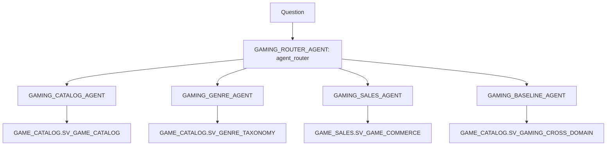

# Router demo (optional)

An optional demo of a front-door agent that routes each question to the domain agent that owns it.
It is not part of the with/without-ontology comparison, and none of these agents use Business Ontology search.
All agents live in `ONTOLOGY_DEMO.AGENTS` and deploy with `bash install.sh --only 03`.
Specs: `agents/router/*.yaml`.



| Agent | Semantic view | Owns | Declines |
|---|---|---|---|
| `GAMING_CATALOG_AGENT` | `SV_GAME_CATALOG` | games, developers, publishers, franchises, release dates, lifecycle status, ratings, engines, modes, awards, accessibility | revenue, customers, genres |
| `GAMING_GENRE_AGENT` | `SV_GENRE_TAXONOMY` | genre membership, counts by genre, parent genres and subgenres, mechanics, similarity | revenue, sales |
| `GAMING_SALES_AGENT` | `SV_GAME_COMMERCE` | digital, hardware and subscription revenue, customers, regions, products, SKUs, exclusivity | developer, franchise, genre |
| `GAMING_BASELINE_AGENT` | `SV_GAMING_CROSS_DOMAIN` | questions that combine sales with catalog or genre data | |
| `GAMING_ROUTER_AGENT` | none | routes to one specialist, or several in parallel, and combines the answers | answering data questions itself |

The cross-domain specialist is the same `GAMING_BASELINE_AGENT` used in the eval, so a cross-domain question through the router gets the baseline's strong-key-only answer. Title-to-game matching stays the ontology's job.

## Routing check

```bash
snow sql -c ONTOLOGY_DEMO_CONN -f scripts/agent_routing_check.sql
```

It runs as `ONTOLOGY_APP_ROLE` with no secondary roles. Each `agent_router` tool call records `subagent_name`, `display_name`, `direct_route` and `planned_followup_tools_and_agents`, and the check reads the routing from those fields.

## Caveats

- **Preview tool.** `agent_router` is a preview, undocumented tool. `CREATE AGENT` doesn't validate preview tool types, so after any change check the spec with `DESCRIBE AGENT ONTOLOGY_DEMO.AGENTS.GAMING_ROUTER_AGENT`.
- **Snowsight.** Snowsight doesn't list the router's subagents as tools, and it can't open semantic views that use `IMPORTS` (`SV_GENRE_TAXONOMY`, `SV_GAMING_CROSS_DOMAIN`). Use SQL (`DESCRIBE AGENT`, `DATA_AGENT_RUN`) or REST instead.
- **Literal requests only.** `DATA_AGENT_RUN` needs a constant request string, so the check file runs one statement per question.
