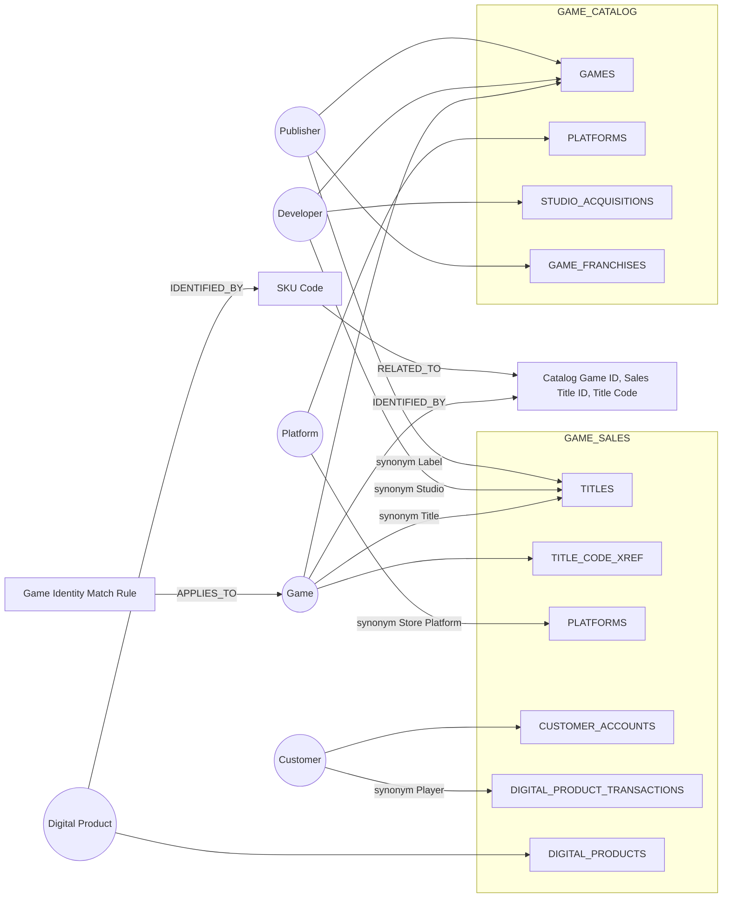
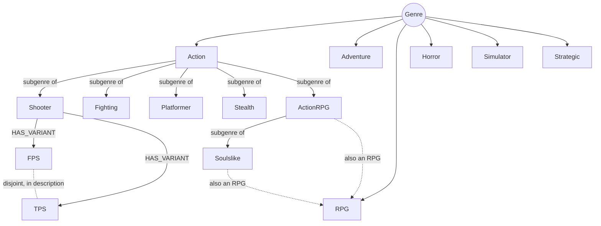

# Business Ontology build guide: ONTOLOGY_DEMO (gaming)

A phased, copy-paste guide for building a Snowflake **Business Ontology** on the deliberately complex `ONTOLOGY_DEMO.GAME_CATALOG` and `ONTOLOGY_DEMO.GAME_SALES` systems.

- **Format:** follows the *Getting Started with Business Ontology* guide (SAP example), adapted to gaming.
- **How to use it:** every prompt runs in Cortex Code (CoCo) with the `$business-ontology` skill.
- **Testing:** the matching with/without-ontology questions are in [ontology_eval_set.md](ontology_eval_set.md).

**Inputs:**
- [README_ontology_games_challenges.md](README_ontology_games_challenges.md): where every concept physically lives in the complex data.
- [ontology-overview.md](ontology-overview.md): the original class, relationship and genre analysis.

**Status (2026-10-13): BUILT.**

Phases 1-7 are live in Business Ontology, read back from the glossary:

| Item | Live count |
|---|---|
| Domains | 3 |
| Terms | 70 ACTIVE (22 ENTITY, 15 METRIC, 33 TERM), 0 drafts |
| Relationships | 93 |
| Representations | 75 |

Phase 8 objects are created:
- `ONTOLOGY_DEMO.GAME_CATALOG.SV_GAMING_CROSS_DOMAIN` (naive semantic view; imports `SV_GAME_CATALOG`, `SV_GENRE_TAXONOMY` and `GAME_SALES.SV_GAME_COMMERCE`, which together cover all 57 tables and views)
- `GAMING_BASELINE_AGENT` (semantic view only)
- `GAMING_BON_AGENT` (BON search + semantic view; the 3 required settings were verified with `DESCRIBE AGENT`)

**Pending:** the Business Ontology search index. `cortex search object ... --types=business-ontology` returned no results right after the build. Run the evaluation only after the Phase 6 search checks return the canonical nodes.

**How to rebuild:**
- Everything installs with `bash install.sh` from the repo root (see the README).
- Glossary content lives in `scripts/build_ontology.py`. `scripts/generate_install_sql.py` turns it into `install/04a-build-ontology.sql` (first install: domains, terms, relationships, representations) and `install/04b-refresh-ontology.sql` (in-place description and formula refresh). Install step 04 picks one based on whether the domains exist.
- The semantic views are `semantic_views/*.yaml` (line 1 of each names its target schema); the agents are `agents/GAMING_BASELINE_AGENT.yaml` and `agents/GAMING_BON_AGENT.yaml`, deployed to `ONTOLOGY_DEMO.AGENTS`. Deploy them with `bash install.sh --only 03`.

---

## What you'll build

| Object | Count | Purpose |
|---|---|---|
| Domains | 3 | Game Catalog, Game Commerce, Genre Taxonomy |
| Entity nodes | 22 | Business objects. 5 are **canonical classes** that span both systems |
| Metric nodes | 15 | Formulas with business rules, traps and reference answers |
| Terms | 33 | 5 identifier/policy terms, 14 code-mapping terms, 14 curated genres (`itemKind: TERM`) |
| Relationships | 93 | Typed edges within and across domains (identity 8, catalog 11, commerce 17, genre 41, metric lineage 16) |
| Representations | about 60 | Every node linked to every system object that realizes it (required, D15) |
| Cortex Agent | 1 | Follow-on (Phase 8): BON search + semantic view, scored against the evaluation set |

---

## Decision log

These decisions shape every phase. Keep them when you extend the ontology or rerun the tests.

| # | Decision | Reason |
|---|---|---|
| D1 | **One canonical class per real-world entity.** Every local name is a synonym, and every system's table or column is a representation. No per-system duplicate nodes. | Challenge 2 in [README_ontology_games_challenges.md](README_ontology_games_challenges.md): "the ontology defines one canonical class, and synonyms collapse the local names." The agent must answer cross-system questions without local vocabulary. |
| D2 | **Game (not Title) is the class**, owned by Game Catalog. Title, Store Title and Product Title are synonyms. `TITLES` and `TITLE_CODE_XREF` are representations of Game. | Title and Game are the same thing in two systems. Two nodes linked by `EQUIVALENT_TO` would force the agent to know the local word. |
| D3 | The same pattern applies to **Platform** (Console, Store Platform), **Developer** (Studio), **Publisher** (Label, SIE) and **Customer** (Player, Subscriber, Buyer, Account). | Same reason as D1. |
| D4 | **Owner domain = who governs the definition**, not where rows live. One node belongs to one domain; edges and representations may cross schemas. | The API takes one `domainName` per term. Multi-domain membership is not verified, so it is not used. |
| D5 | **Identity is modelled as identifier terms, not extra classes.** Game is identified by Catalog Game ID, Sales Title ID and Title Code; Digital Product is identified by SKU Code. The **Game Identity Match Rule** (strong, then medium, then weak) applies to Game and to Game Revenue. | Challenges 3 and 4. Identifiers are keys of one class, not separate entities. |
| D6 | `EQUIVALENT_TO` is used **only** for SIE Region Code vs Sales Region Code. | Those are two distinct code fields, each with its own value list, that mean the same thing. That is not the same as one entity seen in two systems. |
| D7 | **Curated genre layer:** 14 genre TERM nodes (6 top-level, 8 subgenres) with synonyms, membership and roll-up rules. The other 32 genres stay as values in `GENRE_RULES`, listed in the Genre Rule term. | Genre is the main way catalog questions are asked, and synonyms need nodes. Not all 46, because of: drift against the executable `GENRE_RULES` (rule B-02); 17 rules that cannot match; and genres that fail the altitude test (B-05). |
| D8 | **Genre hierarchy edges:** `HAS_VARIANT` only for Shooter to FPS/TPS (single POV axis, rule R-07). `RELATED_TO` labelled "subgenre of" everywhere else. Cross-parent links: ActionRPG and Soulslike `RELATED_TO` RPG. | There is no subclass relationship type; the skill says to use `RELATED_TO` honestly. The RPG cross-links restore what the single-parent table lost. |
| D9 | **Do NOT fix the RPG gap in `GENRE_RULES`.** The table stays single-parent, so RPG rolls up to 0 games by the strict tree. Only the ontology says "ActionRPG is also an RPG". | User decision. The gap is a deliberate with/without-ontology test. Do not raise it again. |
| D10 | **Excluded as genres:** Other (a catch-all bucket); MMO, LocalMultiplayer and MultiplayerAvailable (play modes, overview §7); LiveService (a business model, covered by the Monetization Model term). | Altitude test (B-05). |
| D11 | **SKUs:** Digital Product (synonyms SKU, Add-on) is identified by the **SKU Code** term, which documents the format `<TitleCode>-C<CATEGORY_ID><seq>`. SKU Code is `RELATED_TO` Title Code. Game and Digital Product carry a **grain warning**: one game is sold as many SKUs, so count games, not products. | 354 products (about 3.9 per title, up to 25). 350 have a SKU; 4 do not (PC-only, no store code). A SKU prefix traces to a Game through the crosswalk. |
| D12 | The **Revenue Type Code** term flags that `BASE_GAME_PHYSICAL` sits in the `DIGITAL` category group. | "Digital revenue by group" silently includes $7,881,147.58 of physical editions. |
| D13 | The **`TITLE_CODE_XREF` value is stated as a revenue split** in the Game Revenue description: strong 72 titles / $17,619,373.27; medium (crosswalk) 13 / $1,382,678.74; weak (name + year) 2 / $229,800.00. | It makes the cost of skipping each identity route explicit. |
| D14 | Genre rules go in **descriptions**, not formulas. Only METRIC nodes take a formula. `GENRE_RULES` is named as the executable source. | API constraint; limits drift. |
| D15 | **Representations (Phase 7) are required**, not optional. | They are how D1-D3 work physically: each canonical class is linked to every system's object. |
| D16 | ~~Documentation only.~~ **Superseded 2026-10-13: built.** Phases 1-7 live in Business Ontology; Phase 8 semantic view and agents created. | The user asked to implement the phases. |
| D17 | **No answers in ontology text.** Descriptions give grain, gross vs net, filters, additivity and pitfalls, never an expected value, trap value, member count or eval example. Expected values live only in `ontology_eval_set.md`. `build_ontology.py` fails the build on a leak. Applied 2026-10-14 with `SYSTEM$UPDATE_GLOSSARY_TERM` (now `install/04b-refresh-ontology.sql`); every metric also got a column representation, so there are 92 representations in total. | An agent that can read the answer proves nothing about whether the ontology helps it reason. |

---

## Phase 1: Create domains

```
$business-ontology Create three domains: Game Catalog, Game Commerce, Genre Taxonomy
```

The skill calls `SYSTEM$CREATE_GLOSSARY_DOMAIN()` for each domain. Domains are created immediately, with no draft step.

| Domain | Governs |
|---|---|
| Game Catalog | What a game *is*: Game, Platform, Developer, Publisher, Franchise, Engine, modes, ratings |
| Game Commerce | How a game *earns money*: Customer, products, transactions, subscriptions, revenue types |
| Genre Taxonomy | How a game is *classified*: Genre and its features, plus the curated genre layer |

---

## Phase 2: Add entity nodes (22)

Each entity description names **every physical location** (D1, D15) and the key traps.

### 2a. Canonical classes (5): one node, many local names

```
$business-ontology Add the following entities:

Game Catalog domain:
1. Game. Synonyms: Title, Store Title, Product Title.
   Master record: ONTOLOGY_DEMO.GAME_CATALOG.GAMES (GAME_ID, GAME_NAME, RELEASE_DATE as DATE,
   STATUS, POV). The Sales system calls a game a TITLE: ONTOLOGY_DEMO.GAME_SALES.TITLES
   (TITLE_ID 5001-5090 is a Sales-only key; CATALOG_GAME_ID links to GAMES.GAME_ID but is NULL
   for 15 titles; RELEASE_DATE is text YYYYMMDD). Store codes are in GAME_SALES.TITLE_CODE_XREF.
   8 Sales names differ from the catalog: GT7 = Gran Turismo 7, Ghost of Yotei = Ghost of Yōtei,
   DEATH STRANDING 2 = Death Stranding 2: On the Beach, Spider-Man 2 = Marvel's Spider-Man 2,
   God of War Ragnarok = God of War Ragnarök, Ratchet and Clank Rift Apart = Ratchet & Clank: Rift Apart,
   The Last of Us Part 1 = The Last of Us Part I, Demons Souls = Demon's Souls.
   To match a Title to a Game, use the Game Identity Match Rule.
   GRAIN: one game is sold as many SKUs (Digital Products). Count games, not products.
   To count games with sales, resolve each sale to a catalog GAME_ID first, then COUNT(DISTINCT GAME_ID).

2. Platform. Synonyms: Console, Store Platform, System.
   Catalog: GAME_CATALOG.PLATFORMS (PLATFORM_NAME like PS5, PS4, Pc_gaming, XBOX_ONE).
   Sales: GAME_SALES.PLATFORMS (same PLATFORM_ID values; PLATFORM_NAME like PlayStation 5,
   PC (Steam); PLATFORM_CODE like PS5, PC). PLATFORM_ID is the only key shared by both systems.
   Not the same as the Platformer genre.

3. Developer. Synonyms: Studio, Development Studio.
   No table of its own. Catalog: GAMES.DEVELOPER_ID, GAMES.DEVELOPER_NAME (Santa_Monica_Studio),
   GAMES.DEVELOPER_IS_INDIE; GAME_CATALOG.STUDIO_ACQUISITIONS.STUDIO_NAME.
   Sales: TITLES.STUDIO (Santa Monica Studio, spaces instead of underscores).
   NOT ENGINES.DEVELOPER_COMPANY (that is the engine vendor).

4. Publisher. Synonyms: Label, Publishing Label, SIE.
   No table of its own. Catalog: GAMES.PUBLISHER_ID / PUBLISHER_NAME (Sony Interactive Entertainment)
   / PUBLISHER_HQ; GAME_FRANCHISES.PUBLISHER_ID. Sales: TITLES.PUBLISHER_LABEL = 'SIE';
   HARDWARE_PRODUCTS.MANUFACTURER = 'Sony Interactive Entertainment'.

Game Commerce domain:
5. Customer. Synonyms: Player, Subscriber, Buyer, Account, Customer Account.
   GAME_SALES.CUSTOMER_ACCOUNTS.CUSTOMER_ID. The same key is called PLAYER_ID in
   DIGITAL_PRODUCT_TRANSACTIONS, SUBSCRIBER_ID in SUBSCRIPTION_CHARGES and BUYER_ID in
   HARDWARE_SALES_TRANSACTIONS. Region uses SIE codes; status is A/S/C (see terms).
   Not GAME_MODES MIN_PLAYERS/MAX_PLAYERS (those are headcounts, not customers).
```

### 2b. Other entities (17)

```
$business-ontology Add the following entities:

Game Catalog domain:
6. Franchise. No table of its own: GAME_CATALOG.GAME_FRANCHISES (FRANCHISE_ID, FRANCHISE_NAME,
   FIRST_RELEASE_YEAR, SEQUENCE_ORDER, PUBLISHER_ID, RELATED_GAME_ID, RELATIONSHIP_TYPE).
   The name is also copied in GAMES.FRANCHISE_NAME. Sequel links are RELATED_GAME_ID + RELATIONSHIP_TYPE
   and may point to a game in another franchise.
7. Engine. GAME_CATALOG.ENGINES, GAME_ENGINES (version, custom fork). ENGINES.DEVELOPER_COMPANY
   is the engine vendor, not the game's Developer.
8. Game Mode. GAME_CATALOG.GAME_MODES (MODE_NAME, MIN_PLAYERS, MAX_PLAYERS, ONLINE_REQUIRED).
9. Age Rating. GAME_CATALOG.AGE_RATINGS (RATING_SYSTEM, RATING_VALUE, MIN_AGE), GAME_RATINGS.

Genre Taxonomy domain:
10. Genre. GAME_CATALOG.GENRE_RULES (46 rows, single parent PARENT_GENRE, RULE_DEFINITION,
    DISJOINT_WITH) and GAME_CATALOG.VW_GENRE_HIERARCHY (depth, path, leaf). Membership is inferred
    per game in GAME_GENRE_CLASSIFICATION: a game is in a genre only when MATCH_STATUS = 'FULL'.
    A parent genre's members are the union of its descendants' members. See the Genre Rule term
    and the curated genre terms.
11. Feature Category. GAME_CATALOG.GENRE_CATEGORY_MAP (Combat, Exploration, Multiplayer, Choice...)
    groups concrete feature values for genre rules.
12. Gameplay Type. GAMEPLAY_TYPES + GAME_GAMEPLAY (free_shooting, Co-op, OpenWorld...).
13. Mechanic. MECHANICS + GAME_MECHANICS (permanent_death, crafting, QTE...).
14. Context. CONTEXTS + GAME_CONTEXTS (setting/theme: historical, mithical, zombies_invasion...).
15. Narrative Structure. NARRATIVE_STRUCTURES via GAMES.NARRATIVE_STRUCTURE_ID.

Game Commerce domain:
16. Digital Product. Synonyms: SKU, Add-on, Store Product. GAME_SALES.DIGITAL_PRODUCTS
    (DIGITAL_PRODUCT_ID, TITLE_ID, CATEGORY_ID, PRODUCT_NAME, LIST_PRICE, IS_CONSUMABLE, SKU_CODE,
    STATUS). GRAIN: many products per game; a product count is not a game count.
17. Hardware Product. GAME_SALES.HARDWARE_PRODUCTS (consoles, peripherals, PLATFORM_ID).
18. Subscription Plan. GAME_SALES.SUBSCRIPTION_PLANS (PlayStation Plus tiers, annual billing).
19. Digital Transaction. GAME_SALES.DIGITAL_PRODUCT_TRANSACTIONS (PLAYER_ID = customer,
    TITLE_ID is NULL for every 10th row; recover the game via DIGITAL_PRODUCT_ID ->
    DIGITAL_PRODUCTS.TITLE_ID. GROSS_REVENUE, PLATFORM_COMMISSION_PCT, NET_DEVELOPER_REVENUE
    = publisher share).
20. Hardware Sale. GAME_SALES.HARDWARE_SALES_TRANSACTIONS (BUYER_ID = customer, REGION in
    NA/EU/JP/ASIA/LATAM, GROSS_REVENUE).
21. Subscription Charge. GAME_SALES.SUBSCRIPTION_CHARGES (SUBSCRIBER_ID = customer, PLAN_ID,
    billing period, GROSS_REVENUE).
22. Revenue Type. GAME_SALES.REVENUE_TYPES (CATEGORY_ID, MONETIZATION_TYPE = what was sold,
    CATEGORY_GROUP = DIGITAL / HARDWARE / SUBSCRIPTION).
```

For each entity the skill calls `SYSTEM$DRAFT_GLOSSARY_TERM` with `itemKind: "ENTITY"` and approves it when you confirm.

---

## Phase 3: Add metric nodes with formulas (15)

Each formula is written against the **canonical class**. Descriptions state the grain, gross vs net, filters, additivity and the trap, but **never the answer** (D17). Expected values live only in [ontology_eval_set.md](ontology_eval_set.md). The exact live text is in `scripts/build_ontology.py`, and its build fails if a description contains an eval value.

```
$business-ontology Add the following metrics with formulas:

Game Commerce domain:
1. Digital Gross Revenue
   Formula: SUM(GROSS_REVENUE) FROM GAME_SALES.DIGITAL_PRODUCT_TRANSACTIONS
   Description: Gross value of all digital store sales, before commission. Grain: one row per purchase.
   Do NOT filter TITLE_ID IS NOT NULL: about 1 in 10 rows has no TITLE_ID but still belongs to a game
   through DIGITAL_PRODUCT_ID. Region via PLAYER_ID -> CUSTOMER_ACCOUNTS. Additive.

2. Net Publisher Revenue
   Formula: SUM(NET_DEVELOPER_REVENUE) FROM DIGITAL_PRODUCT_TRANSACTIONS
            (= GROSS_REVENUE * (1 - PLATFORM_COMMISSION_PCT))
   Description: What the Publisher keeps after the store commission. The column is named
   NET_DEVELOPER_REVENUE but it is the PUBLISHER share, not the Developer's. Grain: one row per purchase. Additive.

3. Platform Commission Revenue
   Formula: SUM(GROSS_REVENUE - NET_DEVELOPER_REVENUE) FROM DIGITAL_PRODUCT_TRANSACTIONS
   Description: The store's cut of digital sales; the only part of digital the platform keeps. Additive.

4. Hardware Revenue
   Formula: SUM(GROSS_REVENUE) FROM GAME_SALES.HARDWARE_SALES_TRANSACTIONS
   Description: Gross consoles and peripherals. Grain: one row per hardware purchase. REGION here uses
   NA/EU/JP/ASIA/LATAM (Sales Region Code), not the SIE codes used on customers. Additive.

5. Subscription Revenue
   Formula: SUM(GROSS_REVENUE) FROM GAME_SALES.SUBSCRIPTION_CHARGES
   Description: Gross PlayStation Plus billing. Grain: one row per subscription charge. No commission.
   No region column: join SUBSCRIBER_ID to CUSTOMER_ACCOUNTS. Additive.

6. Total Platform Revenue
   Formula: Hardware Revenue + Platform Commission Revenue + Subscription Revenue
   Description: What the platform keeps business-wide. Digital counts only the commission, not
   the full digital gross. Pitfall: summing every GROSS_REVENUE column overstates it.

7. Active Customer Count
   Formula: COUNT(*) FROM GAME_SALES.CUSTOMER_ACCOUNTS WHERE STATUS = 'A'
   Description: Excludes S (suspended) and C (closed). STATUS here means account status, not game
   or listing status. Grain: one row per customer. REGION uses SIE codes (North America = 'SIEA').

8. Battle Pass Sales Revenue
   Formula: SUM(t.GROSS_REVENUE) FROM DIGITAL_PRODUCT_TRANSACTIONS t
            JOIN DIGITAL_PRODUCTS p USING (DIGITAL_PRODUCT_ID)
            JOIN REVENUE_TYPES r ON r.CATEGORY_ID = p.CATEGORY_ID
            WHERE r.MONETIZATION_TYPE = 'BATTLE_PASS'
   Description: Battle passes actually SOLD. Not the same as games tagged with a battle-pass business
   model in MONETIZATION_TYPES, which is a tag with no money attached. Additive.

9. Currently Exclusive Game Count
   Formula: COUNT(*) FROM GAME_SALES.GAME_PLATFORMS WHERE IS_EXCLUSIVE = 'Y' AND
            (EXCLUSIVITY_TYPE = 'PERMANENT' OR (EXCLUSIVITY_TYPE = 'TIMED' AND EXCLUSIVE_END >= CURRENT_DATE))
   Description: Game-platform pairs exclusive today. IS_EXCLUSIVE is text 'Y'/'N' in Sales
   (BOOLEAN in Catalog). Counts pairs, not games.

Game Catalog domain:
10. Game Revenue
    Formula: SUM(t.GROSS_REVENUE) FROM DIGITAL_PRODUCT_TRANSACTIONS t
             JOIN DIGITAL_PRODUCTS p USING (DIGITAL_PRODUCT_ID)
             -- title per row = COALESCE(t.TITLE_ID, p.TITLE_ID); game per title = Game Identity Match Rule
             GROUP BY resolved catalog GAME_ID
    Description: Revenue per catalog Game. Resolve each title to a Game via
    TITLES.CATALOG_GAME_ID, then TITLE_CODE_XREF.CATALOG_GAME_ID, then name + release year.
    Pitfall: joining on CATALOG_GAME_ID alone drops titles only the crosswalk or name + year resolve.
    Summed over all games it equals Digital Gross Revenue.

11. Developer Revenue
    Formula: Game Revenue grouped by GAMES.DEVELOPER_NAME
    Description: Resolve each sale to a catalog Game first (Game Identity Match Rule), then group.
    Developer has no table; Sales TITLES.STUDIO is the same studio spelled with spaces.

12. Franchise Revenue
    Formula: Game Revenue grouped by GAME_FRANCHISES.FRANCHISE_NAME
    Description: Resolve each sale to a catalog Game first, then group. Franchise has no table.

13. Active Catalog Game Count
    Formula: COUNT(*) FROM GAME_CATALOG.GAMES WHERE STATUS <> 'DELISTED'
    Description: Catalog games not delisted. Use GAMES.STATUS, not the account or listing STATUS.

Genre Taxonomy domain:
14. Genre Match Score
    Formula: MET_CONDITIONS / TOTAL_CONDITIONS FROM GAME_CATALOG.GAME_GENRE_CLASSIFICATION
    Description: Share of a genre rule's conditions a game meets. A game is a MEMBER of a genre only
    when MATCH_STATUS = 'FULL'. PARTIAL is not membership.

15. Weighted Overlap
    Formula: SUM(dimension overlap * SIMILARITY_WEIGHTS.WEIGHT) (GAME_SIMILARITY_SCORES.WEIGHTED_OVERLAP)
    Description: Similarity between two games. Cannibalization candidates: same Publisher and >= 0.3.
```

**Genre roll-up reference.** Games with a FULL match in the genre or any of its descendants, via `VW_GENRE_HIERARCHY`:

| Genre | Games | Note |
|---|---|---|
| Action | 68 | 14 subgenres |
| Strategic | 18 | leaf genre with a rule |
| Adventure | 13 | includes Explorative |
| Horror | 11 | |
| Simulator | 1 | most sim rules cannot be met |
| **RPG (strict tree)** | **0** | only Roguelike is under RPG in `GENRE_RULES` (D9) |
| **RPG (ontology-aware)** | **43** | RPG + Roguelike + ActionRPG + Soulslike (D8) |

---

## Phase 4: Add terms (33, `itemKind: TERM`)

Terms have no formula. The guide's scaling rule applies: **one term per code field, not per value**. The reference tables hold the full value lists, and the terms hold the meaning and the business rules.

### 4a. Identifier and policy terms (5)

```
$business-ontology Add the following terms:

Game Catalog domain:
1. Catalog Game ID. GAME_CATALOG.GAMES.GAME_ID. Also stored as GAME_SALES.TITLES.CATALOG_GAME_ID
   (NULL for some titles) and GAME_SALES.TITLE_CODE_XREF.CATALOG_GAME_ID.
2. Game Identity Match Rule. Policy for resolving a Sales title to a catalog Game, in order:
   (1) strong: TITLES.CATALOG_GAME_ID; (2) medium: TITLE_CODE_XREF.CATALOG_GAME_ID for the title;
   (3) weak: accent-folded lower-case name equal AND same release year
   (TITLES.RELEASE_DATE is text YYYYMMDD and may be the JP date).
   Apply all three routes; skipping (2) and (3) leaves titles unmatched and undercounts revenue.

Game Commerce domain:
3. Sales Title ID. GAME_SALES.TITLES.TITLE_ID (5001-5090), a Sales-only key that does NOT equal
   GAME_ID. Used in DIGITAL_PRODUCTS, Sales GAME_PLATFORMS, Sales GAME_MONETIZATION,
   DIGITAL_PRODUCT_TRANSACTIONS (NULL for every 10th row) and the revenue views.
4. Title Code. GAME_SALES.TITLE_CODE_XREF.TITLE_CODE, the PlayStation Store code per game and platform.
   Prefix: PPSA = PS5, CUSA = PS4, NPUA = PS3, PCSA = PS Vita, SLUS = PS2. PC and Switch releases have
   no code. 100 codes; 12 games have more than one (one per PlayStation generation).
   TITLE_CODE_XREF.CATALOG_GAME_ID is the only route to the catalog for some titles.
5. SKU Code. GAME_SALES.DIGITAL_PRODUCTS.SKU_CODE, format <TitleCode>-C<CC><SS>:
   prefix = the game's newest-generation Title Code, CC = REVENUE_TYPES.CATEGORY_ID (2 digits),
   SS = sequence within that title and category. Example PPSA97384-C0301 = Horizon Forbidden West,
   BASE_GAME_DIGITAL (not an eval SKU). Some products have no SKU (their game has no PlayStation code).
```

### 4b. Code-mapping terms (14)

```
$business-ontology Add the following terms:

Game Catalog domain:
6. Game Lifecycle Status. GAMES.STATUS: RELEASED, REMASTERED, DELISTED (Concord).
   Different from Account Status and Listing Status, which share the column name STATUS.
7. Franchise Relationship Type. GAME_FRANCHISES.RELATIONSHIP_TYPE: original, sequel, prequel,
   spinoff, remake, spiritual_successor. RELATED_GAME_ID may point to another franchise
   (Saros -> Returnal, The Inpatient -> Until Dawn).
8. Age Rating System. AGE_RATINGS.RATING_SYSTEM / RATING_VALUE. Approximate equivalents:
   ESRB E = PEGI 3 = CERO A; ESRB T is about PEGI 16 / CERO C; ESRB M = PEGI 18 = CERO Z.
9. Monetization Model. MONETIZATION_TYPES.MONETIZATION_NAME (both systems; lower case): premium,
   free_to_play, microtransactions, battle_pass, loot_boxes, dlc, subscription, ads, season_pass.
   A business-model TAG on a game; nothing priced. LiveService is a business model, not a genre.
   Do not confuse with Revenue Type Code (same words, what was actually sold).
10. Platform Code. One platform, two naming conventions. Catalog PLATFORMS.PLATFORM_NAME: PS5, PS4,
    PS3, PS2, PS_Vita, Pc_gaming, XBOX_ONE, Xbox_Series, Nintendo_Switch...
    Sales PLATFORMS.PLATFORM_CODE / PLATFORM_NAME: PS5 / PlayStation 5, PS4 / PlayStation 4,
    PSV / PlayStation Vita, PC / PC (Steam), NSW / Nintendo Switch... Join on PLATFORM_ID.

Game Commerce domain:
11. Revenue Type Code. REVENUE_TYPES.MONETIZATION_TYPE (upper case, 13 values): BASE_GAME_DIGITAL,
    BASE_GAME_PHYSICAL, DLC, EXPANSION, SEASON_PASS, BATTLE_PASS, COSMETIC_MICROTRANSACTION,
    CONSUMABLE_MICROTRANSACTION, LOOT_BOX, VIRTUAL_CURRENCY, HARDWARE_CONSOLE, HARDWARE_PERIPHERAL,
    SUBSCRIPTION. What was actually SOLD. WARNING: BASE_GAME_PHYSICAL is in CATEGORY_GROUP 'DIGITAL'
    so "digital" by group includes physical editions.
12. SIE Region Code. CUSTOMER_ACCOUNTS.REGION: SIEA = North America, SIEE = Europe, SIEJ = Japan,
    SIEAP = Asia-Pacific, SIELA = Latin America.
13. Sales Region Code. HARDWARE_SALES_TRANSACTIONS.REGION: NA, EU, JP, ASIA, LATAM.
14. Account Status. CUSTOMER_ACCOUNTS.STATUS: A = active, S = suspended, C = closed.
    Active customers = 'A' only.
15. Listing Status. DIGITAL_PRODUCTS.STATUS: LIVE, DELISTED (store availability of a product).
16. Exclusivity Flag. Sales GAME_PLATFORMS.IS_EXCLUSIVE is text 'Y'/'N' (Catalog uses BOOLEAN).
    Currently exclusive = PERMANENT, or TIMED with EXCLUSIVE_END >= today.

Genre Taxonomy domain:
17. POV Code. GAMES.POV: 1P = first person, 3P = third person.
18. Genre Match Status. GAME_GENRE_CLASSIFICATION.MATCH_STATUS: FULL = member; PARTIAL, NONE,
    UNEVALUABLE = not a member.
19. Genre Rule. GENRE_RULES is the executable source (used by SP_CLASSIFY_GAMES).
    RULE_DEFINITION syntax: hasX VALUE v (exact value), hasX SOME Category (any value in a
    GENRE_CATEGORY_MAP category), MIN/MAX (player count), NOT(...), INTERSECTION(...) = AND.
    PARENT_GENRE is single-parent BY DESIGN: ActionRPG and Soulslike sit under Action, so the strict
    tree gives RPG 0 games; the ontology links them to RPG. Disjoint pairs: FPS-TPS,
    MMO-LocalMultiplayer, Cozy-Horror, Artistic-Realistic, MMO-SinglePlayer.
    Genres held as values only (no node): DynamicAdventure, Survival, Explorative, FamiliarExploration,
    FantasyExploration, InteractiveMovie, Metroidvania, VisualNovel, Gore, Psychological,
    SurvivalHorror, Roguelike, Tactic, BattleRoyale, Match, Scrolling, DatingSim, DrivingSim, JobSim,
    Management, SandBox, Sport, Artistic, Educational, PuzzleGame, Cozy, Other, LiveService,
    MultiplayerAvailable, MMO, LocalMultiplayer, Genre (root).
```

### 4c. Curated genre terms (14, D7)

Each description carries the definition, the membership rule (FULL in `GAME_GENRE_CLASSIFICATION`; parents are the union of descendants), the parent, and its source value (`GENRE_RULES.GENRE = '<value>'`).

```
$business-ontology Add the following terms to the Genre Taxonomy domain:
20. Action. Synonyms: action games. Top-level. Members = union of Shooter, Fighting, Platformer,
    Stealth, Survival, ActionRPG, DynamicAdventure and their subgenres.
21. Adventure. Synonyms: adventure games. Top-level. Includes Explorative, InteractiveMovie,
    Metroidvania, VisualNovel.
22. RPG. Synonyms: role-playing game, roleplaying game. Top-level. Members = RPG + Roguelike +
    ActionRPG + Soulslike. ActionRPG and Soulslike sit under Action in GENRE_RULES;
    always include them. Count distinct games.
23. Horror. Synonyms: horror games. Top-level. Includes Gore, Psychological, SurvivalHorror.
    Disjoint with Cozy.
24. Simulator. Synonyms: sim, simulation game. Top-level. Includes DatingSim, DrivingSim, JobSim,
    Management, SandBox, Sport. Most sim rules are unmet by the data.
25. Strategic. Synonyms: strategy, strategy game. Top-level leaf.
26. Shooter. Synonyms: shooter games, gunplay. Parent Action. Rule hasGameplay VALUE free_shooting.
    Variants FPS and TPS (axis: point of view).
27. FPS. Synonyms: first-person shooter. Variant of Shooter with POV 1P. Disjoint with TPS.
    Use GENRE = 'FPS'; 'first-person shooter' is not a stored value.
28. TPS. Synonyms: third-person shooter. Variant of Shooter with POV 3P.
29. ActionRPG. Synonyms: action RPG, ARPG. Parent Action; also an RPG.
30. Soulslike. Synonyms: Soulsborne, souls-like. Parent ActionRPG; also an RPG. Its rule needs
    melee_combat and a difficulty attribute that do not exist in the data, so it has no FULL matches.
31. Fighting. Synonyms: fighter, versus fighting. Parent Action. Includes Match, Scrolling.
32. Platformer. Synonyms: platform game, platforming. Parent Action.
    Not the Platform entity.
33. Stealth. Synonyms: stealth action. Parent Action.
```

---

## Phase 5: Define relationships (93)

Allowed types: `HAS_VARIANT`, `HAS_PART`, `DERIVES`, `MEASURES`, `IDENTIFIED_BY`, `CLASSIFIES`, `APPLIES_TO`, `SCOPES`, `EQUIVALENT_TO`, `RELATED_TO`. No `CUSTOM`.

```
$business-ontology Define the following relationships:

Identity (D5, D11):
- Game identified by Catalog Game ID
- Game identified by Sales Title ID
- Game identified by Title Code
- Digital Product identified by SKU Code
- SKU Code is related to Title Code
- Game Identity Match Rule applies to Game
- Game Identity Match Rule applies to Game Revenue
- Platform Code classifies Platform

Game Catalog:
- Franchise has part Game
- Game has part Game Mode
- Developer is related to Game
- Publisher is related to Franchise
- Publisher is related to Developer            (studio acquisitions)
- Engine is related to Game
- Platform is related to Game
- Age Rating classifies Game
- Age Rating System classifies Age Rating
- Game Lifecycle Status classifies Game
- Franchise Relationship Type classifies Game

Cross-domain and Game Commerce:
- Game is related to Digital Product
- Platform is related to Customer
- Platform is related to Hardware Product
- Customer is related to Digital Transaction
- Customer is related to Hardware Sale
- Customer is related to Subscription Charge
- Digital Product is related to Digital Transaction
- Hardware Product is related to Hardware Sale
- Subscription Plan is related to Subscription Charge
- Revenue Type classifies Digital Product
- Revenue Type Code classifies Revenue Type
- Account Status classifies Customer
- Listing Status classifies Digital Product
- SIE Region Code classifies Customer
- Sales Region Code classifies Hardware Sale
- SIE Region Code equivalent to Sales Region Code      (D6: the only EQUIVALENT_TO)
- Monetization Model is related to Revenue Type Code   (same words, different meaning)

Genre Taxonomy:
- Feature Category classifies Gameplay Type
- Feature Category classifies Mechanic
- Feature Category classifies Context
- Gameplay Type classifies Game
- Mechanic classifies Game
- Context classifies Game
- Narrative Structure classifies Game
- POV Code classifies Game
- Genre classifies Game
- Genre Rule applies to Genre
- Genre Match Status applies to Genre
- Action, Adventure, RPG, Horror, Simulator, Strategic, Shooter, FPS, TPS, ActionRPG, Soulslike,
  Fighting, Platformer, Stealth: each classifies Game                        (14 edges)
- Shooter has variant FPS                       (D8: single axis, POV)
- Shooter has variant TPS
- Genre is related to Action, Adventure, RPG, Horror, Simulator, Strategic   (top level, 6 edges)
- Action is related to Shooter, Fighting, Platformer, Stealth, ActionRPG     (subgenre of, 5 edges)
- ActionRPG is related to Soulslike             (subgenre of)
- ActionRPG is related to RPG                   (D8/D9: cross-parent, "also an RPG")
- Soulslike is related to RPG                   (D8/D9: cross-parent)

Metric lineage:
- Digital Gross Revenue derives Net Publisher Revenue
- Digital Gross Revenue derives Platform Commission Revenue
- Digital Gross Revenue derives Game Revenue
- Game Revenue derives Developer Revenue
- Game Revenue derives Franchise Revenue
- Hardware Revenue derives Total Platform Revenue
- Platform Commission Revenue derives Total Platform Revenue
- Subscription Revenue derives Total Platform Revenue
- Game Revenue measures Game
- Active Customer Count measures Customer
- Active Catalog Game Count measures Game
- Battle Pass Sales Revenue measures Digital Product
- Genre Match Score measures Genre
- Weighted Overlap measures Game
- Account Status applies to Active Customer Count
- Game Lifecycle Status applies to Active Catalog Game Count
```

Not modelled as edges, because the vocabulary has no disjoint or instance-of type:
- Genre disjointness: kept in the Genre Rule and genre-term descriptions.
- Game-to-game sequel links: kept in Franchise Relationship Type and `GAME_FRANCHISES.RELATED_GAME_ID`.

Total: 93 edges (identity 8, catalog 11, commerce 17, genre 41, metric lineage 16). Use `SYSTEM$GET_GLOSSARY_GRAPH()` in Phase 6 as the authoritative count.

### Canonical classes across systems



### Curated genre layer



---

## Phase 6: Verify your ontology

```
$business-ontology Show me all the terms in the Game Catalog domain
```

```sql
SELECT SYSTEM$GET_GLOSSARY_SUMMARY();   -- expect 3 domains, 70 terms (22 ENTITY, 15 METRIC, 33 TERM)
SELECT SYSTEM$GET_GLOSSARY_GRAPH();     -- expect 93 relationships; drafts are invisible here
SELECT SYSTEM$APPROVE_ALL_GLOSSARY_RELATIONSHIPS();   -- only if drafts remain
```

**Search checks.** Each must return the canonical node, which proves local vocabulary resolves:

| Search | Must return |
|---|---|
| `cortex search object "title revenue" --types=business-ontology` | Game, Game Revenue |
| `"studio revenue"` | Developer, Developer Revenue |
| `"souls-like games"` | Soulslike |
| `"SKU"` | Digital Product, SKU Code |
| `"CUSA code"` | Title Code |

---

## Phase 7: Representations (required, D15)

Representations are what make D1-D3 work physically. **Link each canonical class to every system's object:**

```
$business-ontology Associate entities with their source tables and columns
(all in ONTOLOGY_DEMO):
- Game: GAME_CATALOG.GAMES; GAME_SALES.TITLES; GAME_SALES.TITLE_CODE_XREF
- Platform: GAME_CATALOG.PLATFORMS; GAME_SALES.PLATFORMS
- Developer: columns GAME_CATALOG.GAMES.DEVELOPER_NAME, GAME_CATALOG.STUDIO_ACQUISITIONS.STUDIO_NAME,
  GAME_SALES.TITLES.STUDIO
- Publisher: columns GAME_CATALOG.GAMES.PUBLISHER_NAME, GAME_CATALOG.GAME_FRANCHISES.PUBLISHER_ID,
  GAME_SALES.TITLES.PUBLISHER_LABEL, GAME_SALES.HARDWARE_PRODUCTS.MANUFACTURER
- Customer: GAME_SALES.CUSTOMER_ACCOUNTS; columns DIGITAL_PRODUCT_TRANSACTIONS.PLAYER_ID,
  SUBSCRIPTION_CHARGES.SUBSCRIBER_ID, HARDWARE_SALES_TRANSACTIONS.BUYER_ID
- Franchise: GAME_CATALOG.GAME_FRANCHISES; column GAMES.FRANCHISE_NAME
- Engine: GAME_CATALOG.ENGINES; Game Mode: GAME_MODES; Age Rating: AGE_RATINGS
- Genre: GAME_CATALOG.GENRE_RULES, VW_GENRE_HIERARCHY, GAME_GENRE_CLASSIFICATION
- Feature Category: GENRE_CATEGORY_MAP; Gameplay Type: GAMEPLAY_TYPES; Mechanic: MECHANICS;
  Context: CONTEXTS; Narrative Structure: NARRATIVE_STRUCTURES
- Digital Product: GAME_SALES.DIGITAL_PRODUCTS; Hardware Product: HARDWARE_PRODUCTS;
  Subscription Plan: SUBSCRIPTION_PLANS; Digital Transaction: DIGITAL_PRODUCT_TRANSACTIONS;
  Hardware Sale: HARDWARE_SALES_TRANSACTIONS; Subscription Charge: SUBSCRIPTION_CHARGES;
  Revenue Type: REVENUE_TYPES
```

**Terms to columns:**
- Catalog Game ID: `GAMES.GAME_ID`, `TITLES.CATALOG_GAME_ID`, `TITLE_CODE_XREF.CATALOG_GAME_ID`
- Sales Title ID: `TITLES.TITLE_ID`
- Title Code: `TITLE_CODE_XREF.TITLE_CODE`
- SKU Code: `DIGITAL_PRODUCTS.SKU_CODE`
- Game Lifecycle Status: `GAMES.STATUS`
- Franchise Relationship Type: `GAME_FRANCHISES.RELATIONSHIP_TYPE`
- Age Rating System: `AGE_RATINGS.RATING_SYSTEM`
- Monetization Model: both `MONETIZATION_TYPES.MONETIZATION_NAME`
- Platform Code: both `PLATFORMS.PLATFORM_NAME` and Sales `PLATFORM_CODE`
- Revenue Type Code: `REVENUE_TYPES.MONETIZATION_TYPE`
- SIE Region Code: `CUSTOMER_ACCOUNTS.REGION`
- Sales Region Code: `HARDWARE_SALES_TRANSACTIONS.REGION`
- Account Status: `CUSTOMER_ACCOUNTS.STATUS`
- Listing Status: `DIGITAL_PRODUCTS.STATUS`
- Exclusivity Flag: Sales `GAME_PLATFORMS.IS_EXCLUSIVE`
- POV Code: `GAMES.POV`
- Genre Match Status: `GAME_GENRE_CLASSIFICATION.MATCH_STATUS`
- Genre Rule: `GENRE_RULES.RULE_DEFINITION`
- 14 genre terms: `GENRE_RULES.GENRE`. Each description names its value; value-level representations are not verified as supported.

**Metrics:** link to the semantic view created in Phase 8.

**Lineage this enables:**
- "If I drop `TITLE_CODE_XREF`, what breaks?" returns Game, Title Code, SKU Code (via Title Code) and Game Revenue (via the match rule).
- "If I drop `TITLES`, what breaks?" returns Game, Sales Title ID, Developer, Publisher.

---

## Phase 8: Surfacing through a Cortex Agent (follow-on)

1. **Create a baseline semantic view** over both schemas, with tables, columns and joins only. It is deliberately naive: no synonyms, no business rules.
   - Joins: `TITLES.CATALOG_GAME_ID = GAMES.GAME_ID`; `DIGITAL_PRODUCT_TRANSACTIONS.TITLE_ID = TITLES.TITLE_ID`; `DIGITAL_PRODUCTS.TITLE_ID = TITLES.TITLE_ID`; `PLAYER_ID / SUBSCRIBER_ID / BUYER_ID = CUSTOMER_ID`; `PLATFORM_ID`; `CATEGORY_ID`.
2. **Create two agents** on that semantic view:
   - **Baseline agent:** the text-to-SQL tool only.
   - **BON agent:** text-to-SQL plus `snowscope_search` over the `businessOntology` corpus, following the guide's spec. It needs these three settings, none of which are validated at create time:
     - `experimental.EnableSnowscopeBusinessOntologySearch: true`
     - `tools[].tool_spec.type: snowscope_search`
     - `tool_resources.business_ontology.corpus: businessOntology`
   - Use the "search BON first, then query" orchestration instructions, a 24,000-token budget and a 90-second timeout.
3. **Run [ontology_eval_set.md](ontology_eval_set.md) against both agents** and score them with its results template. The expected outcome:
   - The baseline agent falls into the documented traps.
   - The BON agent matches the expected answers.

---

## Updating the ontology later

- **Regenerating data:** data generation was sunset on 2026-10-26; the data loads from `data/*.parquet`. If the data ever changes, follow [data-generation.md](data-generation.md), then re-run the evaluation SQL and update the evaluation set.
- **Adding games:** generate new data for the current schemas ([data-generation.md](data-generation.md)), then re-export the Parquet files.
- **Play modes:** the Play Mode remodel (overview §7) would add a Play Mode entity and remove MMO, LocalMultiplayer and MultiplayerAvailable from the Genre Rule value list.
