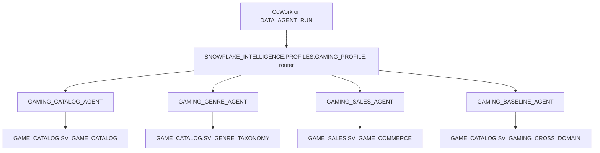

# Router demo as a CoWork profile (optional)

An optional demo of a CoWork profile that routes each question to the domain agent that owns it.
It is not part of the with/without-ontology comparison, and none of these agents use Business Ontology search.
Specs: `agents/cowork_profiles/*.yaml`. Deploy with `bash install.sh --only 03` and then `--only 05`.

A CoWork profile is an agent with an `agent_router` tool that's attached to the CoWork object. Users don't pick an agent: the profile picks one for them. The profile lives in `SNOWFLAKE_INTELLIGENCE.PROFILES` next to the account's other profiles. The specialists stay in `ONTOLOGY_DEMO.AGENTS`. 

For more on CoWork Profiles, which is PuPr see [limitedaccess-links.md](limitedaccess-links.md).



| Agent | Semantic view | Owns | Declines |
|---|---|---|---|
| `GAMING_CATALOG_AGENT` | `SV_GAME_CATALOG` | games, developers, publishers, franchises, release dates, lifecycle status, ratings, engines, modes, awards, accessibility | revenue, customers, genres |
| `GAMING_GENRE_AGENT` | `SV_GENRE_TAXONOMY` | genre membership, counts by genre, parent genres and subgenres, mechanics, similarity | revenue, sales |
| `GAMING_SALES_AGENT` | `SV_GAME_COMMERCE` | digital, hardware and subscription revenue, customers, regions, products, SKUs, exclusivity | developer, franchise, genre |
| `GAMING_BASELINE_AGENT` | `SV_GAMING_CROSS_DOMAIN` | questions that combine sales with catalog or genre data | |
| `GAMING_PROFILE` (profile, "PlayStation Games Analytics") | none | routes to one specialist, or several in parallel, and combines the answers | answering data questions itself, non-games questions |

The cross-domain specialist is the same `GAMING_BASELINE_AGENT` used in the eval, so a cross-domain question through the profile gets the baseline's strong-key-only answer. Title-to-game matching stays the ontology's job.

## What install step 03 does

As ACCOUNTADMIN, step 03:

1. Detaches and drops the old `ONTOLOGY_DEMO.AGENTS.GAMING_ROUTER_AGENT`, which the profile replaces.
2. Creates `SNOWFLAKE_INTELLIGENCE.PROFILES.GAMING_PROFILE` from `agents/cowork_profiles/GAMING_PROFILE.yaml`. It detaches the profile first, because `CREATE OR REPLACE` replaces the object.
3. Creates the role `GAMING_PROFILE_USER` with these grants:
   - `CORTEX_USER`
   - `ONTOLOGY_APP_ROLE` (for the specialists' data)
   - USAGE on the `SNOWFLAKE_INTELLIGENCE` database, the `PROFILES` schema and the profile. All three are required; with only the agent grant, CoWork Admin can't list the profile.
4. Attaches the profile and the four specialists to `SNOWFLAKE_INTELLIGENCE_OBJECT_DEFAULT`. The specialists are attached so they can also be opened by direct link.

The attach and detach calls tolerate the "already in that state" error, so step 03 can be re-run. Step 05 (`app/sql/01_app_role.sql`) re-applies the role and grants, and grants `GAMING_PROFILE_USER` to the installing user.

The generator fails the build if any subagent entry is missing `name`, `display_name`, `description` or `source`, because one missing field silently drops the whole list. It also fails if the `tool_resources` key doesn't match the router tool's name (`router`).

## Test in CoWork

CoWork uses your **default role**, not your session role.

- **Picker view.** As ACCOUNTADMIN (owner of all profiles), open CoWork, choose **PlayStation Games Analytics** in the profile picker under your name, and ask the questions below.
- **Single-profile view** (no picker):

  ```sql
  GRANT ROLE GAMING_PROFILE_USER TO USER <your_user>;   -- step 05 already does this for the installer
  ALTER USER <your_user> SET DEFAULT_ROLE = GAMING_PROFILE_USER;
  -- switch back afterwards: ALTER USER <your_user> SET DEFAULT_ROLE = ACCOUNTADMIN;
  ```

## Routing check (profile API)

A profile is an agent, so it can be called by FQN with `DATA_AGENT_RUN` or the REST endpoint `/api/v2/databases/SNOWFLAKE_INTELLIGENCE/schemas/PROFILES/agents/GAMING_PROFILE:run`, whether or not it's attached to CoWork.

Each routing step shows up as a `tool_use` item of type `agent_router`. Its `input.subagent_name` is the agent that received the question.

```bash
snow sql -c ONTOLOGY_DEMO_CONN -f scripts/agent_routing_check.sql
```

The check runs as `GAMING_PROFILE_USER` with no secondary roles. Step 0 confirms the profile still has 4 subagents. Each statement after that takes 30-120 seconds.

| # | Question | Expected route |
|---|---|---|
| 1 | How many games has Santa Monica Studio developed? | `GAMING_CATALOG_AGENT` |
| 2 | How many RPG games are there? | `GAMING_GENRE_AGENT` |
| 3 | What was hardware revenue in North America? | `GAMING_SALES_AGENT` |
| 4 | Which developer earned the most revenue? | `GAMING_BASELINE_AGENT` (strong-key answer, not the governed one) |
| 5 | How many Horror games are there, and what was total subscription revenue? | Genre and Sales agents in parallel |
| 6 | Catalog agent asked directly: What was hardware revenue in North America? | Declines, no tool call |

## Caveats

- **Preview feature.** CoWork profiles and `agent_router` are private preview. `CREATE AGENT` doesn't validate preview tool types, so after any change check the spec with `DESCRIBE AGENT SNOWFLAKE_INTELLIGENCE.PROFILES.GAMING_PROFILE`.
- **Inaccessible subagents.** The profile sets `orchestration.tool_not_accessible: accept`. A caller whose role can't use a specialist gets warning 399569, and the run continues with the specialists it can use.
- **CoWork Admin.** CoWork Admin can list profiles created with SQL but can't edit them. Change the YAML and re-run step 03 instead.
- **Literal requests only.** `DATA_AGENT_RUN` needs a constant request string, so the check file runs one statement per question.
- **Teardown:**

  ```sql
  ALTER SNOWFLAKE INTELLIGENCE SNOWFLAKE_INTELLIGENCE_OBJECT_DEFAULT DROP AGENT SNOWFLAKE_INTELLIGENCE.PROFILES.GAMING_PROFILE;
  DROP AGENT IF EXISTS SNOWFLAKE_INTELLIGENCE.PROFILES.GAMING_PROFILE;
  DROP ROLE IF EXISTS GAMING_PROFILE_USER;
  ```

  Detach the four specialists the same way before dropping them.
