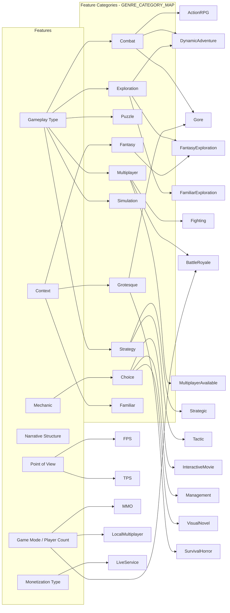
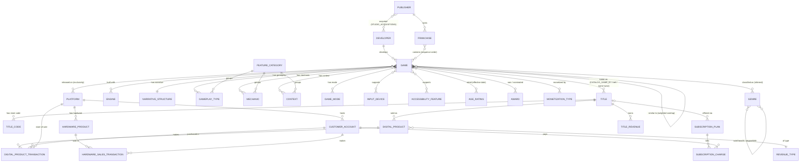
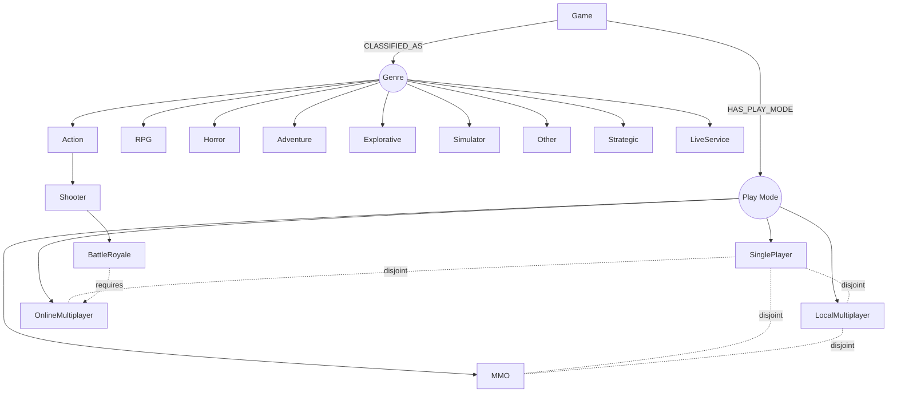

# ONTOLOGY_DEMO — Business Ontology Overview

## Snowflake Business Ontology references:
1. Getting Started with Business Ontology: https://docs.google.com/document/d/100VPtIP-gbiOv2YyltEARtU7DBA8eEZFAYOSAhDE618/

Scope: `ONTOLOGY_DEMO.GAME_CATALOG` (master game data: 31 tables incl. 2 dynamic tables, 6 views) and `ONTOLOGY_DEMO.GAME_SALES` (commercial data: 16 tables incl. 2 dynamic tables, 3 views). Backups are excluded. 90 games in the catalog, 90 titles in Sales.

This is an analysis only. Nothing has been written to the Business Ontology yet.

> **Note (2026-10-13):** both schemas are **deliberately messy** for the ontology demo (Challenges 1-7, applied by `sql/mess/RUN_ALL.sql`). This document describes the **current (messy) physical objects**. The classes and relationships are the **target ontology**, which resolves the mess.
>
> Main differences from the original clean shape:
> - `DEVELOPERS`, `PUBLISHERS`, `FRANCHISES` and `GAME_SEQUELS` were dropped. Their data now lives in `GAMES`, `GAME_FRANCHISES` and `STUDIO_ACQUISITIONS`.
> - Sales `GAMES` became `TITLES`, with its own `TITLE_ID` (5001-5090) and a nullable `CATALOG_GAME_ID`. `TITLE_CODE_XREF` was added.
> - `REVENUE_CATEGORIES` became `REVENUE_TYPES`, and its `CATEGORY_NAME` became `MONETIZATION_TYPE`.
> - Customer keys were renamed per table: `CUSTOMER_ID`, `PLAYER_ID`, `SUBSCRIBER_ID`, `BUYER_ID`.
>
> See [ontology_setup/messy_data_design.md](messy_data_design.md) for every change. `sql/mess/99_restore_clean.sql` returns the clean shape.

---

## 1. Domains

| Domain | Source schema | Purpose |
|---|---|---|
| **Game Catalog** | GAME_CATALOG | What a game *is*: who made it, how it plays, what it is about, how it is rated, and which genres it belongs to |
| **Game Commerce** | GAME_SALES | How a game *earns money*: products, accounts, transactions, subscriptions, revenue roll-ups |
| **Genre Taxonomy** (sub-domain of Catalog) | GENRE_RULES, GENRE_CATEGORY_MAP, DISJOINT_GENRE_PAIRS | Rule-based genre classification. Genres are derived from features, not tagged by hand |

Game, Platform and Monetization Type exist in **both** systems, but under different physical names and keys.

| Concept | GAME_CATALOG | GAME_SALES |
|---|---|---|
| Game | `GAMES` (`GAME_ID`) | `TITLES` (`TITLE_ID`) |
| Platform | `PLATFORMS` (names like `PS5`) | `PLATFORMS` (same `PLATFORM_ID`, names like `PlayStation 5`, plus `PLATFORM_CODE`) |
| Game-platform link | `GAME_PLATFORMS` | `GAME_PLATFORMS` (keyed by `TITLE_ID`, `IS_EXCLUSIVE` = Y/N) |
| Monetization model | `MONETIZATION_TYPES`, `GAME_MONETIZATION` | `MONETIZATION_TYPES`, `GAME_MONETIZATION` (keyed by `TITLE_ID`) |

No shared key links Game to Title. Identity resolves through a hierarchy:
1. `TITLES.CATALOG_GAME_ID` (75 titles)
2. `TITLE_CODE_XREF.CATALOG_GAME_ID` (13)
3. Normalized title name + release year (2)

`PLATFORM_ID` is the only key with the same values in both systems.

---

## 2. Classes (entities)

### 2.1 Game Catalog

| Class | Table | Kind | Notes |
|---|---|---|---|
| **Game** | GAMES | Core entity | POV (1P/3P), release date, narrative structure, lifecycle `STATUS` (RELEASED / REMASTERED / DELISTED) |
| **Developer** | GAMES (`DEVELOPER_ID`, `DEVELOPER_NAME`, `DEVELOPER_IS_INDIE`); STUDIO_ACQUISITIONS.`STUDIO_NAME` | Organization | No table of its own. Stored inside each game row (overloaded) |
| **Publisher** | GAMES (`PUBLISHER_ID`, `PUBLISHER_NAME`, `PUBLISHER_HQ`); GAME_FRANCHISES.`PUBLISHER_ID` | Organization | No table of its own. Founded year is no longer stored |
| **Franchise** | GAME_FRANCHISES (`FRANCHISE_ID`, `FRANCHISE_NAME`, `FIRST_RELEASE_YEAR`, `SEQUENCE_ORDER`); GAMES.`FRANCHISE_NAME` | Collection | No table of its own; the name is stored twice. Owned by a Publisher |
| **Platform** | PLATFORMS | Reference | Sales has its own copy with store-style names and `PLATFORM_CODE` |
| **Engine** | ENGINES | Technology | ray-tracing support. Game uses Engine (version, custom fork) |
| **Gameplay Type** | GAMEPLAY_TYPES | Feature (28 values) | e.g. free_shooting, Co-op, OpenWorld |
| **Mechanic** | MECHANICS | Feature (15 values) | e.g. permanent_death, crafting, QTE |
| **Context (setting/theme)** | CONTEXTS | Feature (19 values) | e.g. zombies_invasion, historical, mithical |
| **Narrative Structure** | NARRATIVE_STRUCTURES | Feature (11 values) | linear, branching, emergent, procedural… |
| **Point of View** | GAMES.POV (attribute) | Feature | only `1P`, `3P` populated |
| **Game Mode** | GAME_MODES | Feature | min/max players, online required |
| **Input Device** | INPUT_DEVICES | Feature | primary device flag |
| **Accessibility Feature** | ACCESSIBILITY_FEATURES | Feature | supported / not supported per game |
| **Age Rating** | AGE_RATINGS | Reference | rating system (ESRB/PEGI…), min age |
| **Award** | AWARDS | Recognition | won or nominated, by year |
| **Monetization Type** | MONETIZATION_TYPES | Business model (9 values) | premium, free_to_play, battle_pass… |
| **Genre** | GENRE_RULES | Defined class (46) | see §3 |
| **Feature Category** | GENRE_CATEGORY_MAP | Abstract grouping | Combat, Exploration, Choice… groups concrete feature values |

### 2.2 Game Commerce

| Class | Table | Notes |
|---|---|---|
| **Title** (Sales view of Game) | TITLES | `TITLE_ID` (Sales key), `TITLE_NAME` (8 spelled differently from the catalog), `STUDIO`, `PUBLISHER_LABEL` (`SIE`), `CATALOG_GAME_ID` (NULL for 15), `RELEASE_DATE` as text `YYYYMMDD` (3 are the JP date) |
| **Title Code** | TITLE_CODE_XREF | PlayStation Store code (`PPSA`/`CUSA`/`NPUA`/`PCSA`/`SLUS`) per title and platform, with `CATALOG_GAME_ID`. 100 rows |
| **Customer Account** | CUSTOMER_ACCOUNTS | `CUSTOMER_ID`, belongs to a Platform, `REGION` in SIE codes (SIEA, SIEE, SIEJ, SIEAP, SIELA), `STATUS` A / S / C |
| **Digital Product** | DIGITAL_PRODUCTS | sellable item for a Title (`TITLE_ID`): base game, DLC, skin… Has a consumable flag, `SKU_CODE` and listing `STATUS` (LIVE / DELISTED) |
| **Hardware Product** | HARDWARE_PRODUCTS | console or peripheral for a Platform |
| **Subscription Plan** | SUBSCRIPTION_PLANS | tier, billing cycle, optionally tied to a Game |
| **Revenue Type** | REVENUE_TYPES | 13 sold-item types (`MONETIZATION_TYPE`) in 3 groups (`CATEGORY_GROUP`): DIGITAL, HARDWARE, SUBSCRIPTION |
| **Digital Product Transaction** | DIGITAL_PRODUCT_TRANSACTIONS | `PLAYER_ID` (= customer), `TITLE_ID` (NULL for every 10th row), gross revenue, platform commission %, `NET_DEVELOPER_REVENUE` (really the publisher share) |
| **Hardware Sales Transaction** | HARDWARE_SALES_TRANSACTIONS | `BUYER_ID` (= customer), gross revenue, `REGION` in NA / EU / JP / ASIA / LATAM |
| **Subscription Charge** | SUBSCRIPTION_CHARGES | `SUBSCRIBER_ID` (= customer), billing period |
| **Title Revenue** (metric) | GAME_REVENUE, MONTHLY_REVENUE, QUARTERLY_REVENUE | lifetime / monthly / quarterly income per **Title** (`TITLE_ID`). Map to catalog Game through the identity hierarchy (§1) |

### 2.3 Derived / analytical concepts

These are computed results, not master data. Model them as **metrics** or **derived relationships**, not entities.

| Concept | Object |
|---|---|
| Genre Classification (Game × Genre → FULL / PARTIAL / NONE) | GAME_GENRE_CLASSIFICATION |
| Game Similarity (weighted overlap, tier) | GAME_SIMILARITY_SCORES, SIMILARITY_WEIGHTS |
| Cannibalization Candidate (same publisher, high overlap) | VW_CANNIBALIZATION_CANDIDATES, SP_FIND_CANNIBALIZATION (publisher from GAMES.PUBLISHER_NAME) |
| Genre Whitespace (under-served genre pairs) | GENRE_WHITESPACE_ANALYSIS |
| Accessibility Gap | VW_ACCESSIBILITY_GAPS |
| Platform Exclusivity (currently exclusive) | VW_PLATFORM_EXCLUSIVITY (per `TITLE_ID` / `TITLE_NAME`, `IS_EXCLUSIVE` = 'Y') |
| Platform Revenue Share | VW_PLATFORM_REVENUE_SUMMARY |

---

## 3. Genre hierarchy (from GENRE_RULES)

### 3.1 How it works

`GENRE_RULES` is an OWL-style **defined-class** taxonomy.

* `PARENT_GENRE` holds **one** parent, so the hierarchy is a **single-parent tree** aligned to `VIDEOWL.ONT_CLASS` (changed 2026-10-09, see §3.2.1). `VW_GENRE_HIERARCHY` returns each genre's depth, path and leaf flag.
* `RULE_DEFINITION` uses description-logic expressions:
  * `hasX VALUE v` — the game has this exact feature value.
  * `hasX SOME Category` — the game has at least one value in a feature category. `GENRE_CATEGORY_MAP` resolves the category to concrete values (e.g. `Combat` = free_shooting | corpo_a_corpo | agonistic).
  * `INTERSECTION(...)` = AND, `NOT(...)` = negation, `MIN` / `MAX` = player-count bounds.
* `DISJOINT_WITH` (also in `DISJOINT_GENRE_PAIRS`) says a game cannot be in both genres.
* Top-level `Genre` is the root. 8 abstract parents have no rule. 38 leaf/intermediate genres have rules. 46 rows in total.

The genre does **not** have a direct Game→Genre table. Membership is **inferred**: `GAME_GENRE_CLASSIFICATION` evaluates each rule against each game's features.

### 3.2 Hierarchy diagram

```mermaid
graph TD
  Genre((Genre))
  Genre --> Action; Genre --> RPG; Genre --> Horror; Genre --> Adventure
  Genre --> Simulator; Genre --> Other
  Genre --> MultiplayerAvailable; Genre --> Strategic; Genre --> LiveService

  Action --> Shooter; Action --> Fighting; Action --> Platformer; Action --> Stealth; Action --> Survival
  Action --> ActionRPG; ActionRPG --> Soulslike
  Action --> DynamicAdventure
  Adventure --> Explorative
  RPG --> Roguelike

  Shooter --> FPS; Shooter --> TPS; Shooter --> Tactic; Shooter --> BattleRoyale
  Fighting --> Match; Fighting --> Scrolling

  Horror --> Gore; Horror --> Psychological; Horror --> SurvivalHorror
  Adventure --> InteractiveMovie; Adventure --> Metroidvania; Adventure --> VisualNovel
  Explorative --> FamiliarExploration; Explorative --> FantasyExploration
  Simulator --> DatingSim; Simulator --> DrivingSim; Simulator --> JobSim
  Simulator --> Management; Simulator --> SandBox; Simulator --> Sport
  MultiplayerAvailable --> MMO; MultiplayerAvailable --> LocalMultiplayer
  Other --> Artistic; Other --> Educational; Other --> PuzzleGame; Other --> Cozy

  FPS -.disjoint.- TPS
  MMO -.disjoint.- LocalMultiplayer
  Cozy -.disjoint.- Horror
  Artistic -.disjoint.- Realistic
```

Solid arrow = `subClassOf` (parent → child). Dotted line = `disjointWith`. Every genre has exactly one parent.

### 3.2.1 Single-parent change log (2026-10-09)

`GENRE_RULES.PARENT_GENRES` (JSON array) was replaced by `PARENT_GENRE` (one value). Each parent comes from `VIDEOWL.ONT_CLASS` where the genre exists there; the rest are best guesses.

| Genre | Old parents | New parent | Source |
|---|---|---|---|
| ActionRPG | Action, RPG | Action | VIDEOWL |
| DynamicAdventure | Action, Explorative | Action | VIDEOWL |
| Explorative | Genre | Adventure | VIDEOWL |
| BattleRoyale | Shooter, Multiplayer | Shooter | Best guess. VIDEOWL's parent `Realistic` is a Context class |
| Soulslike | Action, RPG | ActionRPG | Best guess. Not in VIDEOWL; rule is a specialization of ActionRPG |
| MMO | Multiplayer | MultiplayerAvailable | Best guess. Not in VIDEOWL |
| LocalMultiplayer | Multiplayer | MultiplayerAvailable | Best guess. Not in VIDEOWL |
| Cozy, LiveService | Other, Genre | unchanged | Best guess. Not in VIDEOWL |
| Genre | — | NULL (root) | VIDEOWL has `Genre subClassOf Game`; Game is not a genre |
| **Multiplayer** | Genre | **row deleted** | In VIDEOWL it is a Gameplay class. It remains a feature category in GENRE_CATEGORY_MAP |

Every other genre's parent already matched VIDEOWL.

Dependent changes:
* `GENRE_WHITESPACE_ANALYSIS` no longer hardcodes parent genres. Leaf genres are now "has a rule and is nobody's parent". ActionRPG and MultiplayerAvailable became parents, so they left the pair set: 628 → 559 rows.
* New view `VW_GENRE_HIERARCHY` (recursive): GENRE, PARENT_GENRE, DEPTH, PATH, IS_LEAF, HAS_RULE.
* `SP_CLASSIFY_GAMES` and `DISJOINT_GENRE_PAIRS` were unaffected. Classification is still 3,420 rows / 258 FULL.
* Backup: `GAME_CATALOG.BACKUP_GENRE_RULES_SINGLE_PARENT_20261009`.

### 3.3 Genre → feature dependencies

Each rule makes a genre depend on feature classes. This is the bridge between the taxonomy and the catalog.

### 3.4 Classification results (90 games)

| Strongest FULL matches | Never FULL (0 games) |
|---|---|
| ActionRPG 43, DynamicAdventure 35, Shooter 30, MultiplayerAvailable 30, TPS 20, Strategic 18 | SandBox, Roguelike, Metroidvania, Management, SurvivalHorror, Soulslike, BattleRoyale, LiveService, Psychological, JobSim, DatingSim, DrivingSim, VisualNovel, Cozy, MMO, Scrolling, PuzzleGame |

LocalMultiplayer was 51 before the §7.1 rule fix and is now 3. Many genres never match fully because their rules point at values that do not exist in the data. See §5.

---

## 4. Relationships

### 4.1 Full class diagram

This is the **target ontology**, not the physical tables. In the data, Developer, Publisher and Franchise live inside `GAMES` / `GAME_FRANCHISES`, and Sales uses `TITLE` instead of `GAME`.

### 4.2 Relationship list (ontology-ready)

| Subject | Relationship | Object | Evidence |
|---|---|---|---|
| Developer | DEVELOPS | Game | GAMES.DEVELOPER_ID / DEVELOPER_NAME |
| Publisher | OWNS | Franchise | GAME_FRANCHISES.PUBLISHER_ID |
| Publisher | PUBLISHES | Game | GAMES.PUBLISHER_ID / PUBLISHER_NAME |
| Publisher | ACQUIRED | Developer | STUDIO_ACQUISITIONS (DEVELOPER_ID, STUDIO_NAME) |
| Game | PART_OF | Franchise | GAME_FRANCHISES.FRANCHISE_ID (name also in GAMES.FRANCHISE_NAME) |
| Game | SEQUEL_OF / PREQUEL_OF / SPINOFF_OF / REMAKE_OF / SPIRITUAL_SUCCESSOR_OF | Game | GAME_FRANCHISES.RELATED_GAME_ID + RELATIONSHIP_TYPE |
| Game | RELEASED_ON | Platform | GAME_PLATFORMS (+ exclusivity window) |
| Game | BUILT_WITH | Engine | GAME_ENGINES |
| Game | HAS_GAMEPLAY | Gameplay Type | GAME_GAMEPLAY |
| Game | HAS_MECHANIC | Mechanic | GAME_MECHANICS |
| Game | HAS_CONTEXT | Context | GAME_CONTEXTS |
| Game | HAS_NARRATIVE | Narrative Structure | GAMES.NARRATIVE_STRUCTURE_ID |
| Game | HAS_MODE | Game Mode | GAME_MODES |
| Game | SUPPORTS | Input Device / Accessibility Feature | GAME_INPUT_DEVICES, GAME_ACCESSIBILITY |
| Game | RATED | Age Rating | GAME_RATINGS |
| Game | RECEIVED | Award | GAME_AWARDS |
| Game | MONETIZED_BY | Monetization Type | GAME_MONETIZATION |
| Game | CLASSIFIED_AS | Genre | GAME_GENRE_CLASSIFICATION (inferred) |
| Genre | SUBCLASS_OF | Genre | GENRE_RULES.PARENT_GENRE (single parent) |
| Genre | DISJOINT_WITH | Genre | DISJOINT_GENRE_PAIRS |
| Genre | DEFINED_BY | Feature Category / feature value | GENRE_RULES.RULE_DEFINITION |
| Feature Category | GROUPS | Gameplay Type / Mechanic / Context / Narrative | GENRE_CATEGORY_MAP |
| Game | SIMILAR_TO | Game | GAME_SIMILARITY_SCORES |
| Title | SAME_AS | Game | TITLES.CATALOG_GAME_ID, then TITLE_CODE_XREF.CATALOG_GAME_ID, then name + release year |
| Title | HAS_CODE | Title Code | TITLE_CODE_XREF.TITLE_ID |
| Title | SOLD_AS | Digital Product | DIGITAL_PRODUCTS.TITLE_ID |
| Digital Product | OF_TYPE | Revenue Type | DIGITAL_PRODUCTS.CATEGORY_ID → REVENUE_TYPES |
| Customer Account | REGISTERED_ON | Platform | CUSTOMER_ACCOUNTS.PLATFORM_ID |
| Customer Account | PURCHASED | Digital Product | DIGITAL_PRODUCT_TRANSACTIONS.PLAYER_ID |
| Customer Account | PURCHASED | Hardware Product | HARDWARE_SALES_TRANSACTIONS.BUYER_ID |
| Customer Account | SUBSCRIBES_TO | Subscription Plan | SUBSCRIPTION_CHARGES.SUBSCRIBER_ID |
| Hardware Product | FOR_PLATFORM | Platform | HARDWARE_PRODUCTS.PLATFORM_ID |
| Monetization Type | REALIZED_AS | Revenue Type | implied by name only (battle_pass ↔ BATTLE_PASS, dlc ↔ DLC, subscription ↔ SUBSCRIPTION…). No FK; both use the word "monetization type" |

### 4.3 Key metrics

| Metric | Definition |
|---|---|
| Gross Revenue | SUM(GROSS_REVENUE) across digital, hardware, subscription |
| Net Publisher Revenue | GROSS_REVENUE × (1 − PLATFORM_COMMISSION_PCT). Source column is misnamed `NET_DEVELOPER_REVENUE` |
| Platform Revenue | GROSS_REVENUE − NET_DEVELOPER_REVENUE |
| Title / Game Income (lifetime / monthly / quarterly / cumulative) | GAME_REVENUE, MONTHLY_REVENUE, QUARTERLY_REVENUE, keyed by TITLE_ID. Per catalog Game via SAME_AS |
| Weighted Overlap | Σ(dimension overlap × SIMILARITY_WEIGHTS.WEIGHT) |
| Genre Match Score | MET_CONDITIONS / TOTAL_CONDITIONS |

---

## 5. Data-model gaps found

### 5.1 Genre rules point at values that do not exist

| Rule | Missing reference |
|---|---|
| Roguelike | `turn_based` (gameplay) |
| Soulslike | `melee_combat` (gameplay), `hasDifficulty` (no difficulty attribute) |
| Psychological | `psychological` (context) |
| Scrolling | `side_scrolling` (POV) |
| Metroidvania | `Isometric` → `standard_isometrics`. Only 1P/3P exist |
| VisualNovel | `Textual` POV maps to an empty value |
| Cozy | `collecting` (mechanic), `hasDifficulty` |
| LiveService | `seasonal_content`, `hasUpdate SOME PostLaunch` (no update attribute) |
| Artistic disjointWith | `Realistic` has no genre rule |
| MMO disjointWith | `SinglePlayer` has no genre rule |

These explain why 17 genres never reach FULL.

### 5.2 Modeling issues

* **Homonym: `Multiplayer`** is both a parent Genre and a Feature Category (PVP, Co-op, Party, with_matches). `MultiplayerAvailable` is a third, redundant concept. Pick one name per concept.
* **Questionable parents:** `Tactic` sits under `Shooter`, but its rule (Strategy + Management) has nothing to do with shooting. `Strategic` sits directly under `Genre`. `Tactic` likely belongs under `Strategic`. `Survival` sits under `Action` while `SurvivalHorror` sits under `Horror`.
* **Player-count genres (MMO, LocalMultiplayer, MultiplayerAvailable) are play modes, not genres.** schema.org and most external taxonomies treat them as `playMode`.
* **Duplicate monetization vocabulary (deliberate, Challenge 7):** `MONETIZATION_TYPES` (business model tag) and `REVENUE_TYPES.MONETIZATION_TYPE` (what was sold) share the name and most of the values, and there is no mapping table.
* **Sequel merge done:** `GAME_SEQUELS` was merged into `GAME_FRANCHISES` (`RELATED_GAME_ID`, `RELATIONSHIP_TYPE`) and dropped by `sql/mess/20_c1_overloaded_catalog.sql`.

---

## 6. Comparison with published gaming ontologies

| External ontology | Focus | How ONTOLOGY_DEMO lines up |
|---|---|---|
| **VideOWL** (CEUR-WS Vol-3579, 2023) | OWL ontology that classifies games into genres through features. Properties: `hasGameplay`, `hasMechanic`, `hasContext`, `hasNarrative` (inverses `gameplayOf`, `mechanicOf`, `narrationOf`). Genre subclasses are defined classes | **Direct match.** GENRE_RULES uses the same property names and the same defined-class pattern. GAMEPLAY_TYPES/CONTEXTS values (e.g. `corpo_a_corpo`, `mithical`) look taken from it. This is the best reference for fixing §5.1 |
| **Core Game Ontology (CGO)** — autosemanticgame.eu | Game facets: Gameplay, Narrative, Level Design, Visuals, Audio, Rules, Game Design | Our Gameplay / Mechanic / Narrative map to CGO facets. We have no Level Design, Visuals or Audio facets |
| **Video Game Ontology (VGO)** — Parkkila et al., 2017 | Runtime play data: Player, Session, Achievement, Item, Character, Event, `GameProduct` (purchasable things, built on GoodRelations/schema.org) | Our Digital Product ≈ `vgo:GameProduct`. Customer Account ≈ `vgo:Player`. We model no in-game events or achievements |
| **Game Ontology Project (GOP)** — Zagal et al., 2005 | Design-studies hierarchy of gameplay elements (Interface, Rules, Entity Manipulation, Goals) | Conceptual parent for Mechanics. Useful if Mechanics needs its own hierarchy |
| **schema.org `VideoGame` / `VideoGameSeries`** | Web metadata: `genre`, `gamePlatform`, `playMode` (SinglePlayer, MultiPlayer, CoOp), `numberOfPlayers`, `publisher`, `author`, `contentRating`, `gameEdition`, `offers` | Franchise ≈ `VideoGameSeries`. Age Rating ≈ `contentRating`. Supports moving player-count genres to a `playMode` concept |
| **GameGenre-Ontology** (Zenodo) | Genre, subgenre, characteristics and classification types from a systematic literature review | Possible cross-check for the genre tree and its multiple-inheritance cases |

**Takeaway:** the catalog is a VideOWL-style feature ontology, and the sales side is a typical commerce model close to VGO `GameProduct` + schema.org `Offer`. The two connect through **Game** (Sales calls it Title), **Platform** and **Monetization Type**. In the data that connection exists only through the identity hierarchy in §1 and the shared `PLATFORM_ID`. The ontology is what makes it explicit.

---

## 7. Play Mode remodel (MMO, LocalMultiplayer, MultiplayerAvailable)

Status: **one data fix applied** (§7.1). Everything else in this section is a **recommendation only**. Nothing has been written to the Business Ontology.

### 7.1 Data change applied (2026-10-09)

The LocalMultiplayer rule counted single-player games as local multiplayer. Its only conditions were "4 players or fewer" and "not online", and a single-player game passes both.

| | Rule | FULL matches |
|---|---|---|
| Before | `INTERSECTION(hasPlayerCount MAX 4, NOT(requiresOnline))` | 51 (48 of them single-player only) |
| After | `INTERSECTION(hasPlayerCount MIN 2, hasPlayerCount MAX 4, NOT(requiresOnline))` | 3: God of War: Sons of Sparta, My First Gran Turismo, Knack II |

* `GENRE_RULES` was updated, then `GAME_GENRE_CLASSIFICATION` was rebuilt with `CALL SP_CLASSIFY_GAMES()` (90 games × 38 rules = 3,420 evaluations).
* Backups: `GAME_CATALOG.BACKUP_GENRE_RULES_20261009` and `GAME_CATALOG.BACKUP_GAME_GENRE_CLASSIFICATION_20261009`.
* **Known limitation:** the classifier reads `VW_GAME_PROFILE`, which keeps only the **highest** player count across a game's modes and whether it has **any** online mode. Games such as Mario Kart, with a 4-player split-screen mode *and* a 12-player online mode, still don't match. The Play Mode class in §7.2 fixes this by evaluating each mode separately.

### 7.2 Recommended class: Play Mode

Backed by the existing `GAME_CATALOG.GAME_MODES` table, one row per game × mode. No schema change is needed.

| Play Mode | Definition (per GAME_MODES row) | Replaces |
|---|---|---|
| **SinglePlayer** | `MAX_PLAYERS = 1` | the undefined `SinglePlayer` referenced by the MMO disjoint pair |
| **LocalMultiplayer** | `MODE_NAME IN ('local_multiplayer','local_coop','split_screen')`, or (`MAX_PLAYERS >= 2` and `ONLINE_REQUIRED = false`) | Genre `LocalMultiplayer` |
| **OnlineMultiplayer** | `ONLINE_REQUIRED = true` and `MAX_PLAYERS >= 2` | new |
| **MMO** | `MAX_PLAYERS >= 100` (no members today; the largest is 24) | Genre `MMO` |

Parent class: **Play Mode**, which aligns with schema.org `playMode`. Disjoint pairs move here:
`SinglePlayer ⟂ LocalMultiplayer`, `SinglePlayer ⟂ OnlineMultiplayer`, `SinglePlayer ⟂ MMO`, `LocalMultiplayer ⟂ MMO`. These apply per mode; a game can have several modes.

### 7.3 Recommended relationships and attributes

| Subject | Relationship | Object | Evidence |
|---|---|---|---|
| Game | HAS_PLAY_MODE | Play Mode | GAME_MODES (classified per row) |
| Play Mode | SUBCLASS_OF | Play Mode (root) | — |
| Play Mode | DISJOINT_WITH | Play Mode | §7.2 |
| Game Mode (row) | INSTANCE_OF | Play Mode | GAME_MODES.MODE_NAME / MAX_PLAYERS / ONLINE_REQUIRED |

| Derived attribute | Definition | Replaces |
|---|---|---|
| **Has Multiplayer** (Game, boolean) | the game has a LocalMultiplayer, OnlineMultiplayer or MMO play mode, **or** its gameplay includes the Multiplayer feature category (PVP, Co-op, Party, with_matches) | Genre `MultiplayerAvailable` |
| **Max Player Count** (Game, metric) | MAX(GAME_MODES.MAX_PLAYERS) | — |

### 7.4 Recommended genre-tree changes

| Change | Before | After |
|---|---|---|
| Remove from Genre | MMO, LocalMultiplayer, MultiplayerAvailable | moved to Play Mode / derived attribute. (The `Multiplayer` parent row was already deleted in §3.2.1) |
| `Multiplayer` naming | Genre **and** feature category | **Done.** The genre row was deleted; Multiplayer is a feature category only (GENRE_CATEGORY_MAP) |
| BattleRoyale parent | `Shooter` (done in §3.2.1) | Remaining: its `hasPlayerCount MIN 20` condition becomes "has an OnlineMultiplayer play mode with MAX_PLAYERS ≥ 20" |
| Genre count | 46 (after §3.2.1) | 43 |

Updated genre tree for the top levels (the rest is unchanged from §3.2):

### 7.5 Optional follow-up data changes (not applied)

If you want the database to match the remodel, these are the next steps:
1. Add a `VW_GAME_PLAY_MODES` view that classifies each `GAME_MODES` row into the 4 Play Modes.
2. Delete the MMO, LocalMultiplayer and MultiplayerAvailable rows from `GENRE_RULES`, and their pairs from `DISJOINT_GENRE_PAIRS`. (Multiplayer was already deleted.)
3. Re-run `SP_CLASSIFY_GAMES`. (BattleRoyale was already re-parented.)

---

## 8. Ontology load: superseded by the phased build guide

The load plan now lives in **[business_ontology_phases.md](business_ontology_phases.md)**, and the with/without-ontology test questions are in **[ontology_eval_set.md](ontology_eval_set.md)**. The guide's decision log (D1-D16) changes three things relative to this overview:

- **Three domains:** Game Catalog, Game Commerce and Genre Taxonomy.
- **Canonical classes:** one node per real-world entity (Game, Platform, Developer, Publisher, Customer). Local names are synonyms and each system's tables are representations, so there is no separate Title node.
- **Curated genre layer:** 14 genre nodes, not all 43-46. `SUBCLASS_OF` and `DISJOINT_WITH` don't exist in the relationship vocabulary, so the hierarchy uses `HAS_VARIANT` (Shooter to FPS/TPS only) and `RELATED_TO` ("subgenre of"). ActionRPG and Soulslike are linked to RPG.
  - `GENRE_RULES` deliberately stays single-parent; the RPG roll-up gap is a test case (D9).

The §5.1 vocabulary gaps are still open. The Play Mode remodel (§7) remains optional.

## Sources

- [Modeling the Video Game Environment: the VideOWL Ontology (CEUR-WS Vol-3579)](https://ceur-ws.org/Vol-3579/paper15.pdf)
- [The Core Game Ontology (CGO)](https://autosemanticgame.institutedigitalgames.com/ontologies/core-game-ontology/)
- [The Video Game Ontology – Vocab](https://vocab.linkeddata.es/vgo/)
- [An ontology for videogame interoperability (Springer)](https://link.springer.com/article/10.1007/s11042-016-3552-6)
- [dgarijo/VideoGameOntology (GitHub)](https://github.com/dgarijo/VideoGameOntology)
- [The Game Ontology Project – DiGRA 2005](https://eis.ucsc.edu/papers/OntologyDIGRA2005.pdf)
- [GameGenre-Ontology (Zenodo)](https://zenodo.org/records/21840088)
